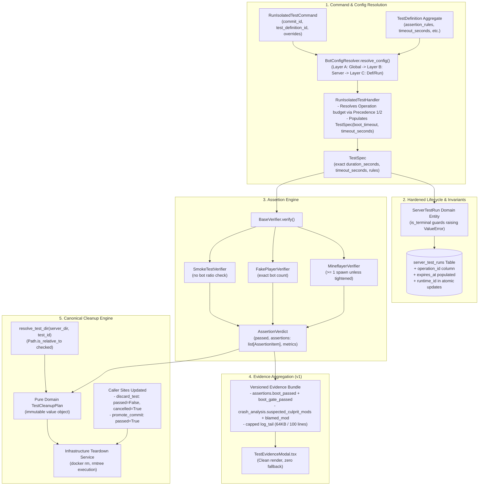

# Phase 5.5 Stage B — Test Run Engine Design Specification

**Status:** Proposed / Design Ready  
**Lane:** Release Improvement track — Release Improvement  
**Decision Level:** D2 — Major (Alembic migration `b1e2100000022` + declarative assertion schema)  
**Roadmap Drift:** Controlled Drift  
**Governing Authority:** project governance standards, `docs/decisions/DECISION-2026-09-27-001-stage-b-test-run-engine.md`  
**Target File:** `docs/decisions/PHASE-5.5-STAGE-B-TEST-RUN-ENGINE-DESIGN.md`

---

## 1. Goal

The goal of **Phase 5.5 Stage B (Test Run Engine)** is to overhaul the execution, assertion, evidence aggregation, and lifecycle cleanup mechanics of ONX isolated test runs. 

Stage A (Reliability Foundation, `docs/decisions/PHASE-5.5-STAGE-A-RELIABILITY-FOUNDATION-DESIGN.md`) established the system-wide operational tracking, idempotency, and progress projection infrastructure (`Operation` aggregate, `OperationStep`, `operation.*` events, WebSocket projections, drawer UI), wiring `RUN_TEST` as its initial producer. Stage A intentionally deferred execution engine internals to Stage B (§22).

Stage B delivers:
1. **Full `TestDefinition` Execution:** Eliminates dead configuration by introducing a typed, validated `AssertionRulesConfig` schema, wiring `timeout_seconds`, `join_stagger_seconds`, and `connect_grace_seconds` through `BotConfigResolver`, `TestSpec`, and `run_isolated_test.py`, and eliminating lossy sub-minute integer rounding (`// 60`).
2. **`ServerTestRun` Lifecycle Hardening:** Enforces strict domain invariants on terminal states (`PASSED`, `FAILED`, `CANCELLED`) using the standard `ValueError` convention to prevent overwrite races, adds persistent `operation_id` linkage via Alembic migration `b1e2100000022`, includes `runtime_id` in atomic conditional outcome updates with benign-skip handling, establishes explicit `expires_at` retention calculations, and repairs query serializers that silently drop Stage D/F metadata.
3. **Declarative Assertion Engine:** Decomposes monolithic imperative runner logic into unified `BaseVerifier` implementations (`SmokeTestVerifier`, `FakePlayerVerifier`, `MineflayerVerifier`), returning structured `AssertionVerdict` and `AssertionItem` results while strictly preserving legacy per-driver semantics, driver identifier normalization (`smoke_test` vs `none`), and zero-target handling.
4. **Canonical Cleanup Plan Engine:** Replaces three divergent filesystem deletion routines with a pure domain `TestCleanupPlan` value object, an infrastructure execution service, a single canonical `resolve_test_dir(server_dir, test_id)` resolver grounded in the authoritative server deployment directory (`server.deployment.server_dir`) with separator-safe path traversal protection (`Path.is_relative_to`), and removes the dangerous `passed=True` default parameter trap by providing explicit outcome arguments at all caller sites (`discard_test.py`, `promote_commit.py`).
5. **Evidence Aggregation & Contract Alignment:** Establishes a versioned evidence schema (`schema_version: "1.0"`), eliminates the silent rendering failure in `TestEvidenceModal.tsx` by writing coherent dual-key payloads (`boot_passed` + `boot_gate_passed`, `suspected_culprit_mods` list + `blamed_mod`), unifies log tail capping (64 KB / 100 lines), and clarifies the boundary with the health module's `EvidenceBundleModel`.
6. **Reconciled Timeout Model:** Eliminates competing inner runner watchdog loops in favor of a single authoritative timeout budget armed via the Stage A `OperationExecutor` timeout watcher (preserving the committed `OPERATION_TIMEOUT` failure code), assigning budget resolution and `TestSpec` population to `run_isolated_test.py`, and recording `TEST_TIMED_OUT` strictly in `failure_reason` and evidence bundle text without implying a database column.

---

## 2. Scope Boundaries & Non-Goals

### 2.1 Authorized Scope (per accepted DECISION-2026-09-27-001)
1. `TestDefinition` execution (consume `assertion_rules` schema, wire timeout/stagger/grace, sub-minute duration support, strict-vs-fallback enum policy).
2. `TestRun` lifecycle hardening (terminal transition guards on `ServerTestRun`, `operation_id` DB linkage, `runtime_id` atomic persistence, `expires_at` calculation, query serializer alignment).
3. Assertion engine (per-driver verifiers behind `BaseVerifier`, legacy semantic preservation, pure pre-pass reuse, `BotVerificationResult` legacy adapter, driver identifier and bot count unification).
4. Cleanup plans (pure domain `TestCleanupPlan`, infrastructure teardown service, separator-safe `resolve_test_dir` resolver grounded in authoritative server deployment, explicit-verdict cleanup across all callers).
5. Evidence aggregation (versioned bundle schema, frontend modal key reconciliation, log-tail cap unification, health module boundary documentation).
6. Timeout reconciliation (single authoritative `OperationExecutor` budget, committed `OPERATION_TIMEOUT` code preserved, deterministic budget resolution in `run_isolated_test.py`).

### 2.2 Strict Hard Boundaries (Must NOT Be Reopened)
- **Execution Truth:** `ServerTestRun` remains the execution truth; `Operation` remains the orchestration and user-facing projection layer.
- **Admission & Concurrency:** No changes to admission formula, global host resource caps, or the Stage A `RUN_TEST` concurrency exemption (§15.1 of Stage A spec).
- **Promotion Gate:** No changes to promotion gating semantics (`promote_commit.py:118-145`) or force-bypass audit records. Direct `require_test_pass` wiring remains gated behind its own decision.
- **No Secondary Subsystems:** No second executor, status machine, or evidence database alongside `Operation` and `ServerTestRun`.
- **No Stage C–G Scope:** Stages C through G (Verification Tiers, Safe Change Pipeline, Modpack Platform, etc.) are strictly out of scope.

---

## 3. Ground Truth & codebase audit Evidence Resolution

All evidence claims were verified against repository code (master branch at commit `457cc6d`):

| ID | Item | Status | Repository Reality | Stage B Resolution |
|---|---|---|---|---|
| **E-01** | `TestDefinition` Execution Gap | **FACT** | `TestDefinition` (`entities.py:470-550`) defines `assertion_rules`, `timeout_seconds`, `join_stagger_seconds`, `connect_grace_seconds`, `duration_seconds`. None are read during execution. `run_isolated_test.py:123` performs lossy `duration_seconds // 60`. | Introduce `AssertionRulesConfig` typed validator; wire all fields through `BotConfigResolver`, `TestSpec`, and `run_isolated_test.py`; support exact seconds in `duration_seconds`. |
| **E-02** | `TestRun` Lifecycle Hardening Gap | **FACT** | `ServerTestRun` (`entities.py:599-665`) guards `mark_booting`/`mark_running` against terminal state, but `mark_passed`, `mark_failed`, and `mark_cancelled` do NOT check `is_terminal`. `ServerTestRunModel` lacks `operation_id`. `expires_at` is nullable in DB but never written. Query handlers drop 6 fields. | Add `is_terminal` guard raising `ValueError`; add `operation_id` column via migration `b1e2100000022`; include `runtime_id` in atomic updates; populate `expires_at = created_at + retention_hours`; update query handlers & Pydantic response schemas. |
| **E-03** | Assertion Engine Gap | **FACT** | `_execute_verification()` in `test_runner.py` uses monolithic branching setting a single `passed: bool` and `failure_reason: str`. Flat evidence assertions dictionary. Driver names are inconsistent (`"none"` vs `"smoke_test"`). | Extract `SmokeTestVerifier`, `FakePlayerVerifier`, and `MineflayerVerifier` under `BaseVerifier`; preserve driver-specific pass semantics; return `AssertionVerdict`; standardize driver name to `smoke_test`; retain `BotVerificationResult` adapter. |
| **E-04** | Cleanup Plans Gap | **FACT** | Three separate deletion sites (`cleanup_test` in `test_runner.py`, `reap_stale_reservations` in `admission.py`, `PruneTestArtifactsHandler` in `prune_test_artifacts.py`) duplicate path calculation. `cleanup_test` defaults `passed=True`, risking silent artifact deletion. | Create separator-safe `resolve_test_dir(server_dir, test_id)` canonical utility grounded in authoritative server deployment; create pure domain `TestCleanupPlan` value object with explicit `test_dir`; require explicit verdict parameter in `cleanup_test` and update callers. |
| **E-05** | Evidence Aggregation Gap | **FACT** | `TestEvidenceModal.tsx:83-85, 158, 177-181` checks `evidence.assertions.boot_passed` and `evidence.crash_analysis.suspected_culprit_mods`. Backend writes `boot_gate_passed` and `blamed_mod`. Modal renders fallback in production. Three log tail caps diverge (50 lines, 100 lines, 64 KB). | Write versioned evidence bundle (`schema_version: "1.0"`); write dual keys (`boot_passed` + `boot_gate_passed`, `suspected_culprit_mods` + `blamed_mod`); unify log tail caps to 64 KB / 100 lines. |
| **E-06** | Health Module Collision | **FACT** | `health/infrastructure/models.py:31-42` defines `EvidenceBundleModel` for table `health_evidence`. Versioning stores evidence as a JSON column `evidence_bundle` on `server_test_runs`. | Pure naming collision in separate bounded contexts. Keep separate. Document architectural boundary explicitly (D1 gate). |

---

## 4. Scoped Architecture & Detailed Design



---

### 4.1 Section 1: TestDefinition Execution

#### 4.1.1 Declarative Assertion Rules Schema
`assertion_rules` on `TestDefinition` (and `ServerTestDefinitionModel`) transitions from an unvalidated JSON dictionary into a typed declarative configuration evaluated by the assertion engine.

```python
@dataclass(frozen=True)
class AssertionRulesConfig:
    """Declarative validation rules applied against test execution outcomes."""
    min_connected_bots_ratio: float | None = None  # None = use driver defaults; float in [0.0, 1.0] tightens
    max_disconnects: int = 0                       # Maximum tolerated bot disconnect events
    min_boot_seconds: float = 0.0                  # Minimum expected server boot duration
    max_boot_seconds: float | None = None          # Maximum tolerated server boot duration
    disallow_crash_reports: bool = True            # Fail test if crash-reports/*.txt exists
    disallow_error_logs: bool = False              # Fail test if [ERROR] appears in server logs
    required_log_markers: list[str] = field(default_factory=list)  # Substrings required in latest.log
    forbidden_log_markers: list[str] = field(default_factory=list) # Substrings forbidden in latest.log

    @classmethod
    def from_dict(cls, data: dict[str, Any] | None) -> AssertionRulesConfig:
        if not data:
            return cls()
        raw_ratio = data.get("min_connected_bots_ratio")
        ratio = float(raw_ratio) if raw_ratio is not None else None
        if ratio is not None and not 0.0 <= ratio <= 1.0:
            raise ValueError(f"min_connected_bots_ratio must be between 0.0 and 1.0, got {ratio}")
        max_disc = int(data.get("max_disconnects", 0))
        if max_disc < 0:
            raise ValueError(f"max_disconnects cannot be negative, got {max_disc}")
        min_boot = float(data.get("min_boot_seconds", 0.0))
        if min_boot < 0:
            raise ValueError(f"min_boot_seconds cannot be negative, got {min_boot}")
        max_boot = data.get("max_boot_seconds")
        max_boot_val = float(max_boot) if max_boot is not None else None
        if max_boot_val is not None and max_boot_val < min_boot:
            raise ValueError(f"max_boot_seconds ({max_boot_val}) cannot be less than min_boot_seconds ({min_boot})")
        return cls(
            min_connected_bots_ratio=ratio,
            max_disconnects=max_disc,
            min_boot_seconds=min_boot,
            max_boot_seconds=max_boot_val,
            disallow_crash_reports=bool(data.get("disallow_crash_reports", True)),
            disallow_error_logs=bool(data.get("disallow_error_logs", False)),
            required_log_markers=list(data.get("required_log_markers", [])),
            forbidden_log_markers=list(data.get("forbidden_log_markers", [])),
        )

    def to_dict(self) -> dict[str, Any]:
        return {
            "min_connected_bots_ratio": self.min_connected_bots_ratio,
            "max_disconnects": self.max_disconnects,
            "min_boot_seconds": self.min_boot_seconds,
            "max_boot_seconds": self.max_boot_seconds,
            "disallow_crash_reports": self.disallow_crash_reports,
            "disallow_error_logs": self.disallow_error_logs,
            "required_log_markers": self.required_log_markers,
            "forbidden_log_markers": self.forbidden_log_markers,
        }
```

Validation occurs in:
- `TestDefinition.__post_init__` and `TestDefinition.update()`
- Pydantic schemas `TestDefinitionCreateRequest` and `TestDefinitionUpdateRequest` in `app/api/v1/schemas/versioning.py`

#### 4.1.2 Duration Seconds & Watchdog Wiring
`BotVerificationConfig` (`app/modules/versioning/domain/value_objects.py`) is enhanced to support sub-minute and exact second execution without holding an unused timeout field:

```python
@dataclass
class BotVerificationConfig:
    bot_count: int = 10
    duration_seconds: float = 900.0  # Exact execution duration in seconds
    bot_tech: BotTech = BotTech.AUTO
    placement_mode: PlacementMode = PlacementMode.SIDECAR
    join_stagger_seconds: float = 3.0
    connect_grace_seconds: float = 60.0
    watchdog_overrun_seconds: float = 300.0  # Renamed from watchdog_overrun_minutes (was 5.0m = 300.0s)
    assertion_rules: AssertionRulesConfig = field(default_factory=AssertionRulesConfig)

    @property
    def duration_minutes(self) -> int:
        """Backwards compatibility accessor for consumers expecting integer minutes."""
        return max(1, math.ceil(self.duration_seconds / 60.0))

    @property
    def watchdog_overrun_minutes(self) -> float:
        """Backwards compatibility accessor for consumers expecting minutes."""
        return self.watchdog_overrun_seconds / 60.0
```

#### 4.1.3 Resolution Hierarchy in `BotConfigResolver`
Layer precedence is formalized in `BotConfigResolver.resolve_config()`:
1. **Layer A (Global Defaults):** Loaded from `get_live_settings()`.
2. **Layer B (Per-Server Settings):** Stored JSON `server.bot_verification_settings`.
3. **Layer C (TestDefinition):** Attributes from referenced `TestDefinition` if `test_definition_id` is supplied.
4. **Layer D (Per-Run Overrides):** Explicit parameters from `RunIsolatedTestCommand` (`bot_count`, `duration_minutes`, `placement_mode`, `bot_tech`).

If `duration_seconds` is provided in Layer C, it takes precedence over legacy `duration_minutes`. If only `duration_minutes` is supplied, `duration_seconds = duration_minutes * 60.0`.
All consumers of `watchdog_overrun_minutes` are updated to `watchdog_overrun_seconds` (default 300.0s), with backward-compatible conversion if minutes are passed.

#### 4.1.4 Strict vs Fallback Policy
- **Strict Mode:** If `bot_technology` is explicitly configured as `FAKEPLAYER_NEXT` on a non-Paper/Purpur server (e.g., Fabric, Vanilla), `BotConfigResolver` raises `UnsupportedBotTechError` (HTTP 400).
- **Auto Mode:** If `bot_technology` is `AUTO`, Paper/Purpur servers resolve to `FAKEPLAYER_NEXT` (if plugin artifact is verified usable via `is_fakeplayer_artifact_usable()`, otherwise downgrading to `SMOKE_TEST` with `downgraded_from="fakeplayer_next"`), and all other servers resolve to `MINEFLAYER`.
- **Smoke Mode:** Unsupported loaders or protocol mismatches execute `SMOKE_TEST`.

---

### 4.2 Section 2: TestRun Lifecycle Hardening

#### 4.2.1 Invariant Enforcement on `ServerTestRun`
In `backend/app/modules/versioning/domain/entities.py`, all terminal transition methods are guarded against overwrites. In strict conformance with the existing exception convention of `ServerTestRun` (where lines 638–645 raise `ValueError`), terminal state violations raise standard `ValueError`:

```python
    @property
    def is_terminal(self) -> bool:
        return self.status in (
            TestRunStatus.PASSED,
            TestRunStatus.FAILED,
            TestRunStatus.CANCELLED,
        )

    def mark_passed(self, log_output: str | None = None) -> None:
        if self.is_terminal:
            raise ValueError(
                f"Cannot transition terminal test run ({self.status}) to PASSED"
            )
        self.status = TestRunStatus.PASSED
        if log_output:
            self.log_output = log_output

    def mark_failed(self, reason: str, log_output: str | None = None) -> None:
        if self.is_terminal:
            raise ValueError(
                f"Cannot transition terminal test run ({self.status}) to FAILED"
            )
        self.status = TestRunStatus.FAILED
        self.failure_reason = reason
        if log_output:
            self.log_output = log_output

    def mark_cancelled(self, reason: str = "Cancelled by user") -> None:
        if self.is_terminal:
            raise ValueError(
                f"Cannot transition terminal test run ({self.status}) to CANCELLED"
            )
        self.status = TestRunStatus.CANCELLED
        self.failure_reason = reason
```

#### 4.2.2 Atomic Persistence: `runtime_id`, Benign-Skip, & Cleanup Guarantee
In `DockerTestExecutionRunner._persist_test_outcome` and `_persist_test_cancelled`:
1. **`runtime_id` Inclusion:** The atomic `UPDATE` statement explicitly includes `runtime_id` (if supplied or present on the handle) alongside status, failure reason, log output, and evidence bundle.
2. **Conditional State Transition:** Updates are conditional:
   `WHERE id = :test_id AND status NOT IN ('PASSED', 'FAILED', 'CANCELLED')`.
3. **Benign-Skip Behavior:** If `result.rowcount == 0`, a competing path (such as the `OperationExecutor` timeout watcher or an asynchronous user cancel) already committed a terminal state. This is a normal, non-exceptional race ("first committed transition wins"):
   - Logged at `DEBUG`: `"Test run %s was already terminal in database; outcome update skipped"`.
   - Does NOT raise an error.
4. **Cleanup Guarantee:** The execution of container removal and artifact directory handling (`cleanup_test` / `execute_cleanup_plan`) is placed in a guaranteed `finally` block. Whether the database transition was committed or benignly skipped, **cleanup always runs**.

```python
stmt = (
    update(ServerTestRunModel)
    .where(
        ServerTestRunModel.id == test_id,
        ServerTestRunModel.status.notin_([
            TestRunStatus.PASSED.value,
            TestRunStatus.FAILED.value,
            TestRunStatus.CANCELLED.value,
        ]),
    )
    .values(
        status=status.value,
        failure_reason=failure_reason,
        log_output=log_output,
        runtime_id=runtime_id,
        evidence_bundle=evidence_bundle,
    )
)
result = await session.execute(stmt)
if result.rowcount == 0:
    logger.debug("Test run %s was already terminal; skipping outcome write", test_id)
```

#### 4.2.3 Persistent `operation_id` Linkage & `expires_at` Calculation
- **`operation_id` Column:** Added to `ServerTestRunModel` and `ServerTestRun` entity as an indexed nullable string (`String(36)`). It persistently binds the versioning test run to the Stage A `Operation` aggregate.
- **`expires_at` Semantics:** Stamped explicitly upon run creation and completion as:
  $$\text{expires\_at} = \text{created\_at} + \text{timedelta}(\text{hours}=\text{retention\_hours})$$
  Default is 24 hours (from `AppSettings.test_artifact_retention_hours`).
- **Query & Serializer Repair:** `GetServerTestRunsHandler` and `GetTestStatusHandler` are updated to include all dropped Stage D/F/B fields:
  - `runtime_id: str | None`
  - `test_definition_id: str | None`
  - `evidence_bundle: dict[str, Any] | None`
  - `artifacts_purged: bool`
  - `reserved_ram_mb: int | None`
  - `reserved_cores: int | None`
  - `expires_at: str | None`
  - `operation_id: str | None`
- `TestRunResponse` in `app/api/v1/schemas/versioning.py` declares `reserved_ram_mb`, `reserved_cores`, and `operation_id`.

#### 4.2.4 Authoritative Deployment-Directory Grounding in Test Lifecycle
- **Ground Truth Binding:** `TestSpec.server_dir` must represent the server's authoritative deployment directory (`server.deployment.server_dir` derived from `ServerModel.root_path` and `ServerModel.working_directory`). Reconstructing paths as `<servers_data_dir>/<server_id>/...` is explicitly prohibited because server deployment roots are configurable and variable (including custom mount points, external paths, and test temporary directories).
- **Execution Derivation & TestHandle Shape:** At test initialization, `DockerTestExecutionRunner.run_test()` derives the canonical test directory via `resolve_test_dir(server_dir=spec.server_dir, test_id=spec.test_id)` and records both `test_dir = str(resolved_test_dir)` and `server_dir = spec.server_dir` on `TestHandle`.
- **Teardown Grounding:** In the execution `finally` block, `cleanup_test(handle, passed=passed, cancelled=cancelled)` extracts `handle.test_dir` and `handle.server_dir` and passes them explicitly to `TestCleanupPlan.create(server_id=handle.server_id, test_id=handle.test_id, container_name=handle.container_name, test_dir=Path(handle.test_dir), server_dir=handle.server_dir, passed=passed, cancelled=cancelled)`. Execution and cleanup are guaranteed to operate on the exact same authoritative filesystem path without fail-open path inference.

---

### 4.3 Section 3: Declarative Assertion Engine

#### 4.3.1 Domain Models
```python
@dataclass(frozen=True)
class AssertionItem:
    name: str
    passed: bool
    expected: Any
    actual: Any
    message: str | None = None

@dataclass(frozen=True)
class AssertionVerdict:
    passed: bool
    failure_reason: str | None
    assertions: list[AssertionItem]
    connected_bots: int
    total_bots: int
    disconnects: int
    survived_duration_seconds: float
    log_output: str
    extra_metrics: dict[str, Any] = field(default_factory=dict)
```

#### 4.3.2 Preserving Legacy Per-Driver Assertion Semantics
To prevent regressions across existing test suites and operational workflows, the verifiers strictly preserve historical verification logic while allowing declarative tightening via `rules`:

1. **`SmokeTestVerifier` (Clean Boot & Liveness):**
   - **Legacy Semantics:** Smoke tests verify container boot (`Done (` marker), lack of crashes, and container liveness.
   - **No Bot-Ratio Check by Default:** Because smoke tests do not spawn synthetic bots, `total_bots = 0` and `connected_bots = 0`. The verifier **never evaluates `min_connected_bots_ratio` by default** and does not raise division-by-zero or ratio failures.
   - Asserts: `container_started`, `boot_gate_passed`, `crash_reports_absent`, `clean_shutdown`.
   - Driver naming is normalized to `smoke_test` (accepting legacy `"none"` as alias).

2. **`MineflayerVerifier` ($\ge 1$ Spawn Preservation & Zero-Target Handling):**
   - **Legacy Semantics:** Historically (`bot_drivers.py:333-337`), Mineflayer passes if at least 1 bot connects successfully (`spawn_successes >= 1`) or if `bot_count == 0`.
   - **Preserved Default:** If `rules.min_connected_bots_ratio is None`, Mineflayer evaluates `passed = (spawn_successes >= 1)` when `bot_count > 0`, and `passed = True` when `bot_count == 0`.
   - **Declarative Tightening:** Only when `rules.min_connected_bots_ratio` is explicitly defined (e.g. `1.0` for 100%) does Mineflayer require $(connected\_bots / total\_bots) \ge ratio$.
   - Asserts: `container_started`, `boot_gate_passed`, `bot_connection_ratio`, `disconnect_ceiling`, `duration_survived`, `crash_reports_absent`.

3. **`FakePlayerVerifier` (Exact Bot Count Preservation):**
   - **Legacy Semantics:** Paper/Purpur RCON FakePlayer runs historically require exact bot count matches (`spawned_bots == bot_cfg.bot_count`).
   - **Preserved Default:** Evaluates `passed = (spawned_bots == bot_cfg.bot_count)`.
   - **Zero-Target Handling:** If `bot_cfg.bot_count == 0`, 0 bots spawned evaluates to `passed = True`.
   - Asserts: `container_started`, `boot_gate_passed`, `plugin_enabled`, `bot_spawn_exact`, `crash_reports_absent`, `clean_shutdown`.

4. **Zero-Target Handling Across All Drivers:**
   - If target `bot_count == 0` (or `bot_count is None` in smoke test), zero connected bots is considered successful.
   - Guarded ratio calculation:
     $$\text{ratio} = \frac{\text{connected\_bots}}{\max(1, \text{total\_bots})} \quad \text{if } \text{total\_bots} > 0 \text{ else } 1.0$$

#### 4.3.3 Common Verifier Interface
A new module `backend/app/modules/versioning/infrastructure/verifiers.py` defines the base interface:

```python
class BaseVerifier(ABC):
    @abstractmethod
    async def verify(
        self,
        spec: TestSpec,
        handle: TestHandle,
        deployment: TestServerDeployment,
        rules: AssertionRulesConfig,
        strategy: StrategyResult,
        container_ip: str,
        rcon_password: str | None,
        on_log: Callable[[str], None],
    ) -> AssertionVerdict:
        """Executes verification and evaluates all assertion rules."""
        pass
```

#### 4.3.4 Legacy Adapter: `BotVerificationResult`
To prevent breaking existing caller sites or test suites, `BotVerificationResult` is retained as a dataclass adapter constructed from `AssertionVerdict`:

```python
@dataclass
class BotVerificationResult:
    passed: bool
    connected_bots: int
    total_bots: int
    disconnects: int
    survived_duration_seconds: float = 0.0
    failure_reason: str | None = None
    logs: list[str] = field(default_factory=list)

    @classmethod
    def from_verdict(cls, verdict: AssertionVerdict, logs: list[str]) -> BotVerificationResult:
        return cls(
            passed=verdict.passed,
            connected_bots=verdict.connected_bots,
            total_bots=verdict.total_bots,
            disconnects=verdict.disconnects,
            survived_duration_seconds=verdict.survived_duration_seconds,
            failure_reason=verdict.failure_reason,
            logs=logs,
        )
```

---

### 4.4 Section 4: Canonical Cleanup Plan Engine

#### 4.4.1 Separator-Safe Canonical Test Directory Resolver Grounded in Authoritative Deployment
Path resolution is unified into a dedicated function `resolve_test_dir` in `backend/app/modules/versioning/domain/paths.py`. It is strictly grounded in the server's authoritative deployment directory rather than an assumed global root:

##### Authoritative Deployment-Directory Lookup
In ONX Manager, a server's deployment directory is stored authoritatively in `ServerDeployment.server_dir` (`ServerModel.root_path` + `ServerModel.working_directory`):
- **Domain Entity:** `server.deployment.server_dir` via `Server` aggregate.
- **Database Model:** `os.path.join(model.root_path, model.working_directory)` if `model.working_directory != "."` else `model.root_path` from `ServerModel`.
- **Lookup Requirement:** All callers performing test directory operations must obtain the server's authoritative deployment directory. Reconstructing paths from `<servers_data_dir>/<server_id>` is prohibited.

##### Safe Test-Dir Derivation Under Deployment Directory
Given authoritative `server_dir`, isolated test staging directories reside strictly under:
`<server_dir>/.onx/tests/<test_id>`

```python
def resolve_test_dir(
    server_dir: Path | str,
    test_id: str,
) -> Path:
    """Canonical safe constructor for isolated test staging directories.

    Grounds resolution in the server's authoritative deployment directory
    (e.g. server.deployment.server_dir), enforcing that test artifacts reside strictly under:
        <server_dir>/.onx/tests/<test_id>

    Guarantees separator-safe and prefix-safe path traversal escape prevention.
    """
    if not test_id or not str(test_id).strip():
        raise ValueError("test_id cannot be empty")

    test_id_str = str(test_id).strip()
    if "/" in test_id_str or "\\" in test_id_str or ".." in test_id_str or Path(test_id_str).name != test_id_str:
        raise ValueError(
            f"Invalid test_id '{test_id}': path separators and traversal tokens are not allowed"
        )

    base_dir = (Path(server_dir).resolve() / ".onx" / "tests").resolve()
    target_dir = (base_dir / test_id_str).resolve()

    # Separator-safe and prefix-safe traversal guard
    if not target_dir.is_relative_to(base_dir) or target_dir == base_dir:
        raise ValueError(
            f"Path traversal detected: test dir '{target_dir}' escapes base '{base_dir}'"
        )
    return target_dir
```

##### Traversal Protection
The traversal guard enforces:
1. `target_dir.is_relative_to(base_dir)`: guarantees that directory climbing (`../`), absolute path overrides, or symlink manipulation cannot escape `<server_dir>/.onx/tests`.
2. `target_dir != base_dir`: prevents targeting or wiping the parent `.onx/tests` root directory.
3. Reject path separators in `test_id`: prevents sub-directory nesting or escaping.

##### Reaping and Pruning Safety Rule (Missing Server or NULL root_path)
When background maintenance loops (`reap_stale_reservations` in `admission.py` or `execute_pruning` in `prune_test_artifacts.py`) process expired test records:
- If the associated server record is missing from the database, or its `root_path` column is `NULL` or empty:
  - The system MUST skip artifact filesystem operations safely and log a structured warning:
    `logger.warning("Skipping artifact cleanup for test %s: server %s missing or root_path is NULL; refusing to guess path", test_id, server_id)`
  - The system MUST mark or record the run as expired/purged in the database to prevent infinite reap/prune retry loops.
  - The system MUST NEVER attempt to guess, reconstruct, or default the server path to `<servers_data_dir>/<server_id>` or any other location.

#### 4.4.2 Pure Domain `TestCleanupPlan`
In accordance with Hexagonal DDD principles, the domain layer defines only pure value objects without filesystem or process side-effects (`backend/app/modules/versioning/domain/cleanup.py`). `TestCleanupPlan.create` accepts an **explicitly validated `test_dir`** with authoritative containment validation:

```python
@dataclass(frozen=True)
class TestCleanupPlan:
    """Pure domain value object defining cleanup requirements."""
    test_id: str
    server_id: str
    test_dir: Path
    container_name: str
    remove_container: bool
    purge_artifacts: bool
    retention_hours: float
    reason: str

    @classmethod
    def create(
        cls,
        server_id: str,
        test_id: str,
        container_name: str,
        test_dir: Path | str,
        server_dir: Path | str,
        passed: bool,
        cancelled: bool = False,
        retention_hours: float = 24.0,
    ) -> TestCleanupPlan:
        """Constructs and validates a pure TestCleanupPlan.

        Enforces authoritative containment validation:
        - Requires explicit authoritative server_dir (no default, no fail-open path inference).
        - Rejects substring checking in favor of exact structural containment.
        - Rejects the tests root itself (<server>/.onx/tests or <server>/.onx/tests/).
        - Rejects cross-server paths (test_dir not matching resolve_test_dir(server_dir, test_id)).
        - Rejects '..' and separator escapes.
        - Keeps invariants tied strictly to expected (server_id, test_id) identity.
        - Preserves resolve_test_dir() as the single canonical safe constructor.
        """
        if not test_id or not str(test_id).strip():
            raise ValueError("test_id cannot be empty")

        test_id_str = str(test_id).strip()
        if "/" in test_id_str or "\\" in test_id_str or ".." in test_id_str or Path(test_id_str).name != test_id_str:
            raise ValueError(
                f"Invalid test_id '{test_id}': path separators and traversal tokens are not allowed"
            )

        if not server_dir or not str(server_dir).strip():
            raise ValueError(
                "server_dir cannot be empty; explicit authoritative server deployment directory is required"
            )

        resolved_test_dir = Path(test_dir).resolve()

        # 1. Structural containment check (strictly NO substring matching)
        # Canonical layout is strictly: <server_dir>/.onx/tests/<test_id>
        if len(resolved_test_dir.parents) < 2:
            raise ValueError(
                f"Path too shallow to be an isolated test directory: '{resolved_test_dir}'"
            )
        tests_dir = resolved_test_dir.parent
        onx_dir = tests_dir.parent
        if tests_dir.name != "tests" or onx_dir.name != ".onx":
            raise ValueError(
                f"Test directory must be directly inside a '.onx/tests' container, got: '{resolved_test_dir}'"
            )

        # 2. Reject the tests root itself and '..' escapes
        # The leaf folder must strictly match test_id and cannot be the tests root
        if resolved_test_dir == tests_dir or resolved_test_dir.name != test_id_str:
            raise ValueError(
                f"Test directory '{resolved_test_dir}' must match test identity '{test_id_str}' and cannot be the tests root"
            )

        # 3. Reject cross-server paths & enforce authoritative containment via canonical constructor
        # Fail-open path inference is eliminated; test_dir must strictly match resolve_test_dir(server_dir, test_id)
        expected_test_dir = resolve_test_dir(server_dir, test_id_str)
        if resolved_test_dir != expected_test_dir:
            raise ValueError(
                f"Cross-server or mismatching test path detected: provided '{resolved_test_dir}' "
                f"does not match authoritative '{expected_test_dir}' for server '{server_id}'"
            )

        # Retention policy: passed runs purge immediately.
        # Failed or cancelled runs retain directories if retention_hours > 0.
        should_retain = (not passed or cancelled) and retention_hours > 0
        return cls(
            test_id=test_id,
            server_id=server_id,
            test_dir=resolved_test_dir,
            container_name=container_name,
            remove_container=True,
            purge_artifacts=not should_retain,
            retention_hours=retention_hours,
            reason="passed_purge" if passed else ("cancelled_retention" if cancelled else "failed_retention"),
        )
```

#### 4.4.3 Infrastructure Teardown Execution
Filesystem and Docker process execution is encapsulated in the infrastructure layer (`backend/app/modules/versioning/infrastructure/cleanup.py`):

```python
@dataclass(frozen=True)
class CleanupResult:
    container_removed: bool
    artifacts_purged: bool
    error: str | None = None

async def execute_cleanup_plan(plan: TestCleanupPlan) -> CleanupResult:
    """Executes the physical teardown actions defined by a TestCleanupPlan."""
    container_removed = False
    artifacts_purged = False
    error_msg = None

    # 1. Remove docker container if requested
    if plan.remove_container:
        try:
            await asyncio.to_thread(
                subprocess.run,
                ["docker", "rm", "-f", plan.container_name],
                capture_output=True,
                text=True,
                timeout=15,
            )
            container_removed = True
        except Exception as e:
            logger.debug("Failed to remove test container %s: %s", plan.container_name, e)
            error_msg = str(e)

    # 2. Purge test directory if requested
    if plan.purge_artifacts:
        try:
            if plan.test_dir.exists():
                await asyncio.to_thread(shutil.rmtree, plan.test_dir, ignore_errors=True)
                if not plan.test_dir.exists():
                    artifacts_purged = True
        except Exception as e:
            logger.warning("Failed to remove test directory %s: %s", plan.test_dir, e)
            error_msg = str(e)

    return CleanupResult(
        container_removed=container_removed,
        artifacts_purged=artifacts_purged,
        error=error_msg,
    )
```

#### 4.4.4 Teardown Execution & Alignment of All 5 Lifecycle Sites

##### `TestHandle` Runtime Shape Alignment
`TestHandle` (`backend/app/modules/versioning/infrastructure/test_runner.py`) carries the authoritative deployment directory so cleanup can always reference it:
```python
@dataclass
class TestHandle:
    __test__ = False

    test_id: str
    server_id: str
    container_name: str
    test_dir: str
    sidecar_runner: PooledRunner | None
    status: TestRunStatus
    server_dir: str = ""  # Authoritative deployment directory populated from spec.server_dir
    runtime_id: str | None = None
    evidence_bundle: dict[str, Any] | None = None
    operation_id: str | None = None
```
In `DockerTestExecutionRunner.run_test()`, `handle` is instantiated with `server_dir=spec.server_dir`.

In `test_runner.py`:
```python
async def cleanup_test(
    self,
    handle: TestHandle,
    *,
    passed: bool,
    cancelled: bool = False,
    server_dir: Path | str | None = None,
) -> None:
    """Teardown test resources. Requires explicit outcome parameter.

    Uses handle.server_dir (or explicit server_dir parameter) to pass the
    authoritative server deployment directory to TestCleanupPlan.create().
    """
    effective_server_dir = server_dir or handle.server_dir
    if not effective_server_dir:
        raise ValueError(
            f"Cannot cleanup test '{handle.test_id}': authoritative server_dir is required and was not provided"
        )
    plan = TestCleanupPlan.create(
        server_id=handle.server_id,
        test_id=handle.test_id,
        container_name=handle.container_name,
        test_dir=Path(handle.test_dir),
        server_dir=effective_server_dir,
        passed=passed,
        cancelled=cancelled,
    )
    await execute_cleanup_plan(plan)
```
Removing `= True` forces all callers to specify whether the run passed, eliminating accidental deletion of failed run debug artifacts.

All 5 lifecycle caller sites are aligned to the same canonical path rule:
1. **`cleanup_test` (`backend/app/modules/versioning/infrastructure/test_runner.py`):**
   Uses `handle.test_dir` and `handle.server_dir` (which was derived from `spec.server_dir` at run initialization).
2. **`discard_test` (`backend/app/modules/versioning/application/commands/discard_test.py`):**
   ```python
   server = await server_repo.get(ServerId(command.server_id))
   if not server.deployment or not server.deployment.server_dir:
       raise NotFoundError(f"Server '{command.server_id}' has no deployment")
   server_dir = server.deployment.server_dir
   test_dir = str(resolve_test_dir(server_dir, command.test_id))
   handle = TestHandle(..., test_dir=test_dir, server_dir=server_dir)
   await self._test_runner.cleanup_test(handle, passed=False, cancelled=True, server_dir=server_dir)
   ```
3. **`promote_commit` (`backend/app/modules/versioning/application/commands/promote_commit.py`):**
   ```python
   server = await server_repo.get(ServerId(command.server_id))
   server_dir = server.deployment.server_dir
   test_dir = str(resolve_test_dir(server_dir, command.test_id))
   # Synchronizes manifest configs and mods/world changes from test_dir to server_dir
   # ...
   handle = TestHandle(..., test_dir=test_dir, server_dir=server_dir)
   await self._test_runner.cleanup_test(handle, passed=True, server_dir=server_dir)
   ```
   *(Resolves the blocker observed in `test_promote_commit_with_keep_world_changes` where `test_dir` looked in default data directory instead of temporary test directory).*
4. **`reap` (`backend/app/modules/versioning/application/scheduling/admission.py:reap_stale_reservations`):**
   Queries expired test runs joining `servers` table (`root_path`, `working_directory`) using an outer join:
   ```python
   for row in expired_rows:
       s_id = row["server_id"]
       t_id = row["id"]
       root_path = row["root_path"]
       working_directory = row["working_directory"]

       # Safety Rule: If server row is missing or root_path is NULL/empty, skip safely with a warning.
       # DO NOT attempt to guess, reconstruct, or default to <servers_data_dir>/<server_id>.
       if not root_path or not str(root_path).strip():
           logger.warning(
               "Skipping artifact reap for test %s: server %s row missing or root_path is NULL; refusing to guess path",
               t_id,
               s_id,
           )
           expired_ids.append(t_id)
           continue

       server_dir = os.path.join(root_path, working_directory) if working_directory and working_directory != "." else root_path
       try:
           t_dir = resolve_test_dir(server_dir, t_id)
           plan = TestCleanupPlan.create(
               server_id=s_id,
               test_id=t_id,
               container_name=f"onx-test-{t_id}",
               test_dir=t_dir,
               server_dir=server_dir,
               passed=False,
           )
           await execute_cleanup_plan(plan)
       except Exception as exc:
           logger.warning("Failed pruning test artifact directory for %s: %s", t_id, exc)
       expired_ids.append(t_id)
   ```
5. **`prune` (`backend/app/modules/versioning/application/commands/prune_test_artifacts.py`):**
   Loads `ServerModel` for `run.server_id` to obtain authoritative `root_path` and `working_directory`:
   ```python
   for run in expired_runs:
       server = await session.get(ServerModel, run.server_id)

       # Safety Rule: If server is missing or root_path is NULL/empty, skip safely with a warning.
       # DO NOT attempt to guess, reconstruct, or default to <servers_data_dir>/<server_id>.
       if server is None or not server.root_path or not str(server.root_path).strip():
           logger.warning(
               "Skipping artifact pruning for test %s: server %s missing or root_path is NULL; refusing to guess path",
               run.id,
               run.server_id,
           )
           run.artifacts_purged = True
           continue

       server_dir = (
           os.path.join(server.root_path, server.working_directory)
           if server.working_directory and server.working_directory != "."
           else server.root_path
       )
       try:
           test_dir = resolve_test_dir(server_dir, run.id)
           plan = TestCleanupPlan.create(
               server_id=run.server_id,
               test_id=run.id,
               container_name=f"onx-test-{run.id}",
               test_dir=test_dir,
               server_dir=server_dir,
               passed=False,
           )
           await execute_cleanup_plan(plan)
       except Exception as exc:
           logger.warning("Invalid test directory for %s: %s", run.id, exc)
       run.artifacts_purged = True
       pruned_count += 1
   ```

---

### 4.5 Section 5: Evidence Aggregation & Contract Alignment

#### 4.5.1 Versioned Evidence Bundle Schema
The evidence bundle dictionary written to `server_test_runs.evidence_bundle` and returned by `GET /tests/{test_id}/evidence` is stamped with `"schema_version": "1.0"`.

```json
{
  "schema_version": "1.0",
  "test_id": "test-c781a95e",
  "server_id": "srv-main-01",
  "commit_id": "com-49abf210",
  "operation_id": "op-910248a1",
  "runtime": {
    "runtime_id": "rt-test-c781a9",
    "container_name": "onx-test-test-c781a95e",
    "exit_code": 0,
    "oom_killed": false,
    "duration_seconds": 60.0
  },
  "assertions": {
    "container_started": true,
    "boot_passed": true,
    "boot_gate_passed": true,
    "bots_spawned_target": 5,
    "bots_spawned_actual": 5,
    "connected_bots": 5,
    "crash_reports_found": 0,
    "clean_shutdown": true,
    "strategy_driver": "fakeplayer_next",
    "strategy_downgraded_from": null,
    "items": [
      {
        "name": "boot_gate",
        "passed": true,
        "expected": "Done (",
        "actual": "Done (12.4s)!",
        "message": null
      }
    ]
  },
  "crash_analysis": {
    "blamed_mod": null,
    "suspected_culprit_mods": [],
    "failure_code": null,
    "summary": null,
    "crash_report_path": null
  },
  "log_tail": [
    "[INFO] Starting minecraft server version 1.21.1",
    "[INFO] Done (12.4s)! For help, type \"help\""
  ]
}
```

#### 4.5.2 Dual-Key Reconciliation for Frontend Modal
To resolve the silent rendering failure in `TestEvidenceModal.tsx`:
- **Boot Gate:** Backend emits BOTH `boot_passed: bool` (read by `TestEvidenceModal.tsx:158, 177`) AND `boot_gate_passed: bool` (for backend tests and backward compatibility).
- **Mod Blaming:** Backend emits BOTH `blamed_mod: str | None` AND `suspected_culprit_mods: list[str]` (`[blamed_mod]` if blamed_mod is present, else `[]`).
- **Bot Counts:** Emits `connected_bots: int` AND `bots_spawned_actual: int` with equal, honest values.

#### 4.5.3 Log Tail Capping Standardization
Log tail captures are capped across the board:
- In `evidence_bundle["log_tail"]`: Last 100 non-empty log lines.
- In `cap_log_output()`: Byte cap of 64 KB (65,536 bytes) with 4 KB head and 60 KB tail, separated by `\n[... N bytes truncated ...]\n`.
- In container stderr tail: `docker logs --tail 100 --timestamps`.

#### 4.5.4 Health Module Boundary Clarification (D1 Decision)
`EvidenceBundleModel` in `backend/app/modules/health/infrastructure/models.py:31` belongs to table `health_evidence` and records host-level node diagnostic health. Versioning test evidence is stored strictly as a JSON column `evidence_bundle` on `server_test_runs`. They are separate tables in distinct modules. No rename or schema migration is performed.

---

## 5. Database Schema & Migration Specification

### 5.1 Alembic Migration `b1e2100000022`
- **Revision ID:** `b1e2100000022`
- **Down Revision:** `b1e2100000021` (`021_add_operations_tables.py`)
- **Target Table:** `server_test_runs`
- **Additive Columns:**
  - `operation_id = Column(String(36), nullable=True, index=True)`

### 5.2 Migration Code
```python
"""add operation_id to server_test_runs

Revision ID: b1e2100000022
Revises: b1e2100000021
Create Date: 2026-09-28
"""
from alembic import op
import sqlalchemy as sa

revision = 'b1e2100000022'
down_revision = 'b1e2100000021'
branch_labels = None
depends_on = None

def upgrade() -> None:
    op.add_column(
        'server_test_runs',
        sa.Column('operation_id', sa.String(length=36), nullable=True)
    )
    op.create_index(
        'ix_server_test_runs_operation_id',
        'server_test_runs',
        ['operation_id'],
        unique=False
    )

def downgrade() -> None:
    op.drop_index('ix_server_test_runs_operation_id', table_name='server_test_runs')
    op.drop_column('server_test_runs', 'operation_id')
```

---

## 6. API & Contract Specifications

### 6.1 Route & Permissions Integrity
Stage B introduces **zero new HTTP routes** and **zero permission changes**. The route count remains verified at 155/155.

All modifications to responses are strictly **additive** extensions to existing endpoints:
- `GET /api/v1/servers/{server_id}/versioning/tests`: Populates `runtime_id`, `test_definition_id`, `evidence_bundle`, `artifacts_purged`, `reserved_ram_mb`, `reserved_cores`, `expires_at`, `operation_id`.
- `GET /api/v1/servers/{server_id}/versioning/tests/{test_id}`: Same as above.
- `GET /api/v1/servers/{server_id}/versioning/tests/{test_id}/evidence`: Returns v1 schema with dual keys.
- `POST /api/v1/servers/{server_id}/versioning/test-definitions`: Accepts validated `assertion_rules` conforming to `AssertionRulesConfig`.

---

## 7. Concurrency, Race Condition & Timeout Model

### 7.1 Single Authoritative Timeout Budget & Reconciliation with Stage A
Stage A introduced an authoritative per-operation timeout watcher via `OperationExecutor.schedule_timeout_watch(operation_id, timeout_seconds)` (`backend/app/modules/operations/application/services/executor.py:48-95`), which commits the failure code `OPERATION_TIMEOUT`.

To prevent race conditions, conflicting deadlines, and duplicate timers between Stage A and Stage B:
1. **Single Authoritative Timer:** The runner does NOT spawn an independent inner asyncio sleeping watchdog. The authoritative timeout is owned and monitored exclusively by the Stage A `OperationExecutor`.
2. **Authoritative Timeout Calculation & Precedence (owned by `RunIsolatedTestHandler` in `run_isolated_test.py`):**
   - **Precedence 1 (TestDefinition Customization):** When `command.test_definition_id` is supplied, `RunIsolatedTestHandler` loads `TestDefinition`. If `test_def.timeout_seconds` is configured and satisfies:
     $$\text{test\_def.timeout\_seconds} \ge \text{run\_boot\_timeout} + \text{duration\_seconds}$$
     it is assigned directly as the authoritative Operation timeout budget (`run_timeout_seconds = test_def.timeout_seconds`).
   - **Precedence 2 (Default Dynamic Formula):** If `test_definition_id` is omitted or `test_def.timeout_seconds < run_boot_timeout + duration_seconds`:
     $$\text{run\_timeout\_seconds} = \text{int}(\text{run\_boot\_timeout} + \text{duration\_seconds} + \text{watchdog\_overrun\_seconds})$$
     Where `run_boot_timeout` is resolved from `server.startup_timeout_seconds or live_settings.test_boot_timeout_seconds`, and `watchdog_overrun_seconds` defaults to 300.0s (from `bot_cfg`).
   - `RunIsolatedTestHandler` passes `timeout_seconds=run_timeout_seconds` to `op_service.create_operation()`.
   - `RunIsolatedTestHandler` populates `TestSpec(boot_timeout_seconds=run_boot_timeout, timeout_seconds=run_timeout_seconds)`.
3. **Execution & Failure-Code Behavior upon Timeout Expiration:**
   - When the `OperationExecutor` timer fires:
     1. It executes `repo.atomic_timeout(operation_id)`, atomically marking the Operation as `TIMED_OUT` with committed Stage A failure code `OPERATION_TIMEOUT`.
     2. It cancels the registered background verification task (`task.cancel()`).
     3. Inside `_execute_verification()`, `asyncio.CancelledError` is raised.
     4. `_execute_verification()` evaluates `await self._is_operation_cancellation_requested(operation_id)`:
        - If cancellation was requested by the user $\rightarrow$ `cancel_finalize = True`, status `CANCELLED`.
        - If cancellation was NOT requested by the user (timeout expiration) $\rightarrow$ marks `ServerTestRun` status as `FAILED` with `failure_reason = f"TEST_TIMED_OUT: Test run timed out after {run_timeout_seconds}s budget"` and records `"TEST_TIMED_OUT"` in `evidence_bundle["crash_analysis"]["failure_code"]`.
        - **No Database Column:** `ServerTestRunModel` has no `failure_code` column; `TEST_TIMED_OUT` is strictly diagnostic text in `failure_reason` and the evidence bundle. The existing Stage A code (`OPERATION_TIMEOUT`) is strictly preserved without renaming.
4. **Field Cleanup:**
   - In `TestSpec`, `timeout_seconds` is populated directly from the resolved operation budget for logging and diagnostics; it has no independent sleeping timer in the runner.
   - All legacy references to `watchdog_overrun_minutes` are adapted to `watchdog_overrun_seconds`.

---

## 8. Frontend Integration & Contract Synchronization

### 8.1 Zero-Fallback `TestEvidenceModal.tsx`
Because backend emits `boot_passed` and `suspected_culprit_mods: list[str]`:
- `evidence.assertions?.boot_passed` evaluates to `true` on passing runs, rendering the green "YES" badge.
- `evidence.crash_analysis?.suspected_culprit_mods` resolves to an array, displaying the culprit mod callout card if a mod caused a crash.
- `evidence.runtime?.exit_code` displays the integer exit code (e.g. `0` or `137`).

### 8.2 TypeScript Definitions (`frontend/src/server_manager/types.ts`)
Additive typing update:
```typescript
export interface ServerTestRun {
  id: string;
  server_id: string;
  commit_id: string;
  node_id: string;
  status: TestRunStatus;
  ephemeral_port: number | null;
  log_output: string | null;
  failure_reason: string | null;
  created_at: string;
  expires_at: string | null;
  bot_count: number;
  duration_minutes: number;
  placement_mode: string;
  bot_tech: string;
  runtime_id?: string | null;
  test_definition_id?: string | null;
  artifacts_purged?: boolean;
  reserved_ram_mb?: number | null;
  reserved_cores?: number | null;
  operation_id?: string | null;
  evidence_bundle?: EvidenceBundle | null;
}
```

---

## 9. Implementation File Census (Exact Affected Files)

| Component / Layer | File Path | Nature of Change |
|---|---|---|
| **Domain Entities** | `backend/app/modules/versioning/domain/entities.py` | Add `is_terminal` guards raising standard `ValueError` to `mark_passed`, `mark_failed`, `mark_cancelled`. Add `operation_id` attribute to `ServerTestRun`. Validate `assertion_rules` in `TestDefinition`. |
| **Domain Value Objects** | `backend/app/modules/versioning/domain/value_objects.py` | Add `AssertionRulesConfig` dataclass. Add `duration_seconds`, `watchdog_overrun_seconds`, `assertion_rules` to `BotVerificationConfig`. |
| **Domain Paths** | `backend/app/modules/versioning/domain/paths.py` | Create `resolve_test_dir(server_dir, test_id)` with `Path.is_relative_to` validation grounded in authoritative server deployment. |
| **Domain Cleanup** | `backend/app/modules/versioning/domain/cleanup.py` | Pure `TestCleanupPlan` value object and factory methods requiring explicit `test_dir` and authoritative `server_dir` (no fail-open inference). |
| **Infrastructure Models** | `backend/app/modules/versioning/infrastructure/models.py` | Add `operation_id = Column(String(36), nullable=True, index=True)` to `ServerTestRunModel`. |
| **Infrastructure Persistence** | `backend/app/modules/versioning/infrastructure/repository.py` | Map `operation_id` and `expires_at` in `save_test_run()` and `_test_run_to_domain()`. |
| **Alembic Migration** | `backend/alembic/versions/b1e2100000022_add_operation_id_to_server_test_runs.py` | Migration adding `operation_id` column and index to `server_test_runs`. |
| **Config Resolution** | `backend/app/modules/versioning/infrastructure/config_resolver.py` | Propagate `join_stagger_seconds`, `connect_grace_seconds`, `duration_seconds`, `watchdog_overrun_seconds`, `assertion_rules` across Layers A–D. |
| **Assertion Verifiers** | `backend/app/modules/versioning/infrastructure/verifiers.py` | Create `BaseVerifier`, `SmokeTestVerifier`, `FakePlayerVerifier`, `MineflayerVerifier`, `AssertionVerdict`, `AssertionItem`. Preserve legacy semantics and zero-target handling. |
| **Bot Drivers** | `backend/app/modules/versioning/infrastructure/bot_drivers.py` | Retain `BotVerificationResult` as adapter. Standardize driver naming and log-tail caps. |
| **Infrastructure Cleanup** | `backend/app/modules/versioning/infrastructure/cleanup.py` | `execute_cleanup_plan()` teardown service executing docker rm and shutil.rmtree. |
| **Test Runner** | `backend/app/modules/versioning/infrastructure/test_runner.py` | Add `server_dir` to `TestHandle` populated from `spec.server_dir`; decompose `_execute_verification()` to delegate to verifiers; atomic outcome update including `runtime_id` and benign-skip handling; construct v1 dual-key evidence bundle; pass `server_dir` explicitly through `cleanup_test()` and remove `passed=True` default. Add `timeout_seconds` to `TestSpec`. |
| **Admission Reaping** | `backend/app/modules/versioning/application/scheduling/admission.py` | Use canonical `resolve_test_dir(server_dir, test_id)` with authoritative server deployment, passing `server_dir` explicitly during lazy artifact reaping. |
| **Artifact Pruner** | `backend/app/modules/versioning/application/commands/prune_test_artifacts.py` | Use canonical `resolve_test_dir(server_dir, test_id)` with authoritative server deployment, passing `server_dir` explicitly in `execute_pruning()`. |
| **Command Execution** | `backend/app/modules/versioning/application/commands/run_isolated_test.py` | Wire `TestDefinition` fields directly into `run_overrides` without lossy `// 60` division; resolve `TestDefinition.timeout_seconds` $\rightarrow$ authoritative `Operation` timeout budget via Precedence 1/2; populate `TestSpec(boot_timeout_seconds=..., timeout_seconds=...)`. |
| **Command Execution** | `backend/app/modules/versioning/application/commands/discard_test.py` | Look up `server.deployment.server_dir`, resolve canonical `test_dir`, populate `handle.server_dir`, and update `cleanup_test(handle)` call to pass required explicit outcome: `cleanup_test(handle, passed=False, cancelled=True, server_dir=server_dir)`. |
| **Command Execution** | `backend/app/modules/versioning/application/commands/promote_commit.py` | Look up `server.deployment.server_dir`, resolve canonical `test_dir` for sync and cleanup, populate `handle.server_dir`, and update `cleanup_test(handle)` call to pass required explicit outcome: `cleanup_test(handle, passed=True, server_dir=server_dir)`. |
| **Query Handlers** | `backend/app/modules/versioning/application/queries/get_server_test_runs.py` | Return `runtime_id`, `test_definition_id`, `evidence_bundle`, `artifacts_purged`, `reserved_ram_mb`, `reserved_cores`, `expires_at`, `operation_id`. |
| **Query Handlers** | `backend/app/modules/versioning/application/queries/get_test_status.py` | Return all Stage D/F/B fields as above. |
| **Query Handlers** | `backend/app/modules/versioning/application/queries/get_test_evidence.py` | Return schema v1 evidence bundle with fallback dual keys. |
| **API Schemas** | `backend/app/api/v1/schemas/versioning.py` | Add `reserved_ram_mb`, `reserved_cores`, `operation_id` to `TestRunResponse`. Validate `assertion_rules` schema in `TestDefinitionCreateRequest`. |
| **Frontend Types** | `frontend/src/server_manager/types.ts` | Add `operation_id`, `reserved_ram_mb`, `reserved_cores` to `ServerTestRun`. |

---

## 10. Test Strategy & Verification Plan

### 10.1 Dedicated Regression & Unit Test Suites
1. **`backend/tests/unit/test_stage_b_assertion_rules.py`:**
   - Validates `AssertionRulesConfig` parsing, bounds checking (e.g. ratio $\in [0.0, 1.0]$, non-negative timeouts).
   - Validates evaluator logic against clean boots, crash reports, bot disconnects, and log markers.
   - Tests legacy per-driver semantics: smoke has no ratio check; Mineflayer passes on $\ge 1$ spawn by default; FakePlayer requires exact count; zero-target bot counts pass cleanly.
2. **`backend/tests/unit/test_stage_b_lifecycle_invariants.py`:**
   - Proves `ServerTestRun` raises standard `ValueError` when attempting `mark_passed()`, `mark_failed()`, or `mark_cancelled()` on an already terminal run.
   - Proves `expires_at` is stamped correctly.
   - Proves atomic update persists `runtime_id` and benignly yields on already-terminal rows without breaking cleanup.
3. **`backend/tests/unit/test_stage_b_cleanup_plan.py`:**
   - **Canonical Path Derivation & Traversal Guards (`resolve_test_dir`):**
     * Valid derivation: `resolve_test_dir(server_dir, "test-123")` returns `<server_dir>/.onx/tests/test-123`.
     * Traversal via `..`: `resolve_test_dir(server_dir, "../escaped")` raises `ValueError`.
     * Traversal to filesystem root: `resolve_test_dir(server_dir, "../../../../etc/passwd")` raises `ValueError`.
     * Traversal targeting tests root itself: `resolve_test_dir(server_dir, ".")` raises `ValueError`.
     * Separator injection: `resolve_test_dir(server_dir, "sub/dir")` and `resolve_test_dir(server_dir, "sub\\dir")` raise `ValueError`.
     * Empty test ID: `resolve_test_dir(server_dir, "")` and whitespace `resolve_test_dir(server_dir, "   ")` raise `ValueError`.
   - **`TestCleanupPlan.create()` Authoritative Containment & Rejection Tests:**
     * **1. Omission Test (`server_dir` Omission / Empty):** Explicitly tests calling `TestCleanupPlan.create(server_dir="")` or omitting `server_dir`. Verifies `TestCleanupPlan.create()` raises `ValueError` or `TypeError`, proving fail-open path inference is completely prohibited.
     * **2. Mismatch Test (Path vs Authoritative Construction Mismatch):** Explicitly tests calling `TestCleanupPlan.create()` where `test_dir` does not match `resolve_test_dir(server_dir, test_id)`. Verifies `TestCleanupPlan.create()` raises `ValueError("Cross-server or mismatching test path detected...")`.
     * **3. Cross-Server Path Test:** Explicitly tests passing a `test_dir` belonging to a different server (e.g. `server_b_dir / ".onx" / "tests" / "test-123"` when `server_id="srv-1"` and `server_dir=server_a_dir`). Verifies `TestCleanupPlan.create()` raises `ValueError`.
     * **4. Tests-Root Test (Tests Root Itself Rejection):** Explicitly tests passing `<server_dir>/.onx/tests` or `<server_dir>/.onx/tests/` as `test_dir`. Verifies `TestCleanupPlan.create()` raises `ValueError` (preventing catastrophic mass deletion of all sibling test artifacts).
     * **5. Traversal Test (Traversal & Escaping Path Rejection):** Explicitly tests passing `test_dir` with traversal tokens (e.g. `<server_dir>/.onx/tests/test-123/..`, `<server_dir>/.onx/tests/../other`, or symlinks escaping `<server_dir>/.onx/tests`). Verifies `TestCleanupPlan.create()` raises `ValueError`.
     * **6. Test ID Mismatch Test:** Explicitly tests passing `test_id="test-123"` but `test_dir` with leaf name `"test-456"`. Verifies `TestCleanupPlan.create()` raises `ValueError` because the path does not match the expected test identity.
     * **No Substring Bypass:** Explicitly tests fake substring-matching paths (e.g. `/tmp/not.onx/tests/test-123` or `/tmp/onx_tests/tests/test-123`). Verifies structural validation rejects them even though substrings `.onx` and `tests` appear in the path.
   - **Missing Server Row / NULL `root_path` Safe Skip Verification (Reap & Prune):**
     * In `admission.reap_stale_reservations`: test expired test run with non-existent server row and test expired run with `root_path = NULL`. Proves the reaper logs a warning, skips filesystem teardown safely, records expiration, and strictly **does not guess, reconstruct, or default to `<servers_data_dir>/<server_id>`**.
     * In `prune_test_artifacts.execute_pruning`: test expired test run where `ServerModel` is missing or `root_path` is empty/NULL. Proves pruner logs a warning, marks `artifacts_purged = True`, skips directory operations safely, and strictly does not guess a path.
   - **Pure Domain Cleanup Plan Lifecycle:**
     * Proves `TestCleanupPlan.create()` produces pure immutable value objects with zero filesystem or Docker side-effects.
     * Proves `passed=True` sets `remove_container=True`, `purge_artifacts=True`, `reason="passed_purge"`.
     * Proves `passed=False, retention_hours=24.0` sets `remove_container=True`, `purge_artifacts=False`, `reason="failed_retention"`.
     * Proves `cancelled=True, retention_hours=24.0` sets `remove_container=True`, `purge_artifacts=False`, `reason="cancelled_retention"`.
   - **Infrastructure Teardown Service (`execute_cleanup_plan`):**
     * Proves physical container removal via mocked `docker rm -f`.
     * Proves physical artifact purging via `shutil.rmtree` when `purge_artifacts=True`, and retention when `purge_artifacts=False`.
   - **Lifecycle Caller Sites Alignment:**
     * Verifies `cleanup_test()` in `test_runner.py` requires explicit outcome (`passed: bool`) with no default and requires authoritative `server_dir`.
     * Verifies `discard_test.py` passes `passed=False, cancelled=True, server_dir=server_dir` and grounds in `server.deployment.server_dir`.
     * Verifies `promote_commit.py` passes `passed=True, server_dir=server_dir` and grounds in `server.deployment.server_dir`.
4. **`backend/tests/unit/test_stage_b_evidence_bundle.py`:**
   - Asserts evidence bundle matches schema v1.
   - Asserts dual keys `boot_passed` + `boot_gate_passed` and `suspected_culprit_mods` + `blamed_mod` are present.
   - Asserts log tail byte and line capping.
5. **`backend/tests/application/test_stage_b_queries_alignment.py`:**
   - Proves `GetServerTestRunsHandler` and `GetTestStatusHandler` include all Stage D/F/B fields.
6. **`frontend/src/server_manager/components/TestEvidenceModal.test.tsx`:**
   - Update test fixture to real backend-shaped payload (containing `boot_passed`, `boot_gate_passed`, `suspected_culprit_mods`, `blamed_mod`).
   - Verify modal renders outcome, exit code, and blamed mod callout card with zero fallbacks.

### 10.2 Quality Gate Verification
Implementation must pass all 6 automated CI gates:
1. `scripts/check-db-revision` (verifies head `b1e2100000022` and count 42)
2. `scripts/check-ruff-baseline` (clean lint baseline)
3. `scripts/check-version-propagation`
4. `scripts/check-route-contract` (155/155 preserved)
5. `scripts/check-ps1-bom`
6. `scripts/check-stray-db`

---

## 11. Governance & Decision Level Classification

| Sub-Decision | Level | Justification | Reversibility |
|---|---|---|---|
| **Alembic Migration `b1e2100000022`** (Add `operation_id` to `server_test_runs`) | **D2 — Major** | Alters persistence schema of a core entity. Standard Alembic upgrade/downgrade. | Reversible via `alembic downgrade -1`. |
| **`AssertionRulesConfig` Declarative Schema** | **D2 — Major** | Establishes domain evaluation schema for reusable test definitions. | Fully reversible before schema stabilization. |
| **Dual-Key Evidence Schema (`v1`)** | **D1 — Standard** | Additive contract alignment between frontend and backend. Zero breaking changes. | Additive; reversible. |
| **Health vs Versioning `EvidenceBundleModel` Separation** | **D1 — Standard** | Formally documents bounded context isolation between server health and test execution. | Pure documentation / architecture boundary. |
| **Single Authoritative OperationExecutor Timeout Model** | **D1 — Standard** | Eliminates duplicate runner timeout loops, unifies timeout budget calculation in `run_isolated_test.py`, and preserves `OPERATION_TIMEOUT`. | Fully reversible. |
| **Canonical Test Directory Grounding & Cleanup Plan** | **D1 — Standard** | Amends Stage B path derivation to ground in authoritative deployment directory across 5 lifecycle sites (DECISION-2026-09-28-001, Accepted). | Fully reversible. |
| **Query Serializer Alignment** | **D0 — Routine** | Local bugfix repairing dropped fields in CQRS read models. | Fully reversible. |

---

## 12. Implementation Order

To ensure safe, incremental development without broken intermediate states, implementation MUST proceed in this exact sequence:

1. **Phase 1: Domain Primitives, Atomic Terminal Persistence & Invariants**
   - Create `backend/app/modules/versioning/domain/paths.py` with separator-safe `resolve_test_dir(server_dir, test_id)` (`Path.is_relative_to`) grounded in authoritative server deployment.
   - Implement atomic conditional terminal persistence and benign-skip handling (`_persist_test_outcome` and `_persist_test_cancelled` in `backend/app/modules/versioning/infrastructure/test_runner.py`), including `runtime_id`, conditional SQL `WHERE status NOT IN ('PASSED', 'FAILED', 'CANCELLED')`, and benign `rowcount == 0` logging. **Placing atomic persistence and benign-skip handling before or together with terminal guards ensures concurrent transitions never skip teardown and cleanup in `finally` is guaranteed to run.**
   - Update `backend/app/modules/versioning/domain/entities.py` to add `is_terminal` guards raising standard `ValueError` to `mark_passed`, `mark_failed`, and `mark_cancelled`. Add `operation_id` to `ServerTestRun`.
   - Create `backend/app/modules/versioning/domain/cleanup.py` with pure `TestCleanupPlan` requiring explicit `test_dir` and authoritative `server_dir` (no fail-open path inference).
   - Update `backend/app/modules/versioning/domain/value_objects.py` with `AssertionRulesConfig` and exact seconds in `BotVerificationConfig`.
2. **Phase 2: Database Schema & Migration**
   - Update `ServerTestRunModel` in `backend/app/modules/versioning/infrastructure/models.py`.
   - Create Alembic migration `backend/alembic/versions/b1e2100000022_add_operation_id_to_server_test_runs.py`.
   - Update `SQLVersioningRepository` in `repository.py` to map `operation_id`.
3. **Phase 3: Configuration & Pre-pass Resolution**
   - Update `BotConfigResolver` in `config_resolver.py` to propagate seconds and `assertion_rules`.
   - Update `RunIsolatedTestCommand` / `run_isolated_test.py` to wire `TestDefinition` attributes without `// 60` truncation, resolve `TestDefinition.timeout_seconds` $\rightarrow$ authoritative `Operation` timeout budget via Precedence 1/2, and populate `TestSpec(boot_timeout_seconds=..., timeout_seconds=...)`.
4. **Phase 4: Assertion Engine & Driver Specialization**
   - Implement `backend/app/modules/versioning/infrastructure/verifiers.py` (`BaseVerifier`, `SmokeTestVerifier`, `FakePlayerVerifier`, `MineflayerVerifier`, `AssertionVerdict`).
   - Wire driver-specific semantics and zero-target handling.
   - Retain `BotVerificationResult` legacy adapter.
5. **Phase 5: Infrastructure Teardown & Canonical Path Migration**
   - Create `backend/app/modules/versioning/infrastructure/cleanup.py` with `execute_cleanup_plan()`.
   - Refactor `cleanup_test()` in `test_runner.py` to add `server_dir` attribute to `TestHandle` populated from `spec.server_dir`, pass `handle.test_dir` and `handle.server_dir` to `TestCleanupPlan.create()`, and remove `passed=True` default.
   - Update all existing caller sites to ground test directory in authoritative server deployment, populate `handle.server_dir`, and pass required explicit outcome arguments:
     - `backend/app/modules/versioning/application/commands/discard_test.py:79`: look up `server.deployment.server_dir`, derive `test_dir = resolve_test_dir(server.deployment.server_dir, command.test_id)`, populate `handle.server_dir`, and update to `await self._test_runner.cleanup_test(handle, passed=False, cancelled=True, server_dir=server_dir)`.
     - `backend/app/modules/versioning/application/commands/promote_commit.py:211`: look up `server.deployment.server_dir`, derive `test_dir = resolve_test_dir(server.deployment.server_dir, command.test_id)` for sync and teardown, populate `handle.server_dir`, and update to `await self._test_runner.cleanup_test(handle, passed=True, server_dir=server_dir)`.
   - Refactor `reap_stale_reservations` in `admission.py` and `prune_test_artifacts.py` to look up authoritative server deployment (`root_path` + `working_directory`), pass `server_dir` explicitly to `TestCleanupPlan.create()`, and use `resolve_test_dir(server_dir, test_id)`.
6. **Phase 6: Runner Lifecycle & Evidence Aggregation**
   - Overhaul `DockerTestExecutionRunner._execute_verification()` in `test_runner.py` to delegate to verifiers and emit versioned evidence bundles.
   - Reconcile cooperative cancellation with the Stage A `OperationExecutor` timeout watcher using committed `OPERATION_TIMEOUT` and text-only `TEST_TIMED_OUT`.
7. **Phase 7: Query Handlers & API Serializers**
   - Update `get_server_test_runs.py`, `get_test_status.py`, and `get_test_evidence.py` to return all Stage D/F/B fields.
   - Update `app/api/v1/schemas/versioning.py` response schemas.
8. **Phase 8: Frontend Types & Evidence Modal Alignment**
   - Update `frontend/src/server_manager/types.ts`.
   - Update `TestEvidenceModal.test.tsx` to verify clean rendering with real backend dual keys.
9. **Phase 9: Comprehensive Verification & CI Quality Gates**
   - Run targeted unit and application test suites.
   - Run full 6/6 automated CI quality gates.

---

## 13. Open Blockers

**None.** (DECISION-2026-09-28-001 approved by owner 2026-09-28).  
All review findings have been fully incorporated. The specification is complete, strictly bounded, and implementation-ready.
