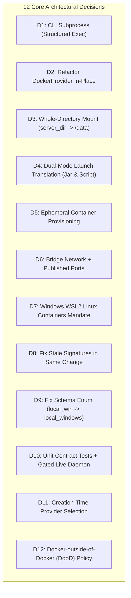

# Design Spec: Phase 5 — Containers System (Docker Integration)

**Document Status:** DRAFT — REVISED (Addressing Orchestrator.md §6 Design Review Gaps)  
**Governance Classification:** Decision Level D2 (Major) / Lane B (Release Improvement)  
**Governing Authority:** `docs/governance/GOVERNANCE.md` §4–5  
**Preceding Precedent:** DECISION-2026-09-10-001 (Build Phase 5 before Phase 4 starts)  
**Target Delivery:** Phase 5 — Containers System  
**Author:** Antigravity (Design Agent)  
**Date:** 2026-09-11  

---

## 1. Goal

Establish a robust, production-grade Docker container runtime provider (`DockerProvider`) in ONX Manager that implements the canonical `ServerProvider` ABC interface (`backend/app/modules/server/infrastructure/providers/base.py`), enabling Minecraft servers (Vanilla, Paper, Purpur, Fabric, Forge, and NeoForge) to run in isolated Linux containers across Linux and Windows (WSL2) hosts.

### Concrete Objectives
1. **Creation-Time Provider Selection:** Provide an end-to-end activation path allowing users to select Docker as the runtime provider during server creation, including API request schema extensions, pre-flight daemon availability validation (`DockerProvider.ping()`), aggregate initialization, and a frontend provider selector on the creation wizard.
2. **Docker-outside-of-Docker (DooD) Strategy:** Define explicit support boundaries and deployment architecture for ONX Manager when ONX itself is deployed via Docker Compose, specifying host socket bind-mounting rules, CLI packaging, path resolution, and security trade-offs.
3. **Fix the Live Runtime Call Path:** Update `DockerProvider.start()` to accept the live 4-argument signature `(server_id, config, deployment, launch_config)` invoked by `StartServerHandler` and `RestartServerHandler`.
4. **Correct Provider ABC Conformance Across the Codebase:** Align the stale 2-argument `start()` signatures in `SSHProvider`, `CloudProvider`, and `CircuitBreakerProviderWrapper` to conform to `ServerProvider.start()`.
5. **Define a Whole-Directory Volume Mount Contract:** Ensure containerized servers share their entire working directory (`server_dir` bind-mounted to `/data`), preserving full interoperability with the host File Manager, Backup subsystem, Mod/Plugin managers, and Diagnostics scanner.
6. **Support Script & Jar Launches:** Translate `LaunchConfiguration` into container execution commands for standard Java jars and Forge/NeoForge `run.sh` script entrypoints.
7. **Implement Ephemeral Container Provisioning:** Enable Forge/NeoForge multi-gigabyte installer execution inside isolated ephemeral containers without requiring host Java runtimes, while maintaining live WebSocket progress streaming.
8. **Integrate with Existing Exposure Subsystems:** Support `playit.gg`, Cloudflare Tunnels, and UPnP through a bridge-networked port-publishing model that requires zero modifications to exposure supervisors.
9. **Correct Configuration Contracts:** Synchronize `contracts/config.schema.json` (`local_win` → `local_windows`) with registered providers.
10. **Establish Comprehensive Test Conformance:** Provide complete unit contract test coverage with mocked Docker CLI invocations, alongside explicitly gated live-daemon integration tests (`@pytest.mark.docker`) excluded from standard CI.

---

## 2. Current Behavior

### 2.1 Runtime Call Site Desynchronization
In `backend/app/modules/server/application/commands/start_server.py:270-275` and `restart_server.py:288-293`, server startup invokes:
```python
result = await asyncio.wait_for(
    provider.start(
        server_id=sid,
        config=config,
        deployment=server.deployment,
        launch_config=server.launch_config,
    ),
    timeout=30,
)
```
However, `DockerProvider.start()` in `backend/app/modules/server/infrastructure/providers/docker.py:32` is defined as:
```python
async def start(self, server_id: str, config: dict[str, Any]) -> DeploymentResult:
```
Invoking `start()` on `DockerProvider` fails immediately at runtime with:
```
TypeError: start() got an unexpected keyword argument 'deployment'
```
The exact same stale 2-argument signature exists on `SSHProvider` (`remote.py:48`), `CloudProvider` (`cloud.py:63`), and `CircuitBreakerProviderWrapper` (`circuit_breaker_wrapper.py:47`). Because `CircuitBreakerProviderWrapper` is designed to wrap any provider, wrapping any provider immediately breaks the live call path.

### 2.2 Creation-Time Provider Hardcoding
In `backend/app/modules/server/application/commands/create_server.py:94-99`:
```python
deployment = ServerDeployment(
    location_type=LocationType.LOCAL,
    root_path=str(Path(server_dir_path).resolve()),
    working_directory=".",
    startup_jar="server.jar",
)
```
The server creation handler hardcodes `location_type=LocationType.LOCAL` for every newly created server. Furthermore:
- Neither `ServerCreateRequest` (`backend/app/api/v1/schemas/server.py`) nor `CreateServerCommand` accept a `provider` or `location_type` field.
- `Server.create()` in `aggregate.py:235` defaults `self._runtime = RuntimeInfo(provider=default_provider_for_platform())`.
- As a consequence, even if `DockerProvider` is bug-free, users have **no activation path** to create a server backed by Docker from the API or UI.

### 2.3 Compose-Deployed ONX Backend Lacks Docker Access
In `docker-compose.yml`, the backend service is configured as:
```yaml
  backend:
    build:
      context: ./backend
      dockerfile: Dockerfile
    volumes:
      - onx-db-data:/app/data
      - onx-server-data:/app/data/servers
```
And `backend/Dockerfile` is built on `python:3.12-slim` without the `docker` CLI package. Under this configuration:
1. The containerized backend cannot invoke `docker` commands (`docker: command not found`).
2. The Docker daemon socket (`/var/run/docker.sock`) is not mounted into the backend container.
3. If ONX is deployed via Docker Compose, it cannot spawn sibling game-server containers.

### 2.4 Storage & File Layout Disconnect
`DockerProvider` currently only mounts the world folder:
```python
if world_dir:
    volume_flags.append(f"-v {shlex.quote(world_dir)}:/data/world")
```
Under this layout:
- Server configuration files (`server.properties`, `eula.txt`), JARs (`server.jar`, `paper.jar`), and Forge scripts (`run.sh`, `user_jvm_args.txt`, `libraries/`) are not mounted from the host server directory.
- Installed plugins (`plugins/`) and mods (`mods/`) managed by ONX Manager on the host are invisible inside the container.
- Console logs written to `/data/logs/latest.log` inside the container are not visible to host diagnostics or the File Manager API.

### 2.5 Hardcoded Entrypoint Assumptions
The existing `docker.py` hardcodes the image `itzg/minecraft-server:latest` and relies on `itzg`-specific environment variables (`VERSION`, `MEMORY`, `JVM_XX_OPTS`) and `rcon-cli`. It does not support executing Forge/NeoForge `run.sh` entrypoints or generic OpenJDK runtimes, nor does it translate `launch_config.jvm_flags` or CPU pinning configurations.

### 2.6 Command Execution Safety
`DockerProvider._docker_command` currently shells out via `asyncio.create_subprocess_shell(f"docker {args}")`. String formatting commands with shell interpolation creates command injection and shell-escaping vulnerabilities when server names, paths, or console inputs contain special characters.

### 2.7 Contract & Documentation Inconsistencies
1. `contracts/config.schema.json:43` defines `"enum": ["local", "docker", "remote", "cloud", "local_win"]`. The registered Windows provider type is `"local_windows"`, while `"local_win"` matches no provider. Schema validation rejects valid `"local_windows"` configurations.
2. `docs/runtime/providers.md` lists `DockerProvider` as a *"Deferred Stub"*, even though it is structurally registered and near-complete.

---

## 3. Proposed Change

### 3.1 Twelve Core Architectural Decisions



#### Decision 1: SDK (docker-py) vs. Continue CLI-Subprocess Approach
- **Decision:** Continue the CLI-subprocess approach, refactored to structured array execution (`asyncio.create_subprocess_exec("docker", *args)`).
- **Reasoning:**
  1. *Zero Transitive Dependencies:* Preserves the minimal footprint in `backend/pyproject.toml` without introducing `docker-py` (which pulls synchronous dependencies like `requests` and `urllib3`) or `aiodocker`.
  2. *Async Native:* Running the official Python Docker SDK requires offloading all socket calls via `asyncio.to_thread`. Subprocess execution using `asyncio.create_subprocess_exec` is asynchronous and non-blocking.
  3. *Daemon & Context Agnostic:* The `docker` CLI automatically respects host Docker contexts, credential helpers, rootless Docker sockets, and Windows named pipes (`//./pipe/docker_engine` via WSL2) without manual socket management.
  4. *Security Hardening:* Replacing `create_subprocess_shell` with `create_subprocess_exec` passes arguments as discrete tokens (`list[str]`), eliminating shell escaping and injection vectors.

#### Decision 2: Fix Existing DockerProvider vs. Rewrite
- **Decision:** Structurally refactor the existing `DockerProvider` in-place (`backend/app/modules/server/infrastructure/providers/docker.py`).
- **Reasoning:** The existing class already integrates with `provider_factory`, registers capabilities, and implements clean teardown and status polling logic. Refactoring fixes the broken interface, volume mapping, and command execution while preserving existing unit test patterns and avoiding unnecessary architectural churn.

#### Decision 3: Volume-Mount Contract & Container Path Layout
- **Decision:** Whole-directory bind mount from host `server_dir` to container `/data`.
- **Layout & Contract:**
  - Host Path: `server_dir = deployment.server_directory()`
  - Container Working Directory: `/data` (`WORKDIR /data`)
  - Mount Flag: `-v {host_server_dir}:/data`
  - Container File Mapping:
    - `/data/server.jar` (or startup jar)
    - `/data/server.properties`
    - `/data/eula.txt`
    - `/data/user_jvm_args.txt` (for Forge/NeoForge)
    - `/data/run.sh` (for Forge/NeoForge)
    - `/data/world/`
    - `/data/plugins/`
    - `/data/mods/`
    - `/data/logs/latest.log`
  - User Permissions: On Linux hosts, inject `--user {os.getuid()}:{os.getgid()}` (or `-e PUID={uid} -e PGID={gid}` if using `itzg`) so files written by the container are owned by the host application user, preventing permission lockouts in File Manager and backup services.

#### Decision 4: LaunchConfiguration → Container Entrypoint Translation
- **Decision:** Deterministic translation supporting both standard JAR launches and Forge/NeoForge `run.sh` script launches.
- **Translation Rules:**
  - *Standard JAR Launch (Vanilla, Paper, Purpur, Fabric):*
    - Container Command: `java [jvm_flags] -Xms{min}M -Xmx{max}M [cpu_flags] -jar /data/{startup_jar} nogui`
  - *Script Launch (Forge, NeoForge):*
    - Automatically generate or patch `/data/user_jvm_args.txt` on the host with memory flags (`-Xms{min}M`, `-Xmx{max}M`) and CPU flag (`-XX:ActiveProcessorCount={cores}`).
    - Container Command: `bash /data/run.sh nogui` (always `run.sh`, even when ONX runs on Windows, because the container OS is Linux).
  - *CPU Allocation:* Pass `--cpus {cores}` and `--cpuset-cpus {affinity}` directly as Docker resource constraints when `cpu_cores > 0` or `cpu_affinity` is configured, alongside Java's `-XX:ActiveProcessorCount`.
  - *Image Selection:* Configurable via server config or global settings (`AppSettings.docker_default_image`), defaulting to `eclipse-temurin:21-jre-jammy` (or `itzg/minecraft-server:latest` if selected by user).

#### Decision 5: Provisioning Location
- **Decision:** Host-side provisioning by default when Java is available, with an ephemeral container runner (`ContainerInstallerRunner`) when running in container mode without host Java.
- **Reasoning:**
  - Full image builds (`docker build`) per server are rejected: they generate multi-gigabyte layer waste and trap server files inside image layers.
  - Ephemeral Container Execution:
    `docker run --rm -v {server_dir}:/data -w /data eclipse-temurin:21-jdk java -jar /data/{installer_jar} --installServer /data`
  - Output artifacts (`run.sh`, `libraries/`) are written directly to host `server_dir` via the bind mount.
  - Streams stdout lines asynchronously through `_parse_progress_line` to preserve live `ForgeProvisionProgressEvent` WebSocket progress tracking on the frontend.

#### Decision 6: Container Network Model & Exposure Integration
- **Decision:** Docker `bridge` network with published host ports.
- **Port Mapping:**
  - Game Port: `-p {host_port}:{container_port}` (e.g., `-p 25565:25565`).
  - RCON Port: `-p 127.0.0.1:{rcon_port}:{rcon_port}` (published exclusively to host loopback).
- **Exposure Subsystem Integration:**
  - `playit.gg`: The host-level playit agent forwards packets to `127.0.0.1:{target.local_port}`. Because the container publishes the port to the host loopback/interfaces, playit functions with zero code changes.
  - `cloudflared`: Connects to `127.0.0.1:{target.local_port}`, communicating directly with the published container port.
  - `UPnP`: Binds external router ports to the host's LAN IP. Published Docker ports receive and route this traffic into the container.
- **Why Host Network (`--net=host`) is Rejected:** It is unsupported on Docker Desktop for Windows and macOS, preventing cross-platform consistency.

#### Decision 7: Windows Policy & Portability
- **Decision:** Mandatory WSL2 backend with Linux containers mode.
- **Requirements & Policies:**
  - Windows hosts must run Docker Desktop 4.x+ with WSL2.
  - Linux Containers mode is mandatory (Minecraft Java server images are Linux ELF/bash based).
  - Path Normalization: Windows paths (`C:\minecraft\servers\...`) must be converted to forward-slash format (`C:/minecraft/servers/...`) for Docker CLI `-v` mount arguments.
  - Health & Ping Gate: `DockerProvider.ping()` verifies daemon reachability and asserts `OSType == "linux"`. If ping fails, startup fails fast with actionable diagnostics. The Windows default provider remains `local_windows` (`default_provider_for_platform()`).

#### Decision 8: Fix Plan for the 3 Stale `start()` Signatures
- **Decision:** Align `DockerProvider`, `CircuitBreakerProviderWrapper`, `SSHProvider`, and `CloudProvider` in the same Phase 5 change.
- **Reasoning:** The `ServerProvider` ABC is the foundation of server lifecycle management. Leaving any provider with a stale 2-argument signature violates LSP and causes `TypeError` during startup or circuit breaker interception. Bundling this fix ensures all providers conform to the domain contract.

#### Decision 9: Schema-Enum Correction
- **Decision:** Update `contracts/config.schema.json` to replace `"local_win"` with `"local_windows"`.
- **Reasoning:** Synchronizes schema validation with `LocalWindowsProvider.provider_type == "local_windows"`, eliminating false validation failures and aligning with ADR 0009.

#### Decision 10: Provider-Conformance Test Plan
- **Decision:** Comprehensive unit contract tests using mocked `_docker_command` in standard CI, with explicitly marked live-daemon integration tests (`@pytest.mark.docker`) excluded from default CI.
- **CI Test Suite:** Validates argument parsing, quoting, volume flags, CPU pinning, environment variables, and status transitions with 100% mock isolation.
- **Live Daemon Suite:** Gated behind `pytest -m docker` and skipped unless a live Docker daemon is confirmed via `ping()`.

#### Decision 11: Creation-Time Provider Selection
- **Decision:** Expose an explicit `provider` field on server creation endpoints, commands, and frontend UI, gated by pre-flight daemon liveness validation.
- **Architecture & Implementation:**
  1. *API Schema Extension:* Add `provider: str | None = Field(default=None)` to `ServerCreateRequest` (`backend/app/api/v1/schemas/server.py`). Accepted values: `"local"`, `"docker"`, `"local_windows"`.
  2. *Command Bus Extension:* Add `provider: str | None = None` to `CreateServerCommand` (`backend/app/modules/server/application/commands/create_server.py`).
  3. *Validation Gate in `CreateServerHandler`:*
     - If `command.provider == "docker"`: Invoke `await provider_factory.get("docker").ping()`.
     - If `ping()` returns `False`: Fail creation immediately with `CommandResult(success=False, error="Docker daemon is unreachable or not running in Linux container mode", error_code="DOCKER_UNAVAILABLE")`.
     - When valid: Initialize `deployment = ServerDeployment(location_type=LocationType.DOCKER, ...)` and `runtime = RuntimeInfo(provider="docker")`.
     - If `command.provider` is omitted/None: Fall back to `default_provider_for_platform()` with `LocationType.LOCAL` (maintaining 100% backwards compatibility).
  4. *Aggregate Factory Extension:* Update `Server.create()` in `backend/app/modules/server/domain/aggregate.py` to accept `runtime: RuntimeInfo | None = None`, ensuring the explicit provider is stored in the domain model and database.
  5. *Minimal Frontend UI:*
     - Extend `WizardData` in `frontend/src/server_manager/pages/CreateServerPage.tsx` with `provider: string`.
     - In Step 3 ("Configuration"), render a segmented toggle or dropdown:
       - **Host Process** (default): Tooltip "Runs natively on the host via tmux/Win32".
       - **Docker Container**: Tooltip "Runs isolated in a Docker container".
     - Query backend `/api/v1/health` or `/api/v1/system/environment` to inspect Docker status. If Docker is offline, disable the toggle with an informational badge: *"Docker daemon not detected"*.

#### Decision 12: Docker-outside-of-Docker (DooD) & Compose Deployment Policy
- **Decision:** Native host installation is the **Primary Supported Tier** for Phase 5. Docker Compose deployment with DockerProvider is supported via an **Opt-In DooD Profile (`docker-compose.dood.yml`)**, with explicit documentation of the privilege escalation attack surface.
- **Architecture & Trade-offs:**
  1. *Backend Image Packaging:* Install static `docker-cli` binary in `backend/Dockerfile`:
     ```dockerfile
     COPY --from=docker:cli /usr/local/bin/docker /usr/local/bin/docker
     ```
     This adds negligible image size (~50MB) and ensures the CLI is present regardless of deployment mode.
  2. *Socket Mount & Privilege Escalation Surface (Documented Explicitly):*
     - For compose-deployed ONX to manage sibling containers, it must bind-mount the host Docker socket:
       ```yaml
       volumes:
         - /var/run/docker.sock:/var/run/docker.sock
       ```
     - > [!CAUTION]
       > **Security Implication (Host Privilege Escalation):** Mounting `/var/run/docker.sock` grants the container root-equivalent privileges on the host system. Any user or process that compromises the ONX backend can execute arbitrary Docker commands, mount the host root directory (`-v /:/host`), and compromise the entire host operating system.
     - Therefore, this socket mount will **NOT** be included in the default `docker-compose.yml`. It will be isolated in an opt-in override file (`docker-compose.dood.yml`).
  3. *Path Translation for DooD Sibling Mounts:*
     - When DooD is active, sibling containers are created by the *host* Docker daemon, which resolves volume paths on the *host filesystem*, not inside the backend container.
     - Consequently, named Docker volumes (e.g. `onx-server-data`) cannot be bind-mounted into sibling containers by container-internal paths (`/app/data/servers/...`).
     - Rule: In DooD mode, users must configure a host bind mount for server data (e.g. `./data/servers:/app/data/servers`) and set `ONX_HOST_DATA_DIR=$(pwd)/data/servers` so `DockerProvider` passes the correct host-absolute path to `-v`.
  4. *Graceful Degradation:*
     - When ONX runs in default Compose (without socket mount), `DockerProvider.ping()` returns `False`.
     - The server manager operates seamlessly with native/mocked providers, and Docker option in UI is disabled with clear explanation: *"Docker socket not mounted into ONX Compose container"*.

---

## 4. Affected Components

| Component | File Path | Nature of Change |
|---|---|---|
| **Server Create Command** | `backend/app/modules/server/application/commands/create_server.py` | Add `provider` field, `ping()` validation gate, `LocationType.DOCKER` deployment. |
| **Server Aggregate** | `backend/app/modules/server/domain/aggregate.py` | Update `Server.create()` to accept and assign `runtime: RuntimeInfo`. |
| **Server Request Schemas** | `backend/app/api/v1/schemas/server.py` | Add `provider: str | None` to `ServerCreateRequest`. |
| **Servers API Router** | `backend/app/api/v1/routers/servers.py` | Forward `body.provider` into `CreateServerCommand`. |
| **Frontend Create Wizard** | `frontend/src/server_manager/pages/CreateServerPage.tsx` | Add provider selector toggle in Configuration step with daemon status badge. |
| **Frontend Server Types** | `frontend/src/server_manager/types/index.ts` | Add `provider?: string` to `CreateServerPayload`. |
| **Docker Provider** | `backend/app/modules/server/infrastructure/providers/docker.py` | Refactor `start()`, volume mounts, structured exec, CPU limits, entrypoints. |
| **Backend Dockerfile** | `backend/Dockerfile` | Install static `docker-cli` binary from `docker:cli` builder. |
| **Compose DooD Override** | `docker-compose.dood.yml` | New opt-in compose override mounting `/var/run/docker.sock` with host bind paths. |
| **Circuit Breaker Wrapper** | `backend/app/modules/server/infrastructure/providers/circuit_breaker_wrapper.py` | Update `start()` signature to accept `deployment` and `launch_config`. |
| **SSH Provider** | `backend/app/modules/server/infrastructure/providers/remote.py` | Update `start()` signature to accept optional `deployment` and `launch_config`. |
| **Cloud Provider** | `backend/app/modules/server/infrastructure/providers/cloud.py` | Update `start()` signature to accept optional `deployment` and `launch_config`. |
| **Installer Runner** | `backend/app/modules/server/infrastructure/installer.py` | Add `ContainerInstallerRunner` for ephemeral container provisioning. |
| **Server Commands** | `backend/app/modules/server/application/commands/start_server.py` | Extract `session_name` / `container_name` consistently from `DeploymentResult`. |
| **Config Schema** | `contracts/config.schema.json` | Replace `local_win` with `local_windows` in `provider_type` enum. |
| **Contract Integrity Tests** | `backend/tests/core/test_contracts_integrity.py` | Assert `local_windows` in schema enum. |
| **Provider Unit Tests** | `backend/tests/infrastructure/test_providers.py` | Update and expand `TestDockerProvider` with comprehensive mock contract tests. |
| **Provider Conformance Tests** | `backend/tests/infrastructure/test_provider_conformance.py` | New parameterized contract test suite verifying all registered providers against ABC. |
| **Runtime Documentation** | `docs/runtime/providers.md` | Update `DockerProvider` status from "Deferred Stub" to "Active / Functional". |

---

## 5. Interfaces & Contracts

### 5.1 Server Creation API & Command Extension
`ServerCreateRequest` in `backend/app/api/v1/schemas/server.py`:
```python
class ServerCreateRequest(BaseModel):
    name: str = Field(..., min_length=1, max_length=128)
    server_type: str = Field(default="vanilla")
    minecraft_version: str = Field(default="1.20.4")
    ...
    provider: str | None = Field(
        default=None,
        description="Target runtime provider: 'local', 'docker', 'local_windows'. Defaults to platform default.",
    )
```

`CreateServerCommand` in `backend/app/modules/server/application/commands/create_server.py`:
```python
class CreateServerCommand(Command):
    idempotency_key: IdempotencyKey = Field(default_factory=IdempotencyKey)
    creator_id: str | None = None
    name: str
    server_type: str = "vanilla"
    minecraft_version: str
    ...
    provider: str | None = None
```

Validation and resolution in `CreateServerHandler`:
```python
requested_provider = command.provider
if requested_provider == "docker":
    provider_instance = provider_factory.get("docker")
    if not await provider_instance.ping():
        return CommandResult(
            success=False,
            error="Docker daemon is unreachable or not running in Linux container mode",
            error_code="DOCKER_UNAVAILABLE",
        )
    location_type = LocationType.DOCKER
    runtime_provider = "docker"
else:
    location_type = LocationType.LOCAL
    runtime_provider = requested_provider or default_provider_for_platform()

deployment = ServerDeployment(
    location_type=location_type,
    root_path=str(Path(server_dir_path).resolve()),
    working_directory=".",
    startup_jar="server.jar",
)
runtime = RuntimeInfo(provider=runtime_provider)

server = Server.create(
    server_id=server_id,
    name=command.name,
    server_type=ServerType(command.server_type),
    minecraft_version=parsed_version,
    memory=...,
    java_args=...,
    properties=...,
    group_id=command.group_id,
    deployment=deployment,
    runtime=runtime,
    owner_id=command.creator_id,
)
```

### 5.2 Updated `ServerProvider.start()` Conformance
All implementations will conform strictly to the abstract declaration in `base.py:51-57`:
```python
@abstractmethod
async def start(
    self,
    server_id: str,
    config: dict[str, Any] | None = None,
    deployment: ServerDeployment | None = None,
    launch_config: LaunchConfiguration | None = None,
) -> DeploymentResult: ...
```

### 5.3 Structured Docker Command Execution Interface
`DockerProvider` will replace string-interpolated shell commands with tokenized arguments:
```python
async def _docker_exec(self, *args: str) -> tuple[int, str]:
    """Execute docker CLI command without shell interpolation."""
    proc = await asyncio.create_subprocess_exec(
        "docker",
        *args,
        stdout=asyncio.subprocess.PIPE,
        stderr=asyncio.subprocess.PIPE,
    )
    stdout, stderr = await proc.communicate()
    output = stdout.decode("utf-8", errors="replace")
    if proc.returncode != 0:
        err_msg = stderr.decode("utf-8", errors="replace")
        logger.warning("Docker command failed: docker %s (code %d): %s", " ".join(args), proc.returncode, err_msg)
    return proc.returncode or 0, output
```

### 5.4 DeploymentResult Contract Harmonization
`DeploymentResult.metadata` returned by `DockerProvider.start()` will explicitly include:
```python
return DeploymentResult(
    status=ServerRuntimeStatus.RUNNING,
    address="127.0.0.1",
    port=port,
    pid=pid,
    metadata={
        "handle": str(handle),
        "session_name": container_name,
        "container_name": container_name,
        "image": image,
        "server_dir": server_dir,
    },
)
```

### 5.5 Command Execution via RCON & Container Exec
To execute console commands (`execute_command(handle, command)`):
1. Primary Method: If RCON is enabled in `server.properties`, connect via internal `AsyncRCONClient` (`backend/app/modules/monitoring/infrastructure/rcon_client.py`).
2. Fallback Method: When running images with CLI tools (e.g. `rcon-cli`), invoke via `docker exec {container_name} rcon-cli "{command}"`.

---

## 6. Failure Cases & Edge Cases

| Failure Scenario | Root Cause | Handling & Mitigation Strategy |
|---|---|---|
| **User Selects Docker But Daemon Offline** | Docker service stopped or Docker Desktop closed during server creation. | `CreateServerHandler` calls `DockerProvider.ping()`. Returns `400 Bad Request` with `error_code="DOCKER_UNAVAILABLE"` and message: *"Docker daemon is unreachable or not running in Linux container mode"*. Creation aborted before database or disk modification. |
| **Docker Daemon Inactive at Server Start** | Docker service stopped after server was created. | `DockerProvider.ping()` returns `False`. `start()` raises `ProviderError("docker", "start", "Docker daemon unreachable...")`. Server aggregate records crash/broken state with clear diagnostic log. |
| **DooD Volume Path Resolution Mismatch** | Sibling container fails to mount host path in DooD mode. | `DockerProvider` checks for `ONX_HOST_DATA_DIR` environment variable. If set, translates internal `/app/data/servers` paths to host-relative paths before issuing `-v`. Clear error logged if host path is inaccessible. |
| **Port Conflict on Host** | Port already bound by host service or another container. | Pre-flight socket check in `start_server.py` detects port collision before container creation. `docker create` failure with `port already allocated` is caught and translated to `ProviderError`. |
| **Container OOM (Out of Memory)** | JVM memory exceeds allocated container memory. | Docker `--memory` limit set with a 512MB headroom above `memory_max_mb` (to accommodate JVM metaspace, thread stacks, and OS overhead). Container exit code 137 (OOMKilled) is detected in `inspect` and recorded as `ServerStatus.CRASHED` with an OOM diagnostic milestone. |
| **Permission Denied on Bind Mount (Linux)** | Container runs as root (UID 0) while host runs as standard user. | Container spawned with `--user {os.getuid()}:{os.getgid()}`. Directory creation on the host occurs before mount. |
| **Windows Path Formatting Error** | Windows backslashes `\` misinterpreted by Docker volume parser. | All Windows paths passed to `-v` are normalized using `Path(server_dir).as_posix()`. |
| **Stale Container With Same Name Exists** | Previous process crashed without `docker rm`. | Before `docker create`, `DockerProvider` checks for and removes any existing stopped container named `onx-{server_id}`. |
| **Slow Image Pull Exceeding Timeout** | Image pull over slow network exceeds 30s startup timeout. | Image presence is checked in pre-flight. If missing, image pull is awaited with progress logging or pre-warmed during server creation. |
| **Orphaned Containers on Backend Crash** | Backend daemon killed abruptly while container runs. | `RuntimeReconciliationService` scans Docker containers with label `com.onx-manager.managed=true` during backend startup and re-attaches or cleans up orphan state (ADR 0011). |

---

## 7. Tests & Verification

### 7.1 Server Creation & Provider Selection Tests
Location: `backend/tests/application/test_create_server_provider.py`
- `test_create_server_with_docker_provider_success`: Asserts that when `provider="docker"` and `DockerProvider.ping()` is True, the created server has `deployment.location_type == LocationType.DOCKER` and `runtime.provider == "docker"`.
- `test_create_server_with_docker_provider_unavailable`: Asserts that when `provider="docker"` and `DockerProvider.ping()` is False, creation returns `DOCKER_UNAVAILABLE` error without writing to disk or database.
- `test_create_server_default_provider_fallback`: Asserts that when `provider` is omitted, server defaults to platform default (`local` on Linux, `local_windows` on Windows).

### 7.2 Unit Contract Tests (Mandatory in CI)
Location: `backend/tests/infrastructure/test_docker_provider.py` and `test_providers.py`
- `test_docker_ping_success_and_failure`: Validates `ping()` logic against simulated Linux and Windows OSType responses.
- `test_docker_start_with_launch_config_jar`: Verifies `create` arguments for Vanilla/Paper servers (flags, mounts, memory, port, labels).
- `test_docker_start_with_forge_script`: Verifies script launch generates `bash /data/run.sh nogui` and writes `user_jvm_args.txt`.
- `test_docker_start_cpu_allocation`: Verifies `--cpus` and `--cpuset-cpus` flags match domain `CpuAllocation`.
- `test_docker_stop_graceful_and_force`: Verifies RCON stop followed by `docker stop -t 30` and `docker kill` on force.
- `test_docker_console_logs`: Verifies `docker logs --tail 100 --timestamps` parsing.
- `test_docker_execute_command_tokenized`: Verifies structured argument passing without shell interpolation.

### 7.3 Provider Conformance Suite
Location: `backend/tests/infrastructure/test_provider_conformance.py`
- Parameterized test over `[LocalLinuxProvider, LocalWindowsProvider, DockerProvider, SSHProvider, CircuitBreakerProviderWrapper]`.
- Asserts every registered provider:
  1. Implements `capabilities()` returning a subset of canonical capabilities (`process`, `console`, `exec`).
  2. Implements `start(server_id, config, deployment, launch_config)` accepting all 4 keyword arguments without raising `TypeError`.
  3. Returns a valid `DeploymentResult` with populated metadata (`session_name`).

### 7.4 Live Daemon Integration Tests (Gated)
Location: `backend/tests/integration/test_docker_live_daemon.py`
- Gated with `@pytest.mark.docker` and skipped unless `os.environ.get("RUN_DOCKER_TESTS") == "1"` and `DockerProvider().ping()` is `True`.
- Spawns an actual lightweight container (`alpine` or `eclipse-temurin:21-jre`), verifies port reachability, streams logs, executes a test command, and terminates cleanly.

---

## 8. Out of Scope

1. **GPS / Local-Global-Mode Validation:**
   - Explicitly excluded: *"GPS/local-global-mode validation — blocked pending Mohamed's definition (roadmap-stated, recon-confirmed undefined in code as of 2026-09-10)"*. No implementation, interfaces, or assumptions will be introduced for GPS in this phase.
2. **Phase 4 Community Features:**
   - Features #1 to #5 of Phase 4 (transparent update system, test environment, custom mod support, change history log, log readability) are strictly out of scope for Phase 5 design and build.
3. **Multi-Host Clustering & Orchestration:**
   - Kubernetes, Docker Swarm, Nomad, or remote Docker host clustering are out of scope. `DockerProvider` targets the local Docker daemon.
4. **Native Windows Container Mode:**
   - Running Windows-based Minecraft container images (Windows Server containers) is not supported; Java Edition requires Linux containers.

---

## 9. Alternatives Considered (D2 Requirement)

### Alternative 1: Official Python Docker SDK (`docker` / `docker-py`)
- *Description:* Use the `docker` PyPI package to manage containers via Docker Engine API over sockets.
- *Pros:* Strongly-typed Python objects, direct HTTP API interaction.
- *Why Rejected:*
  - `docker-py` is entirely synchronous and blocks the asyncio event loop unless wrapped in `asyncio.to_thread`.
  - Introduces substantial transitive dependencies (`requests`, `urllib3`, `websocket-client`) into the backend.
  - Requires platform-specific socket path management (`unix:///var/run/docker.sock` vs `npipe:////./pipe/docker_engine`).
  - The CLI-subprocess approach (`asyncio.create_subprocess_exec`) is natively asynchronous, dependency-free, and delegates context/credential resolution to the Docker CLI.

### Alternative 2: Container Network Mode `--net=host`
- *Description:* Run containers sharing the host's network namespace directly, removing the need for `-p` port publishing.
- *Pros:* Eliminates port mapping configuration; all interfaces appear directly on `127.0.0.1`.
- *Why Rejected:*
  - `--net=host` does not work on Docker Desktop for Windows or macOS (attaches to the WSL2/Hyper-V VM network, not the host interface).
  - Precludes running multiple Minecraft servers on the same container-internal default port (25565).
  - Bridge mode with published ports (`-p`) functions identically across Linux and Windows and integrates seamlessly with host exposure tools (`playit`, `cloudflared`, `UPnP`).

### Alternative 3: Dynamic Image Builds per Server (`docker build`)
- *Description:* Build a dedicated Docker image for each server containing its JAR, mods, and configuration.
- *Pros:* Complete container immutability.
- *Why Rejected:*
  - Build times can reach 15–30 minutes for large modpacks, creating unacceptable server creation delays.
  - Generates severe disk bloat by duplicating Java runtimes and Minecraft asset layers across dozens of containers.
  - Incompatible with the existing host File Manager and Backup subsystems, which require immediate host filesystem access to server data.

### Alternative 4: Per-Server Exposure Sidecar Containers
- *Description:* Spawn `playit` or `cloudflared` as container sidecars alongside each Minecraft container.
- *Pros:* Network isolation within Docker bridge networks.
- *Why Rejected:*
  - Violates the current ONX exposure architecture, where `PlayitAgentSupervisor` and `CloudflaredSupervisor` run as centralized host daemons.
  - Would require an extensive rewrite of the exposure bounded context for zero operational benefit, as bridge port publishing already exposes `127.0.0.1:{port}` to host exposure daemons.

### Alternative 5: Docker-in-Docker (DinD) for Compose Deployment
- *Description:* Run an independent Docker daemon nested inside the ONX backend container (`dockerd-entrypoint.sh`).
- *Pros:* Completely isolates game containers from host Docker daemon; no host `/var/run/docker.sock` mount required.
- *Why Rejected:*
  - Requires running the ONX backend container with `--privileged` flag, which completely breaks container isolation and security.
  - High resource consumption (nested daemon, independent overlayfs storage layer inside container).
  - Storage performance regressions when nesting filesystem layers.
  - Docker-outside-of-Docker (DooD) with opt-in profile is significantly lighter, simpler, and reuses host images/caches.

---

## 10. Rollback Path (D2 Requirement)

### 10.1 Operational & Configuration Rollback
- In the event of an unforeseen regression in containerized execution:
  1. The default server provider for existing platforms remains unchanged: `LocalLinuxProvider` on Linux and `LocalWindowsProvider` on Windows (`default_provider_for_platform()`).
  2. Any containerized server can be transitioned back to local execution by updating its database configuration:
     ```sql
     UPDATE servers SET provider = 'local' WHERE provider = 'docker';
     ```
  3. Because the volume mount contract preserves the identical filesystem layout in `deployment.server_directory()`, all JARs, worlds, configs, and mods remain intact on the host filesystem and can immediately boot under `LocalLinuxProvider` or `LocalWindowsProvider` without data migration.

### 10.2 Code & Deployment Rollback
- The changes introduced in this phase:
  - Do not introduce destructive Alembic database schema migrations.
  - Do not modify domain models or persistence tables (the `provider` string column already accepts arbitrary provider keys).
  - Reverting the Git commit for Phase 5 cleanly restores `docker.py` and `create_server.py` to their previous states without leaving dangling database artifacts.
  - The signature updates on `CircuitBreakerProviderWrapper`, `SSHProvider`, and `CloudProvider` are backwards-compatible (parameters have default `None` values) and introduce zero risk of regression to existing local execution paths.

---

## 11. Acceptance & Sign-off Gate

Per `docs/governance/GOVERNANCE.md` §4–5, this D2 (Major) Design Spec requires review and explicit sign-off from Mohamed before Build begins.

- [ ] **Mohamed Approval:** Required for D2 scope commitment.
- [ ] **Roadmap Sync:** Synchronize `ROADMAP_v1.1.md` Phase 5 scope with this design spec.
- [ ] **Proceed to Build:** Authorized only upon completion of the above items.
