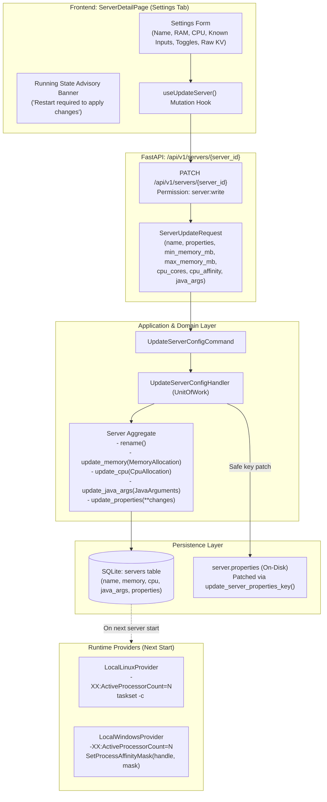

# Design Spec: Server Settings Section (Detail View Diagnostic Layer) — v2

**Document Status:** DRAFT  
**Governance Level:** D1 (Architectural extension of existing server configuration paths)  
**Target Lane:** Lane B (Feature & Diagnostic Layer)  
**Scope:** Design Only (No Implementation Code)

---

## Changelog from v1

- **Fix 1:** Removed "Save & Restart" button and `restartServer.mutate()` call from §8.3; only "Save Changes" + running-state advisory banner remain.
- **Fix 2:** Added explicit key-collision resolution: **Option (b)** — typed sections always take precedence; raw-box duplicates of known keys are rejected with inline error before save enabled.
- **Fix 3:** Removed upper-bound host core count validation from `CpuAllocation`; `cores` is now validated only as `≥0` (user responsibility for host limits), documented in §5.1. Fixed contradictory `cores == 1` rejection.
- **Fix 4:** Added explicit `model_config = ConfigDict(extra="ignore")` to `ServerUpdateRequest` in §7.1.
- **Fix 5:** Removed new `/servers/:serverId/settings` route and ServerShell nav item; Settings tab is now a local component state tab inside existing `/servers/:serverId` route, following the identical pattern as Console/Files tabs (verified: `ServerDetailPage` uses internal tab state, not nested routes).
- **Fix 6:** Specified in §6.1/§6.2 that `LocalLinuxProvider.start()` and `LocalWindowsProvider.start()` call `CpuAllocation.validate()` as a hard gate before command assembly, raising `ProviderError` on invalid format.
- **Fix 7:** Added Test Files section to §9 with four test files and behavior each proves.
- **Fix 8:** Stripped all unrequested polish: live MOTD preview, port conflict validation, RAM preset buttons, tagged JVM flags UI — replaced with plain inputs/textarea.
- **Fix 9:** Clarified `raw_properties` read path in §7.2: disk read happens in `ServerDetailReadModel` via `scanner._read_properties()`, missing/unreadable file returns empty dict (no error), disk I/O added to GET `/servers/{id}` query path (explicitly acknowledged).
- **Fix 10:** Aligned `CpuAllocation` shape with `MemoryAllocation` — frozen dataclass, required fields with sensible defaults (`cores: int = 0` meaning unconstrained, `affinity: str = ""`), `__post_init__` validation, `__str__` method.

---

## 1. Summary

This design specifies a unified "Settings" configuration **tab** located directly within `ServerDetailPage.tsx` (alongside Console and Files) that converts the current read-only configuration panel into an interactive diagnostic edit interface. It reuses existing server mutation pipelines (`servers.py:288` and `jar_service.py:973`) to modify server identity, RAM allocation, CPU allocation/affinity, custom JVM flags, and `server.properties` (with typed inputs, boolean toggle controls, and raw fallback for unknown keys). Editing remains fully accessible during server execution, displaying an explicit notification that changes take effect upon subsequent server restart. **No restart action is included in this feature.**

---

## 2. Explicit Inventory: Reused vs. Net-New Components

| Area                  | Reused Component (As-Is / Extended)                          | Net-New Work                                                  |
|-----------------------|--------------------------------------------------------------|---------------------------------------------------------------|
| API Endpoint          | `servers.py:288` (extended with CPU, JVM flags, java_args)   | None (zero parallel endpoints created)                        |
| Permissions           | `server:write` permission gate (`permissions.yaml:154`)      | None                                                          |
| Properties Sync       | `jar_service.py:973` line-level patch preserving comments    | Read-back of full on-disk key-value pairs into `ServerDetailResponse` |
| Memory Domain Model   | `value_objects.py:18` (128 MB min, 256 GB max, min ≤ max)    | None                                                          |
| CPU Domain Model      | None                                                         | `value_objects.py` value object `CpuAllocation` (aligned with `MemoryAllocation` pattern) |
| Database Schema       | `models.py:19` columns `name`, `memory_min_mb`, `memory_max_mb`, `java_args`, `port`, `motd`, etc. | `cpu_cores` (nullable int) and `cpu_affinity` (nullable str) columns on `servers` table |
| Linux Execution       | `local.py:154` JVM command generation (`-Xms`, `-Xmx`) and tmux execution | Injection of `-XX:ActiveProcessorCount` and optional `taskset -c` prefix |
| Windows Execution     | `local_windows.py:110` command generation and subprocess spawning | Injection of `-XX:ActiveProcessorCount` and Win32 `SetProcessAffinityMask` |
| Frontend Form Layer   | `useServers.ts:93` hook, `api.ts:306`, `ServerDetailPage.tsx:372` field elements | Interactive `ServerSettingsSection` with categorized cards, raw properties editor |
| Tab Navigation        | Existing internal tab state in `ServerDetailPage` (Console/Files) | Settings as additional tab, no new route |

---

## 3. Architecture & Data Flow



---

## 4. Domain & Database Changes (CPU Allocation & Configuration)

### 4.1 Value Object: CpuAllocation

Extends the domain model in `value_objects.py` **matching the exact pattern of `MemoryAllocation`** (`value_objects.py:17-35`):

```python
@dataclass(frozen=True)
class CpuAllocation:
    cores: int = 0          # 0 = unconstrained (default), ≥1 = max logical processors
    affinity: str = ""      # "" = unconstrained (default), e.g. "0-3" or "0,2,4"

    def __post_init__(self) -> None:
        if self.cores < 0:
            raise ValueError(f"cores must be ≥0, got {self.cores}")
        if self.affinity:
            # Validate affinity format: "0-3" or "0,2,4" (non-negative ints, ranges or comma-separated)
            import re
            if not re.fullmatch(r"[0-9]+(?:-[0-9]+)?(?:,[0-9]+(?:-[0-9]+)?)*", self.affinity):
                raise ValueError(f"Invalid affinity format: {self.affinity!r} (expected e.g. '0-3' or '0,2,4')")
            # Parse and validate each core ID is non-negative
            parts = self.affinity.replace(",", " ").split()
            for part in parts:
                if "-" in part:
                    start, end = part.split("-")
                    if int(start) < 0 or int(end) < 0 or int(start) > int(end):
                        raise ValueError(f"Invalid affinity range: {part}")
                elif int(part) < 0:
                    raise ValueError(f"Invalid affinity core ID: {part}")

    def __str__(self) -> str:
        parts = []
        if self.cores > 0:
            parts.append(f"cores={self.cores}")
        if self.affinity:
            parts.append(f"affinity={self.affinity}")
        return " ".join(parts) if parts else "unconstrained"

    @classmethod
    def validate(cls, cores: int, affinity: str) -> None:
        """Static validation gate for provider startup — raises ValueError on invalid input."""
        cls(cores=cores, affinity=affinity)  # triggers __post_init__
```

**Key design decisions:**
- `cores=0` = unconstrained (default), `cores≥1` = explicit limit. No upper bound enforced server-side (host core count unavailable in config mutation path).
- `affinity=""` = unconstrained. Format validated strictly at construction time.
- Frozen dataclass with `__post_init__` validation, `__str__` for logging, static `validate()` classmethod for provider gate.
- **No special-case rejection of `cores=1`** — it is a valid, useful value (e.g., minimal resource testing).

---

### 4.2 Database Model: ServerModel

Modifications in `models.py`:

- Add column `cpu_cores = Column(Integer, nullable=True, default=0)` (0 = unconstrained)
- Add column `cpu_affinity = Column(String(64), nullable=True, default="")`
- Handled via forward Alembic migration (`b1e210000010_add_server_cpu_allocation.py`).

---

### 4.3 Aggregate Methods: Server

Modifications in `aggregate.py`:

- Internal field: `self._cpu: CpuAllocation = cpu or CpuAllocation()`
- Property: `cpu -> CpuAllocation`
- Mutation method: `update_cpu(self, cpu: CpuAllocation) -> None`
- Mutation method: `update_java_args(self, java_args: JavaArguments) -> None`
- Emits `ServerConfigChangedEvent(server_id=self._id, changed_keys=["cpu"])` and `ServerConfigChangedEvent(server_id=self._id, changed_keys=["java_args"])`.

---

## 5. Runtime Provider Enforcement Mechanics

### 5.1 Linux Execution (LocalLinuxProvider)

Location: `local.py:154` (start method)

1. **Processor Count Limiting:**
   - When `server.cpu.cores > 0`:
     - Direct JAR launches: append `-XX:ActiveProcessorCount={cpu.cores}` into the JVM launch argument list.
     - Script launches (`run.sh` / Forge / NeoForge): write/append `-XX:ActiveProcessorCount={cpu.cores}` into `user_jvm_args.txt` in the server root directory alongside `-Xms` and `-Xmx`.

2. **Core Affinity Pinning:**
   - When `server.cpu.affinity` is non-empty:
     - **Hard validation gate:** `CpuAllocation.validate(server.cpu.cores, server.cpu.affinity)` called **before** command assembly; raises `ProviderError` on invalid format.
     - Wrap the execution command with `taskset -c {shlex.quote(cpu.affinity)} <command>`.
     - Ensures OS scheduler limits thread execution strictly to assigned cores.
     - If `taskset` binary not found (stripped container), log structured warning and rely on `-XX:ActiveProcessorCount` alone.

---

### 5.2 Windows Execution (LocalWindowsProvider)

Location: `local_windows.py:110` (start method)

1. **Processor Count Limiting:**
   - When `server.cpu.cores > 0`:
     - Direct JAR launches: append `-XX:ActiveProcessorCount={cpu.cores}` into `cmd_args`.
     - Script launches (`run.bat` / `run.ps1`): write/append `-XX:ActiveProcessorCount={cpu.cores}` into `user_jvm_args.txt`.

2. **Core Affinity Pinning:**
   - When `server.cpu.affinity` is non-empty:
     - **Hard validation gate:** `CpuAllocation.validate(server.cpu.cores, server.cpu.affinity)` called **before** command assembly; raises `ProviderError` on invalid format.
     - Parse affinity string (e.g., `"0-3"`) into a 64-bit integer bitmask (e.g., `0b1111 = 0xF`).
     - Immediately following `proc = subprocess.Popen(...)`, apply the mask to the running process handle using Win32 API:
       ```python
       import ctypes
       ctypes.windll.kernel32.SetProcessAffinityMask(int(proc._handle), ctypes.c_uint64(mask))
       ```
     - Gracefully log a structured warning if affinity assignment fails, without aborting server startup; `-XX:ActiveProcessorCount` guarantees processor limit enforcement regardless.

---

## 6. API Contract Changes

### 6.1 Request Schema: ServerUpdateRequest

Extend existing schema in `server.py:40`:

```python
from pydantic import BaseModel, Field, ConfigDict

class ServerUpdateRequest(BaseModel):
    model_config = ConfigDict(extra="ignore")  # explicit: unknown fields silently ignored

    name: str | None = None
    properties: dict[str, object] = {}
    min_memory_mb: int | None = None
    max_memory_mb: int | None = None
    cpu_cores: int | None = None
    cpu_affinity: str | None = None
    java_args: list[str] | None = None
```

**Notes:**
- All new fields optional with `None` default (additive, no breaking change).
- `extra="ignore"` ensures forward compatibility — callers sending unknown fields won't break.

---

### 6.2 Response Schema: ServerDetailResponse

Extend existing schema in `server.py:69`:

- Add `cpu_cores: int = 0`
- Add `cpu_affinity: str = ""`
- Add `raw_properties: dict[str, str] = {}` — contains the exact key-value pairs parsed from the on-disk `server.properties` file, allowing the frontend to populate both typed controls and the raw textarea.

---

### 6.3 Handler Execution: UpdateServerConfigHandler

Enhance `update_server_config.py:61`:

1. **CPU Updates:**
   - If `command.cpu_cores is not None` or `command.cpu_affinity is not None`, instantiate `CpuAllocation(cores=command.cpu_cores or 0, affinity=command.cpu_affinity or "")` and call `server.update_cpu(...)`.

2. **Java Args Updates:**
   - If `command.java_args is not None`, validate and call `server.update_java_args(JavaArguments(command.java_args))`.

3. **Properties Updates:**
   - Iterate through `command.properties`. For every key-value pair, translate known keys through `_PROP_KEY_MAP` and call `update_server_properties_key(props_path, file_key, str_val)` directly on disk. Unknown keys are passed through unchanged.

---

## 7. Frontend Component & Interaction Plan

### 7.1 View Layout & Navigation Integration

- **Tab Navigation (no new route):**
  - `ServerDetailPage` already uses internal tab state for Console/Files switching (verified: `ServerDetailPage.tsx` uses local component state, not nested routes).
  - Add "Settings" as a third tab in the existing tab switcher at the top of the main column.
  - No entry in `ServerShell.tsx` top-level navigation.
  - No new route in `App.tsx` — Settings tab reached by clicking the tab inside the existing `/servers/:serverId` view.

---

### 7.2 Settings Form Organization

The settings form is split into four distinct visual cards:

1. **General & Identity:**
   - Server Name: Text input bound to `name`.
   - Server Port: Number input bound to `properties["server-port"]` (1024–65535).
   - MOTD: Text input bound to `properties["motd"]`.

2. **Resource Allocation (RAM & CPU):**
   - RAM Allocation: Min RAM (`min_memory_mb`) and Max RAM (`max_memory_mb`) numeric inputs with dynamic validation (128 ≤ min ≤ max ≤ 262144).
   - CPU Allocation:
     - Maximum Cores: Numeric input (`cpu_cores`), default 0 (unconstrained), min 0.
     - Core Affinity Mask: Text input (`cpu_affinity`), helper text: "e.g. 0-3 or 0,2,4".
   - Custom JVM Flags: Plain text area bound to `java_args` (one flag per line).

3. **Gameplay & World Properties (Typed Inputs & Toggles):**
   - Gamemode: Select dropdown (survival, creative, adventure, spectator).
   - Difficulty: Select dropdown (peaceful, easy, normal, hard).
   - Player Capacity: Numeric input (`max-players`, range 1–500).
   - World Generation: Spawn protection blocks, view distance (2–32), simulation distance (2–32).
   - Boolean Toggles (Switch controls):
     - PvP: Toggle (`pvp`)
     - Online Mode (Mojang Auth): Toggle (`online-mode`)
     - Whitelist Enforcement: Toggle (`white-list`)
     - Command Blocks: Toggle (`enable-command-block`)

4. **Advanced & Raw Properties (Unknown Key Fallback):**
   - Multi-line monospace text editor for custom/plugin-injected `server.properties` entries not included in the typed schema (e.g., `level-seed`, `generator-settings`, `resource-pack`, `enforce-secure-profile`).
   - **Key-collision resolution (explicit, deterministic):** Typed sections always take precedence. On form parse, the raw textarea is scanned for keys that also exist in any typed control (including boolean toggles). Duplicate known keys in the raw box are **rejected with an inline error** ("Key 'pvp' is already controlled by the PvP toggle above — remove it from the raw editor to proceed"). Save button remains disabled until all collisions are resolved. Unknown keys pass through unchanged.

---

### 7.3 State Management & Running Server Advisory

- **Running Advisory Banner:**
  When `server.status === "running"`, display a prominent warning banner at the top of the Settings form:
  ```
  │ Server is Currently Running:
  │ Configuration edits are saved immediately to disk and database, but require a server
  │ restart to be applied to the active process.
  ```

- **Save Action:**
  - Single "Save Changes" button: Calls `useUpdateServer.mutateAsync()` with modified delta.
  - Success toast: "Settings updated. Restart server to apply."
  - **No "Save & Restart" button** — intentionally omitted per scope.

---

## 8. Affected Files & Modules

| File Path                                      | Role                | Nature of Change                                           |
|------------------------------------------------|---------------------|------------------------------------------------------------|
| `backend/app/modules/server/domain/value_objects.py` | Domain Value Objects | Add `CpuAllocation` dataclass (aligned with `MemoryAllocation` pattern) |
| `backend/app/modules/server/domain/aggregate.py`     | Domain Aggregate    | Add `cpu` property, `update_cpu()`, `update_java_args()` methods |
| `backend/app/modules/server/infrastructure/models.py` | Persistence ORM     | Add `cpu_cores` and `cpu_affinity` columns to `ServerModel` |
| `backend/alembic/versions/b1e210000010_add_server_cpu_allocation.py` | DB Migration        | Alembic migration for new CPU columns |
| `backend/app/api/v1/schemas/server.py`          | API Schemas         | Add `cpu_cores`, `cpu_affinity`, `java_args` to `ServerUpdateRequest` (with `extra="ignore"`); add `raw_properties` to `ServerDetailResponse` |
| `backend/app/modules/server/application/read_models.py` | Read Model          | Populate `cpu_cores`, `cpu_affinity`, and `raw_properties` from disk in `ServerDetailReadModel` |
| `backend/app/modules/server/application/commands/update_server_config.py` | Command Handler     | Wire CPU, JVM args, and dynamic `server.properties` patching |
| `backend/app/modules/server/infrastructure/providers/local.py` | Linux Runtime Provider | Enforce CPU limit (`-XX:ActiveProcessorCount`) and affinity (`taskset -c`) on startup with hard validation gate |
| `backend/app/modules/server/infrastructure/providers/local_windows.py` | Windows Runtime Provider | Enforce CPU limit (`-XX:ActiveProcessorCount`) and affinity (`SetProcessAffinityMask`) on startup with hard validation gate |
| `frontend/src/server_manager/pages/ServerDetailPage.tsx` | UI Detail View      | Integrate Settings tab into existing tab switcher, wire `useUpdateServer` form |
| `frontend/src/server_manager/components/ServerSettingsSection.tsx` | Form Component      | Dedicated settings form component with typed inputs, toggles, raw textarea, collision detection |
| `frontend/src/services/api.ts`                  | Frontend API Client | Update `ServerDetailResponse` TypeScript interface with CPU and raw properties fields |

---

## 9. Test Files (Required for Definition of Done)

| Test File | Behavior Proven |
|-----------|-----------------|
| `backend/tests/unit/test_cpu_allocation.py` | `CpuAllocation` construction validates: `cores≥0`, affinity format regex, range parsing, rejects negative cores/affinity IDs; `__str__` output matches expected format; `validate()` classmethod raises `ValueError` on invalid input. |
| `backend/tests/unit/test_update_server_config_cpu.py` | Handler correctly: merges `cpu_cores`/`cpu_affinity` into `CpuAllocation`, calls `server.update_cpu()`, emits `ServerConfigChangedEvent` with `changed_keys=["cpu"]`; handles `java_args` update similarly; properties patch still preserves unknown keys. |
| `backend/tests/integration/test_local_provider_cpu_enforcement.py` | `LocalLinuxProvider.start()` with `cpu_cores>0` injects `-XX:ActiveProcessorCount`; with `cpu_affinity` non-empty wraps command in `taskset -c`; validation gate raises `ProviderError` on malformed affinity before command assembly; Windows provider equivalent with `SetProcessAffinityMask` called and warning logged on failure. |
| `frontend/src/server_manager/components/ServerSettingsSection.test.tsx` | Form renders all four cards; boolean toggles reflect `properties` values; raw textarea accepts unknown keys; **collision detection**: typing a known key (e.g., `pvp=false`) in raw box shows inline error and disables Save; unknown keys pass through; running banner displays when `status==="running"`; Save button calls `useUpdateServer` with correct delta. |

---

## 10. Risks & Review Considerations

1. **taskset Availability on Linux:**
   - Risk: Minimal containerized or stripped Linux distributions might not have `util-linux` (`taskset`) pre-installed.
   - Mitigation: `LocalLinuxProvider` tests for `taskset` binary presence prior to prepending command; if absent, logs warning and relies on `-XX:ActiveProcessorCount` JVM flag.

2. **Win32 SetProcessAffinityMask Permission Constraints:**
   - Risk: If onx-manager runs under restricted privileges on Windows, process affinity calls could return `ERROR_ACCESS_DENIED`.
   - Mitigation: Wrapped in try/except that logs advisory warning without failing server startup; `-XX:ActiveProcessorCount` guarantees processor limit enforcement regardless of OS permission level.

3. **Property Key Format Collision:**
   - Risk: Users might submit keys in snake_case (`online_mode`) or kebab-case (`online-mode`).
   - Mitigation: `UpdateServerConfigHandler` normalizes keys through `_PROP_KEY_MAP` and replaces underscores with hyphens before writing to `server.properties`.

4. **Port Conflicts on Running Server Edit:**
   - Risk: Changing `server-port` while running does not check port availability immediately.
   - Mitigation: **Out of scope for this feature** — port validation remains at server start time (existing behavior).

5. **raw_properties Disk I/O on Detail Query:**
   - Risk: Adding `server.properties` disk read to `GET /servers/{id}` changes its performance/failure profile (permission errors, missing file).
   - Mitigation: Read happens in `ServerDetailReadModel` via `scanner._read_properties()`; missing/unreadable file returns empty dict (no error), so detail query never fails due to properties file. Explicitly acknowledged as new disk I/O on hot path.

6. **CpuAllocation vs MemoryAllocation Shape Consistency:**
   - Resolved: `CpuAllocation` now matches `MemoryAllocation` pattern exactly — frozen dataclass, required fields with sensible defaults, `__post_init__` validation, `__str__` method, static `validate()` gate. The only semantic difference: `cores=0` = unconstrained (vs `MemoryAllocation` where min/max always have values), which is intentional because CPU limits are genuinely optional at the OS level.

---

**End of Design Spec v2**