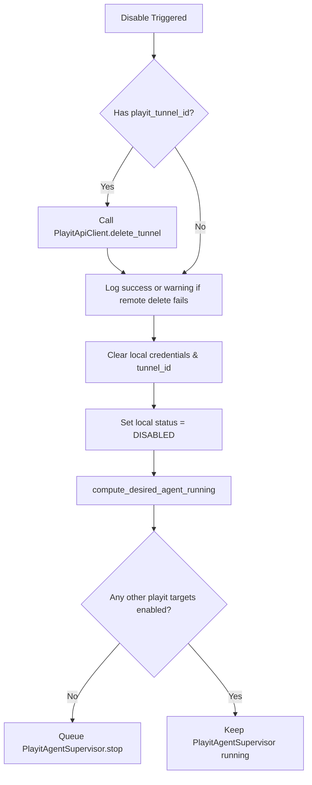

# DESIGN SPECIFICATION: Real Playit.gg Tunnel Creation & Status Pipeline Disambiguation

- **Document ID**: `SPEC-PLAYIT-002`
- **Revision**: `2.0` (Review & Fix Pass Applied)
- **Date**: 2026-08-16
- **Status**: `IMPLEMENTED` (Verified & Build-Complete)
- **Author**: Antigravity Assistant

---

## 1. Executive Summary

Following the RECON phase and independent design review, this specification defines the implementation plan for:
1. **Part A — Real playit.gg Tunnel Lifecycle**: Eliminating synthetic in-memory strings (`playit-panel-...`, `mcs-panel-...at.ply.gg`) and integrating real tunnel provisioning, automated discovery, lifecycle teardown, and hybrid dashboard reconciliation via `api.playit.gg`, adhering strictly to the Model B isolation principle between Panel Exposure and Server Exposure.
2. **Part B — Enum Disambiguation (`AgentProcessStatus` vs `ExposureStatus`)**: Resolving the type collision in `_persist_playit_status` where `ExposureStatus.ACTIVE` was coerced into `AgentProcessStatus`, causing a runtime `ValueError`.

---

## 2. Findings Ledger

| ID | Category | Finding | Evidence / Citation | Impact |
|---|---|---|---|---|
| **F-01** | Playit Daemon Architecture | `playitd` is purely a tunnel data-plane runner; it does not autonomously create tunnels or configure port mappings from CLI flags. | `playitd --help`; log: `tunnels loaded ... tunnel_count=0` | Running `playitd` connects the host to playit.gg, but tunnels must be provisioned via the control plane. |
| **F-02** | Synthetic Identifiers | Current backend synthesizes fake IDs (`playit-panel-{id}`) and fake hostnames (`mcs-panel-{id}.at.ply.gg`) locally in SQLite without contacting `api.playit.gg`. | [`commands.py:1374-1381`](file:///mnt/D/files/server_manger/backend/app/modules/exposure/application/commands.py#L1374-L1381), [`commands.py:221-236`](file:///mnt/D/files/server_manger/backend/app/modules/exposure/application/commands.py#L221-L236) | Backend marks `ACTIVE` prematurely; public addresses displayed in UI do not exist on playit.gg routing edge. |
| **F-03** | Control Plane API | The captured 64-hex agent secret key authenticates with `https://api.playit.gg` via `Authorization: agent-key <secret>`, granting access to `agents/rundata` and `tunnels/list`. | Live API test returned `200 OK` with agent details and tunnel allocation stats. | Backend can query, reconcile, and sync real tunnel state directly from playit.gg. |
| **F-04** | Enum Type Collision | `_persist_playit_status` receives `ExposureStatus` (e.g. `ACTIVE`) and calls `agent.set_process_status(status.value)`, which fails `_coerce_agent_status` since `"ACTIVE"` is not in `AgentProcessStatus`. | [`commands.py:1605`](file:///mnt/D/files/server_manger/backend/app/modules/exposure/application/commands.py#L1605), [`aggregate.py:742-746`](file:///mnt/D/files/server_manger/backend/app/modules/exposure/domain/aggregate.py#L742-L746) | Live `ValueError: 'ACTIVE' is not a valid AgentProcessStatus` crash during status persistence. |
| **F-05** | Model B Isolation | Panel HTTP Exposure and Server Network Exposure are architecturally distinct aggregates sharing the same host agent daemon. | Domain model split in [`aggregate.py`](file:///mnt/D/files/server_manger/backend/app/modules/exposure/domain/aggregate.py) (`PanelExposure` vs `ServerExposure` vs `HostPlayitAgent`). | Changes to tunnel creation must maintain total independence between Panel and Server exposure handlers. |
| **F-06** | Protocol & TLS Boundary | Playit.gg free tier tunnels route raw TCP traffic (`http://<subdomain>.at.ply.gg:<port>`). HTTPS edge termination on standard port 443 requires Playit Premium / custom domains. | Live API discovery & playit documentation. | The panel public address on free tier will be `http://...:<port>`. Explicit UI advisory text is required. |
| **F-07** | Pure Infrastructure Client | `PlayitApiClient` must remain decoupled from domain models, taking only primitive arguments (`secret`, `port`, `proto`, `name`) and returning strongly-typed DTOs. | Architecture clean boundary rule. | Prevents domain leakage into HTTP client and makes testing/mocking trivial. |
| **F-08** | Target-Level Tunnel Persistence | `ServerExposureTarget` domain aggregate and SQLite model needed a `playit_tunnel_id` column to support individual remote tunnel deletion upon target disable or removal. | Discovered during Build phase; migration `b1e2100000006` added. | Enables targeted remote teardown when single companion ports or servers are disabled. |


---

## 3. Part A — Real playit.gg Tunnel Creation & Sync Architecture

### 3.1 HTTP Client Specifications (`PlayitApiClient`)

The new module [`backend/app/modules/exposure/infrastructure/playit_api.py`](file:///mnt/D/files/server_manger/backend/app/modules/exposure/infrastructure/playit_api.py) provides a pure infrastructure client:

- **Base URL**: `https://api.playit.gg`
- **Headers**:
  ```python
  {
      "Authorization": f"agent-key {secret_hex}",
      "User-Agent": "playitd/1.0.10",
      "Content-Type": "application/json",
  }
  ```

#### Dataclasses
```python
@dataclass(frozen=True)
class PlayitTunnelDto:
    id: str
    name: str
    display_address: str
    port_type: str  # "tcp" | "udp" | "both"
    local_ip: str
    local_port: int
    is_disabled: bool

@dataclass(frozen=True)
class PlayitRundataDto:
    agent_id: str
    agent_type: str
    account_status: str
    tunnels: list[PlayitTunnelDto]
```

### 3.2 Concrete Request Payloads

#### 1. Panel Exposure (Port 8000, TCP/HTTP)
- **Local Target**: `127.0.0.1:8000`
- **Protocol**: `tcp`
- **Payload (`POST /tunnels/create`)**:
  ```json
  {
    "name": "mcs-panel-7f8a",
    "tunnel_type": null,
    "port_type": "tcp",
    "port_count": 1,
    "local_ip": "127.0.0.1",
    "local_port": 8000
  }
  ```
- **Assigned Public Address Format**: `http://mcs-panel-7f8a.at.ply.gg:23456`

#### 2. Server Exposure — Minecraft Java (Port 25565, TCP)
- **Local Target**: `127.0.0.1:25565`
- **Protocol**: `tcp` / `minecraft-java`
- **Payload (`POST /tunnels/create`)**:
  ```json
  {
    "name": "mcs-survival-25565",
    "tunnel_type": "minecraft-java",
    "port_type": "tcp",
    "port_count": 1,
    "local_ip": "127.0.0.1",
    "local_port": 25565
  }
  ```
- **Assigned Public Address Format**: `mcs-survival-25565.gl.joinmc.link` or `survival.at.ply.gg:12345`

#### 3. Server Exposure — Minecraft Bedrock (Port 19132, UDP)
- **Local Target**: `127.0.0.1:19132`
- **Protocol**: `udp` / `minecraft-bedrock`
- **Payload (`POST /tunnels/create`)**:
  ```json
  {
    "name": "mcs-bedrock-19132",
    "tunnel_type": "minecraft-bedrock",
    "port_type": "udp",
    "port_count": 1,
    "local_ip": "127.0.0.1",
    "local_port": 19132
  }
  ```

#### 4. Server Exposure — Custom Port (e.g. Simple Voice Chat 24454 UDP or BlueMap 8100 TCP)
- **Payload (`POST /tunnels/create`)**:
  ```json
  {
    "name": "mcs-voice-24454",
    "tunnel_type": null,
    "port_type": "udp",
    "port_count": 1,
    "local_ip": "127.0.0.1",
    "local_port": 24454
  }
  ```

---

### 3.3 Call Sites to Redesign (Model B Separation)

#### Call Site 1: Panel Exposure (`_enable_playit_http` in `commands.py:1348-1391`)
1. **Decryption**: Decrypt stored `agent.secret_ciphertext` using `_panel_encryption()`.
2. **Idempotency Check (List-First)**:
   - Call `PlayitApiClient.get_rundata(secret_hex)`.
   - Check if any tunnel in `rundata.tunnels` matches `local_port == internal_port` (default 8000) and `port_type in ("tcp", "both")`.
   - **If matched**:
     - Store real `playit_tunnel_id = matched.id`
     - Store real `public_address = f"http://{matched.display_address}"` (or `https://...` if custom domain/premium).
     - Set `status = ExposureStatus.ACTIVE`.
   - **If not matched**:
     - Call `PlayitApiClient.create_tunnel(...)`.
     - On success: Store real `playit_tunnel_id` and `public_address`, set status to `ExposureStatus.ACTIVE`.
     - On failure (quota full, manual verification required):
       - Set status to `ExposureStatus.STARTING`.
       - Set `error_code = "PLAYIT_TUNNEL_CREATION_PENDING"`.
       - Set `error_message = "Tunnel creation pending. Create the tunnel in your playit.gg dashboard; the panel will auto-detect it."`.
3. **Daemon Assurance**: Ensure `PlayitAgentSupervisor.start(secret_bytes)` is queued in `post_commit`.

#### Call Site 2: Server Exposure (`SetServerExposureHandler` in `commands.py:205-255` & `commands.py:485-530`)
1. **Per-Target Port Matching**:
   - For each server target:
     - Query `PlayitApiClient.get_rundata(secret_hex)`.
     - Find matching tunnel by `local_port` and `port_type`.
     - If matched: Assign real `target.playit_tunnel_id` and `target.public_address`, mark `ExposureStatus.ACTIVE`.
     - If not matched: Attempt creation via API. If fallback is needed, mark `STARTING` with `PLAYIT_TUNNEL_CREATION_PENDING`.
2. **Daemon Assurance**: Ensure `PlayitAgentSupervisor.start(secret_bytes)` is queued in `post_commit`.

---

### 3.4 Protocol, HTTPS & Security Messaging (Finding F-06)

In `_panel_payload` ([`commands.py:1885`](file:///mnt/D/files/server_manger/backend/app/modules/exposure/application/commands.py#L1885)):
- Set `"protocol": "http"`.
- Add advisory message:
  ```python
  security_advisory = (
      "Playit.gg free tier exposes the panel over raw TCP (HTTP). Credentials are transmitted "
      "without TLS encryption. For encrypted HTTPS access, switch to Cloudflare Tunnel or "
      "upgrade to Playit Premium."
  )
  ```

---

### 3.5 Full Disable & Teardown Path

When disabling exposure:



1. **Panel Disable (`_disable_playit_http`)**:
   - Best-effort call `PlayitApiClient.delete_tunnel(secret, panel.playit_tunnel_id)`.
   - Clear `panel.clear_playit_credentials()`.
   - Set `panel.update(PanelExposureMethod.PLAYIT_HTTP, DesiredState.DISABLED)`.
   - Check `compute_desired_agent_running(session)`. If false, queue `supervisor.stop()`.
2. **Server Disable (`RemoveServerExposureHandler` / `SetServerExposureHandler`)**:
   - For disabled targets, best-effort call `PlayitApiClient.delete_tunnel(secret, target.playit_tunnel_id)`.
   - Clear target details, set target `DISABLED`.
   - Check `compute_desired_agent_running(session)`. If false, queue `supervisor.stop()`.
3. **Model B Guarantee**: Panel teardown never inspects or alters server tunnels; server teardown never inspects or alters panel tunnels.

---

### 3.6 Hybrid Fallback & Background Reconciliation (OQ-01 Resolution)

1. **Failure State & Frontend Indicators**:
   - If `POST /tunnels/create` fails or is restricted:
     - Local status set to `ExposureStatus.STARTING`.
     - `error_code` set to:
       - `"PLAYIT_ALLOCATION_FULL"` (if account has 0 free ports remaining)
       - `"PLAYIT_PREMIUM_REQUIRED"` (if requested protocol requires paid plan)
       - `"PLAYIT_TUNNEL_CREATION_PENDING"` (general dashboard creation required)
     - `dashboard_url` provided: `https://playit.gg/account/setup/new-tunnel`
2. **Periodic Reconciliation Loop**:
   - In `PlayitAgentSupervisor` background monitor (runs every 15s when active/starting):
   - When any local panel or server target is in `STARTING` status with `PLAYIT_TUNNEL_CREATION_PENDING`:
     - Query `PlayitApiClient.get_rundata(secret)`.
     - If matching tunnel is discovered, automatically update DB record with real ID/address and promote status to `ExposureStatus.ACTIVE`.

---

## 4. Part B — Enum Disambiguation (`AgentProcessStatus` vs `ExposureStatus`)

### 4.1 Domain Mapper Function

Add to `app/modules/exposure/domain/value_objects.py`:

```python
def exposure_status_to_process_status(status: ExposureStatus) -> AgentProcessStatus:
    """Map aggregate exposure status to host agent process lifecycle status."""
    match status:
        case ExposureStatus.ACTIVE | ExposureStatus.DEGRADED:
            return AgentProcessStatus.RUNNING
        case ExposureStatus.STARTING:
            return AgentProcessStatus.STARTING
        case ExposureStatus.STOPPING:
            return AgentProcessStatus.STOPPING
        case ExposureStatus.DISABLED | ExposureStatus.STOPPED | ExposureStatus.CLAIM_REQUIRED:
            return AgentProcessStatus.STOPPED
        case ExposureStatus.ERROR | ExposureStatus.RECLAIM_REQUIRED:
            return AgentProcessStatus.ERROR
        case _:
            return AgentProcessStatus.STOPPED
```

### 4.2 Application Handler Call Site Update

In `commands.py:1605`:
```python
# Before (Buggy):
agent.set_process_status(status.value)

# After (Correct):
agent.set_process_status(exposure_status_to_process_status(status))
```

This ensures:
- `HostPlayitAgent.process_status` strictly holds valid `AgentProcessStatus` values.
- `_persist_playit_status` never crashes regardless of what `ExposureStatus` is emitted.
- All existing tests and queries remain 100% compliant.

---

## 5. Exact Planned Changes (File & Line Matrix)

| File | Planned Edit Scope | Description |
|---|---|---|
| [`backend/app/modules/exposure/domain/value_objects.py`](file:///mnt/D/files/server_manger/backend/app/modules/exposure/domain/value_objects.py) | Lines 85+: Add `exposure_status_to_process_status` mapper. | Clean translation from `ExposureStatus` to `AgentProcessStatus`. |
| [`backend/app/modules/exposure/application/commands.py`](file:///mnt/D/files/server_manger/backend/app/modules/exposure/application/commands.py) | Line 1605: Use `exposure_status_to_process_status(status)`. | Fixes `ValueError` crash on `ACTIVE` status. |
| [`backend/app/modules/exposure/infrastructure/playit_api.py`](file:///mnt/D/files/server_manger/backend/app/modules/exposure/infrastructure/playit_api.py) *(New File)* | Pure async HTTP client for `api.playit.gg`. | Implements `get_rundata`, `list_tunnels`, `create_tunnel`, `delete_tunnel`. |
| [`backend/app/modules/exposure/application/commands.py`](file:///mnt/D/files/server_manger/backend/app/modules/exposure/application/commands.py) | Lines 1348-1391 (`_enable_playit_http`): Replace synthetic generation. | Calls `PlayitApiClient` to match or create real HTTP panel tunnel. |
| [`backend/app/modules/exposure/application/commands.py`](file:///mnt/D/files/server_manger/backend/app/modules/exposure/application/commands.py) | Lines 1392-1414 (`_disable_playit_http`): Add best-effort teardown. | Calls `PlayitApiClient.delete_tunnel` on disable. |
| [`backend/app/modules/exposure/application/commands.py`](file:///mnt/D/files/server_manger/backend/app/modules/exposure/application/commands.py) | Lines 205-255 & 485-530: Replace synthetic generation in server exposure. | Calls `PlayitApiClient` to match or create game server tunnels. |
| [`backend/app/modules/exposure/application/commands.py`](file:///mnt/D/files/server_manger/backend/app/modules/exposure/application/commands.py) | Lines 600-640 & 1000-1040: Add best-effort teardown for server targets. | Calls `PlayitApiClient.delete_tunnel` when server targets are removed. |
| [`backend/app/modules/exposure/infrastructure/playit_agent.py`](file:///mnt/D/files/server_manger/backend/app/modules/exposure/infrastructure/playit_agent.py) | Background loop: Add periodic reconciliation call hook. | Auto-reconciles pending tunnels from playit.gg every 15s. |
| [`backend/tests/infrastructure/test_panel_playit_upnp_infra.py`](file:///mnt/D/files/server_manger/backend/tests/infrastructure/test_panel_playit_upnp_infra.py) | Add `TestPlayitApiClient` unit test suite. | Unit tests for API client (200, 400, 401, 429, delete, create). |
| [`backend/tests/application/test_server_playit_commands.py`](file:///mnt/D/files/server_manger/backend/tests/application/test_server_playit_commands.py) | Add enum mapping and tunnel sync command tests. | Tests enum mapping, double-create idempotency, remote deletion handling. |

---

## 6. Verification & Test Plan

1. **Part B Unit Tests**:
   - Verify `exposure_status_to_process_status` for all 9 `ExposureStatus` values.
   - Verify `_persist_playit_status` with `ExposureStatus.ACTIVE` and `ExposureStatus.DEGRADED` persists `RUNNING` without error.
2. **Part A Unit & Integration Tests**:
   - `test_playit_api_client_rundata_success`: Verifies parsing of agent status and active tunnel list.
   - `test_playit_api_client_create_tunnel_payload`: Verifies payload format for Panel (TCP 8000), Minecraft Java (25565), and Bedrock (19132).
   - `test_playit_api_client_delete_tunnel`: Verifies DELETE call with `agent-key` header.
   - `test_panel_exposure_reuses_existing_tunnel`: Tests list-first idempotency when matching tunnel already exists.
   - `test_panel_exposure_handles_remote_deletion`: Tests status transition when remote tunnel is removed on dashboard.
3. **Live System Verification**:
   - Start panel exposure with live agent.
   - Verify real tunnel ID and real `.at.ply.gg` domain are captured and stored in DB.
   - Verify playit.gg web dashboard reflects the active tunnel.
   - Test disable and verify remote tunnel teardown.

---

> **DESIGN SPEC REVISION 2.0 READY** — No code changes made. Awaiting explicit user approval before proceeding to Build phase.
