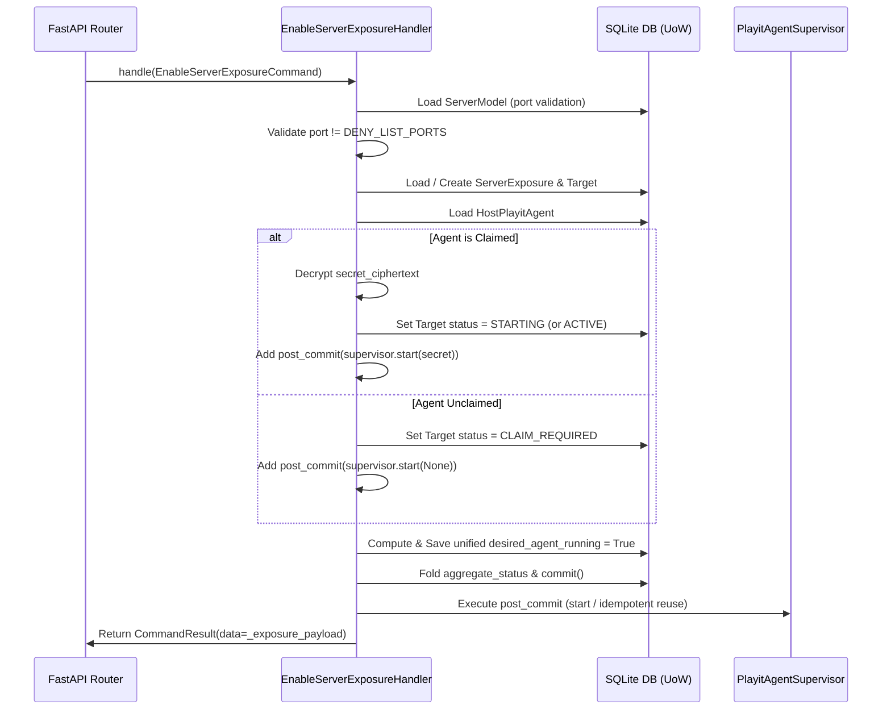
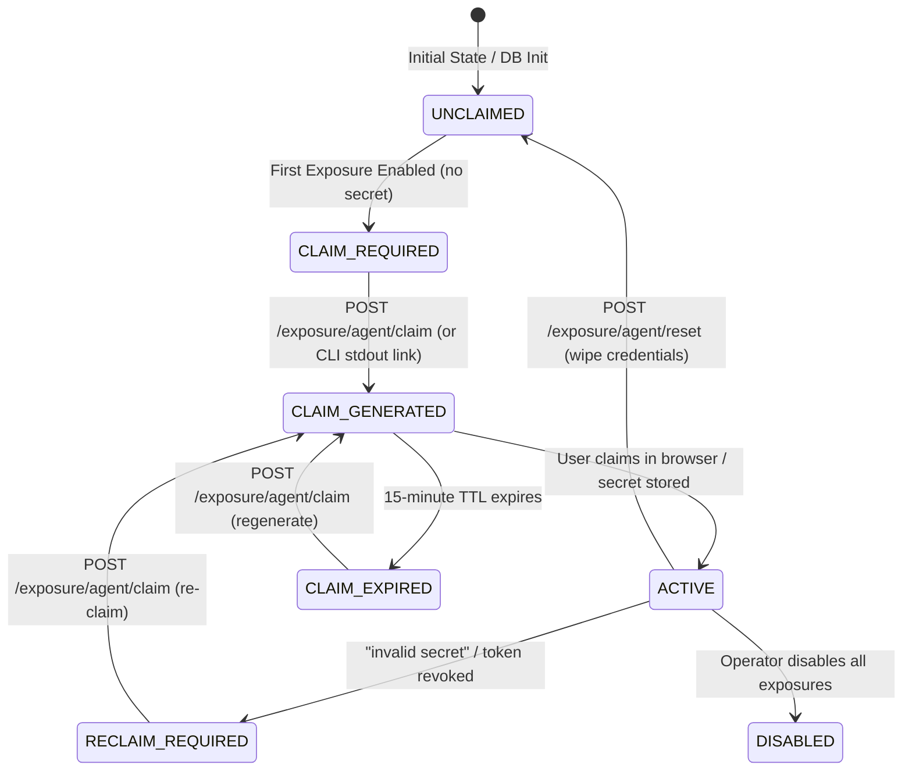

# MCS-Manager Phase 7.3a — Design Spec
**Host-Level playit.gg Agent + Assisted Setup + Core Multi-Target (Java TCP first)**

**Status:** DESIGN READY FOR REVIEW (REVISED)  
**Revision:** 2026-08-15 (Post-RECON Addenda 1 & 2 Revision)  
**Preceding Work:** Batch 7.1 (Committed [`56cd384`](file:///mnt/D/files/server_manger)), Batch 7.2a (Committed [`b357a5a`](file:///mnt/D/files/server_manger)), Batch 7.2b (Committed [`ab2c278`](file:///mnt/D/files/server_manger)), Batch 7.3a RECON & RECON Addenda 1–2 (Completed)  
**Governing Roadmap:** [`docs/roadmap/MCS-Manager-Phase7-Network-Access-Roadmap-v3.1.md`](file:///mnt/D/files/server_manger/docs/roadmap/MCS-Manager-Phase7-Network-Access-Roadmap-v3.1.md) (§6, §6c, §6c.1, §6c.2, §6c.3, §8.6, §10)

---

## Revision Notes (Post-RECON Addenda 1 & 2)

This specification incorporates the findings from:
1. **RECON Addendum 1:** Verified live that `playit 1.0.10` CLI does not contain `tunnels prepare` or `tunnels list` subcommands. The local daemon is strictly an agent runner (`playitd`).
2. **RECON Addendum 2:** Verified that no public, third-party REST API exists for zero-touch tunnel creation; the agent secret is a session-scoped daemon key (`AgentKey`), not an account management API token.
3. **Assisted Setup Alignment:** In accordance with Roadmap Flow 1 (§6, line 216), Flow 1 in Phase 7 v1 operates via **Assisted Setup with Semi-Manual Dashboard Handoff**: MCS Manager runs the host agent process and validates ports, surfaces clear playit.gg dashboard instructions for adding the game tunnel, and allows the operator to record the assigned public address.

---

## 1. Scope & Scope Boundary

### In Scope (Batch 7.3a)
- **Host-Level `playit` Agent Generalization:** Extending the existing [`PlayitAgentSupervisor`](file:///mnt/D/files/server_manger/backend/app/modules/exposure/infrastructure/playit_agent.py) singleton to serve as the unified, shared agent process for both panel exposure and all game server exposures.
- **Supervisor Concurrency & Idempotency:** Guarding `PlayitAgentSupervisor.start()` with an async lifecycle lock to prevent race conditions and duplicate subprocess spawns when multiple servers or the panel activate concurrently.
- **Unified `desired_agent_running` Computation:** Deriving agent running state from:
  $$\text{desired\_agent\_running} \iff \left(\exists\, e \in \text{ServerExposure} : e.\text{method}=\text{'playit'} \land e.\text{desired\_state}=\text{'ENABLED'}\right) \lor \left(\text{PanelExposure}.\text{method}=\text{'playit\_http'} \land \text{PanelExposure}.\text{desired\_state}=\text{'ENABLED'}\right)$$
- **Server Exposure Command Handlers Implementation:** Fully wiring [`EnableServerExposureHandler`](file:///mnt/D/files/server_manger/backend/app/modules/exposure/application/commands.py#L120), [`DisableServerExposureHandler`](file:///mnt/D/files/server_manger/backend/app/modules/exposure/application/commands.py#L169), and [`SetServerExposureHandler`](file:///mnt/D/files/server_manger/backend/app/modules/exposure/application/commands.py#L45) to trigger agent lifecycle, validate game ports against `ServerModel.port` and `DENY_LIST_PORTS`, and update target statuses.
- **Assisted Setup Dashboard-Handoff & Address Management:** Surfacing dashboard URL (`https://playit.gg/manage`) and local port binding guidance (`127.0.0.1:<port>`) in API responses, setting target status to `ACTIVE` when the host agent connects, leaving `public_address` as `null` until populated, and supporting operator address entry/update.
- **Multi-Server Shared Agent Test Suite:** Comprehensive hermetic test suite proving 2+ servers sharing 1 agent process without cross-server interference or duplicate process spawns.

### Out of Scope (Deferred to Later Batches)
- **Batch 7.3b:** Port Forwarding / UPnP for Game Servers.
- **Batch 7.3c:** Cloudflare TCP (Advanced) for Game Servers.
- **Batch 7.3d:** Bedrock / UDP Targets & Companion Ports (blocked on approved companion registry).
- **Batch 7.4 / 7.5:** Frontend UI components for Panel Access and Server Exposure.

---

## 2. Decision 1 — Idempotency Guard in `PlayitAgentSupervisor`

### Problem
[`PlayitAgentSupervisor.start()`](file:///mnt/D/files/server_manger/backend/app/modules/exposure/infrastructure/playit_agent.py#L101) currently executes `await self._spawn_child()` without checking if a child process is already running or in the middle of starting. When multiple game servers enable playit exposure in quick succession, redundant calls to `start()` would spawn duplicate subprocesses, creating orphaned child processes.

### Resolution & Implementation Specification
1. **Async Lifecycle Lock:** Add an `asyncio.Lock()` instance attribute `self._lifecycle_lock = asyncio.Lock()` in `PlayitAgentSupervisor.__init__`.
2. **Idempotency Check in `start()`:**
   ```python
   async def start(
       self,
       secret: bytes | str | None = None,
       on_status: Callable[[ExposureStatus], Awaitable[None]] | None = None,
   ) -> None:
       async with self._lifecycle_lock:
           if on_status is not None:
               self._on_status = on_status

           # Already active or starting with valid process
           if self.is_running or self._status in (
               ExposureStatus.STARTING,
               ExposureStatus.ACTIVE,
               ExposureStatus.CLAIM_REQUIRED,
           ):
               logger.debug("playit supervisor already active/starting; reusing running instance")
               return

           # Proceed with clean start
           self._stop_event.clear()
           self._restart_count = 0
           self._error_message = None
           ...
   ```
3. **Secret Rotation Guard:** If `start()` is invoked with a non-empty secret when the supervisor is currently running with *no* secret (or a different secret), the supervisor invokes `self.restart(secret)`. If the secret is identical or `None` while already running, `start()` returns immediately as a safe no-op.

---

## 3. Decision 2 — Unified `desired_agent_running` Computation

### Problem
`ReconcileExposureHandler` currently checks only `len(await repo.list_playit_enabled()) > 0`, ignoring `PanelExposure`. Conversely, `_enable_playit_http` starts the supervisor directly without updating `HostPlayitAgent.desired_agent_running`.

### Resolution & Implementation Specification
1. **Authoritative Function:** Define a centralized async query helper `compute_desired_agent_running(session: AsyncSession) -> bool`:
   ```python
   async def compute_desired_agent_running(session: AsyncSession) -> bool:
       server_repo = SQLServerExposureRepository(session)
       panel_repo = SQLPanelExposureRepository(session)

       playit_servers = await server_repo.list_playit_enabled()
       panel = await panel_repo.get()

       panel_playit_enabled = (
           panel.method == PanelExposureMethod.PLAYIT_HTTP
           and panel.desired_state == DesiredState.ENABLED
       )
       return len(playit_servers) > 0 or panel_playit_enabled
   ```
2. **Call Sites Updated:**
   - [`EnableServerExposureHandler`](file:///mnt/D/files/server_manger/backend/app/modules/exposure/application/commands.py#L120)
   - [`DisableServerExposureHandler`](file:///mnt/D/files/server_manger/backend/app/modules/exposure/application/commands.py#L169)
   - [`SetServerExposureHandler`](file:///mnt/D/files/server_manger/backend/app/modules/exposure/application/commands.py#L45)
   - [`RemoveServerExposureHandler`](file:///mnt/D/files/server_manger/backend/app/modules/exposure/application/commands.py#L201)
   - [`SetPanelExposureHandler`](file:///mnt/D/files/server_manger/backend/app/modules/exposure/application/commands.py#L520) (for `PLAYIT_HTTP` enable/disable)
   - [`StopAllExposuresHandler`](file:///mnt/D/files/server_manger/backend/app/modules/exposure/application/commands.py#L269)
   - [`ReconcileExposureHandler`](file:///mnt/D/files/server_manger/backend/app/modules/exposure/application/commands.py#L836)
3. **State Sync Behavior:**
   - In each handler, if `desired_running != agent.desired_agent_running`:
     - Update `agent.set_desired_agent_running(desired_running)`.
     - If `desired_running is False` and `supervisor.is_running`: enqueue `post_commit.append(supervisor.stop)`.
     - If `desired_running is True` and `not supervisor.is_running`: decrypt secret (if claimed) and enqueue `post_commit.append(lambda: supervisor.start(secret))`.

---

## 4. Decision 3 — `EnableServerExposureHandler` / `DisableServerExposureHandler` Real Wiring

### Sequence of Operations: `EnableServerExposureHandler`


### Sequence of Operations: `DisableServerExposureHandler`
1. Load `ServerExposure` by `server_id`. If `None` → `NotFoundError`.
2. Set `exposure.set_desired_state(DesiredState.DISABLED)`.
3. Set all targets to `status = ExposureStatus.DISABLED`.
4. Recompute unified `desired_agent_running`:
   - If `desired_running is False`: update `agent.set_desired_agent_running(False)` and enqueue `post_commit.append(supervisor.stop)`.
   - If other playit exposures remain active: `desired_running` remains `True`; supervisor is **not** stopped.
5. Fold `aggregate_status`, commit transaction, execute post-commit supervisor actions, and return payload.

### Error & Status Mapping Matrix

| Condition | `ServerExposureTarget.status` | `error_code` | `error_message` |
|---|---|---|---|
| Port in `DENY_LIST_PORTS` or mismatch | `ERROR` | `DENY_LIST_VIOLATION` / `INVALID_PORT` | Descriptive port violation message |
| Agent unclaimed | `CLAIM_REQUIRED` | `CLAIM_REQUIRED` | `"playit.gg host agent claim required before tunnel activation"` |
| Secret decryption failed | `RECLAIM_REQUIRED` | `RECLAIM_REQUIRED` | `"Stored playit agent secret cannot be decrypted"` |
| Supervisor starting / child spawned | `STARTING` | `None` | `None` |
| Supervisor active & connected | `ACTIVE` | `None` | `None` (`public_address` may be null until configured) |
| Consecutive health failures (3x) | `DEGRADED` | `None` | `None` |
| Process crash / max restarts | `ERROR` | `AGENT_CRASHED` | `"playit exceeded max restarts (5)"` |
| Auth failure ("invalid secret") | `RECLAIM_REQUIRED` | `RECLAIM_REQUIRED` | `"playit.gg reported an invalid or revoked agent secret"` |
| Exposure disabled by operator | `DISABLED` | `None` | `None` |

---

## 5. Decision 4 — Status & Assisted Setup Dashboard-Handoff Mechanism

### Target Status Progression in Assisted Setup
1. **`CLAIM_REQUIRED`**: Host agent is not yet authenticated with playit.gg. `claim_url` is surfaced.
2. **`STARTING`**: Host agent is claimed; supervisor subprocess is launching and establishing mesh connection.
3. **`ACTIVE`**: Host agent process is running and healthy. `public_address` is `null` on initial activation pending dashboard tunnel creation.
4. **`ACTIVE` with Address**: The operator inputs the assigned public address (e.g. `xyz.gl.joinmc.link` or `xyz.at.ply.gg:12345`) via the target update endpoint, recording it on the `server_exposure_target` row.

### Dashboard-Handoff Payload Shape
When querying or enabling server exposure, `_target_payload` and `_exposure_payload` include assisted setup guidance:
```json
{
  "status": "ACTIVE",
  "public_address": null,
  "dashboard_url": "https://playit.gg/manage",
  "setup_instructions": "Add a Minecraft Java (TCP) tunnel on playit.gg pointing to local address 127.0.0.1:<local_port>.",
  "local_port": 25565
}
```

### Manual Public Address Update Path
1. **Command:** `UpdateExposureTargetCommand(server_id: str, target_id: str, public_address: str | None)`
2. **Validation:** Validates that `public_address` (if non-null) matches standard hostname/port format (`^[a-zA-Z0-9.-]+(:\d{1,5})?$`).
3. **RBAC:** Guarded by `require_exposure_grant("server.{id}.exposure")`.

### Host Restart Reconciliation
On application startup (`lifespan`), `ReconcileExposureCommand` re-reads all persisted desired states from SQLite:
- If `compute_desired_agent_running()` is `True`: launches `PlayitAgentSupervisor` with the persisted secret.
- If `False`: ensures supervisor child process remains stopped.

---

## 6. Decision 5 — Multi-Server Shared Agent Test Scenarios

The test suite in `backend/tests/application/test_server_playit_commands.py` must explicitly cover the following multi-server interaction scenarios with hermetic mocking:

1. **Concurrent Activation Sharing:**
   - Server 1 (`port=25565`) and Server 2 (`port=25566`) both dispatch `EnableServerExposureCommand`.
   - Supervisor `_spawn_child` is invoked **exactly once**.
   - Both server targets transition to `ACTIVE` (with `public_address=None` and dashboard handoff instructions).
   - `HostPlayitAgent.desired_agent_running` is `True`.
2. **Independent Deactivation:**
   - Server 1 and Server 2 both active.
   - Server 1 dispatches `DisableServerExposureCommand`.
   - Server 1 target moves to `DISABLED`.
   - Server 2 target remains `ACTIVE`.
   - `PlayitAgentSupervisor.stop()` is **not** called. `desired_agent_running` remains `True`.
3. **Last Target Teardown:**
   - Server 2 subsequently dispatches `DisableServerExposureCommand`.
   - Server 2 target moves to `DISABLED`.
   - `compute_desired_agent_running()` returns `False`.
   - `PlayitAgentSupervisor.stop()` is called and child process is terminated.
4. **Cross-Subsystem Panel + Server Sharing:**
   - Panel exposure enabled with `playit_http` + Server 1 enabled with `playit`.
   - Panel exposure disabled. Agent process remains active because Server 1 is still enabled.
   - Server 1 disabled. Agent process terminates.
5. **Manual Public Address Attachment:**
   - Operator updates Server 1 target with `public_address="my-server.gl.joinmc.link"`.
   - Target persists the address and returns it in GET queries.
6. **Auth Failure Broadcast:**
   - Supervisor encounters `"invalid secret"` output marker.
   - All active targets across Server 1, Server 2, and Panel transition simultaneously to `RECLAIM_REQUIRED`.

---

## 7. Decision 6 — Claim Flow State Machine



- **Claim Scope:** The claim flow establishes agent-level pairing only. It does not provision individual game server tunnels.
- **Claim Code Generation:** `POST /api/v1/exposure/agent/claim` invokes `GenerateClaimHandler`, generating a 10-char alphanumeric code with `claim_expires_at = datetime.now(UTC) + timedelta(minutes=15)`.
- **TTL Enforcement:** `HostPlayitAgent.has_active_claim` checks `datetime.now(UTC) < claim_expires_at`. Expired claim codes are treated as inactive, allowing immediate regeneration without 409 Conflict.
- **Reset Flow:** `POST /api/v1/exposure/agent/reset` clears `secret_ciphertext`, clears claim fields, terminates the supervisor process, and resets all playit targets to `CLAIM_REQUIRED`.

---

## 8. Decision 7 — RBAC Application Points

All endpoints use existing permissions already registered in [`contracts/permissions.yaml`](file:///mnt/D/files/server_manger/contracts/permissions.yaml):

| Endpoint | Method | Permission Dependency | Notes |
|---|---|---|---|
| `/api/v1/exposure/agent` | `GET` | `require_permission("exposure.credentials.manage")` | Host agent status view |
| `/api/v1/exposure/agent/claim` | `POST` | `require_owner()` | Generate claim code |
| `/api/v1/exposure/agent/reset` | `POST` | `require_owner()` | Reset agent / wipe credentials |
| `/api/v1/exposure/credentials/remove` | `POST` | `require_owner()` | Wipe credentials |
| `/api/v1/exposure/stop-all` | `POST` | `require_owner()` | Instance-wide stop |
| `/api/v1/exposure/agent/reconcile` | `POST` | `require_permission("exposure.credentials.manage")` | Manual reconciliation trigger |
| `/api/v1/servers/{server_id}/exposure` | `GET` | `require_exposure_grant("server.{id}.exposure.view")` | Read server exposure |
| `/api/v1/servers/{server_id}/exposure` | `PUT` | `require_exposure_grant("server.{id}.exposure")` | Update method & desired state |
| `/api/v1/servers/{server_id}/exposure` | `PATCH` | `require_exposure_grant("server.{id}.exposure")` | Enable/disable toggle |
| `/api/v1/servers/{server_id}/exposure` | `DELETE` | `require_exposure_grant("server.{id}.exposure")` | Delete exposure config |
| `/api/v1/servers/{server_id}/exposure/targets` | `GET` | `require_exposure_grant("server.{id}.exposure.view")` | List server targets |
| `/api/v1/servers/{server_id}/exposure/targets` | `POST` | `require_exposure_grant("server.{id}.exposure")` | Create server target |
| `/api/v1/servers/{server_id}/exposure/targets/{target_id}` | `PUT` / `PATCH` | `require_exposure_grant("server.{id}.exposure")` | Update target address/details |

---

## 9. Already Built vs. Genuinely New in Batch 7.3a

| Component | Status Before 7.3a | Scope in Batch 7.3a |
|---|---|---|
| `host_playit_agent`, `server_exposure`, `server_exposure_target` DB Schema | **Built & Live** (Alembic `b1e2100000001`) | Reused as-is without migration |
| `PlayitAgentSupervisor` Child Subprocess Management | **Built** in [`playit_agent.py`](file:///mnt/D/files/server_manger/backend/app/modules/exposure/infrastructure/playit_agent.py) | Extended with `_lifecycle_lock` idempotency |
| REST API Routes (Agent, Server Exposure) | **Wired** in [`exposure.py`](file:///mnt/D/files/server_manger/backend/app/api/v1/routers/exposure.py) | Reused as-is, target update wired |
| `EnableServerExposureHandler` / `DisableServerExposureHandler` | **Stubs** from Batch 7.1 | **NEW:** Full orchestration with supervisor lifecycle and target status sync |
| Centralized `compute_desired_agent_running` | **Partial** (checked only servers) | **NEW:** Unified across server exposures + panel exposure |
| Assisted Setup Guidance & Target Address Update | **None** | **NEW:** Return setup instructions and wire target address update handler |
| Multi-Server Sharing Hermetic Test Suite | **None** | **NEW:** Full pytest suite testing 2+ servers sharing 1 agent process |

---

## 10. Findings Ledger

| ID | Title | Summary | File Citations |
|---|---|---|---|
| **F-73A-01** | Assisted Setup Semi-Manual Dashboard Handoff | Replaced deterministic tunnel alias / automated CLI creation assumptions with verified Semi-Manual Assisted Setup. `TargetResponse` attaches `dashboard_url` and `setup_instructions` for active targets without public address; manual address update wired via `UpdateExposureTargetCommand`. | `app/api/v1/schemas/exposure.py`, `app/modules/exposure/application/commands.py` |
| **F-73A-02** | Supervisor Lifecycle Concurrency & Idempotency Guard | Added `_lifecycle_lock = asyncio.Lock()` and secret hash caching to `PlayitAgentSupervisor.start()`. Prevents duplicate process spawning under concurrent server/panel activation requests. | `app/modules/exposure/infrastructure/playit_agent.py` |
| **F-73A-03** | Centralized `compute_desired_agent_running` Computation | Unified host agent state computation across all server-level playit exposures and panel-level playit_http exposure. Prevents premature daemon teardown while other exposures remain active. | `app/modules/exposure/application/commands.py` |
| **F-73A-04** | Hermetic Multi-Server Process Sharing Test Suite | Created comprehensive application test suite validating multi-server sharing of 1 supervisor process, independent deactivation, final teardown, manual address updates, and hermetic signal mocking (`SAFE_SENTINEL_PID = 99999`). | `tests/application/test_server_playit_commands.py` |

---

## 11. Open Questions for Mohamed

1. **Passive Tunnel Auto-Discovery via Daemon Output / IPC:**  
   *Question:* Should a future enhancement investigate whether `playit status` (or daemon stderr/stdout log parsing) can passively extract assigned tunnel domains after the user creates them on the playit.gg dashboard, or is the explicit manual public address entry path sufficient for Phase 7 v1?  
   *(Recommended: Explicit manual entry in Batch 7.3a satisfies Flow 1 Assisted Setup; investigate passive log discovery as a non-blocking post-7.3 enhancement).*

---

*End of Revised Design Specification for Batch 7.3a.*

