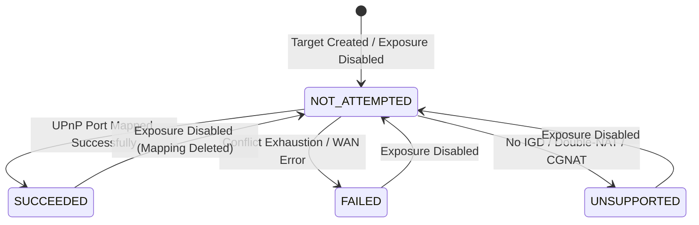
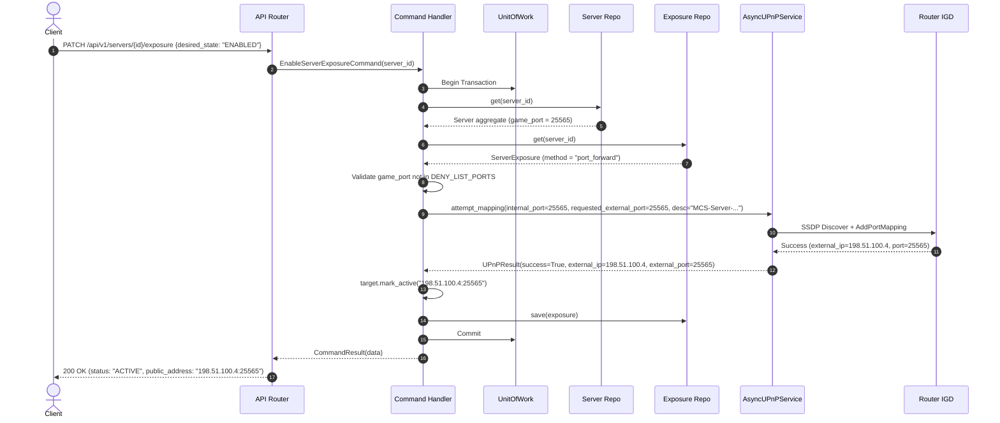
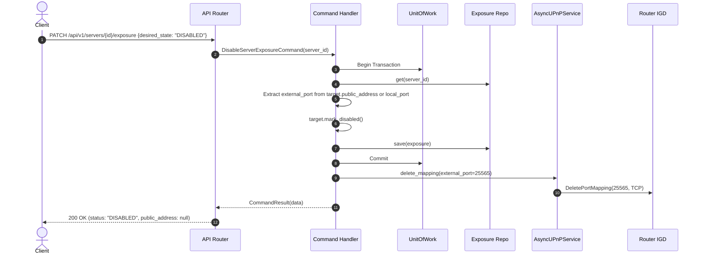

# MCS Manager — Phase 7.3b Design Specification
**Backend: Port Forwarding / UPnP for Game Servers**

**Author:** Senior Systems Architect  
**Status:** DESIGN READY FOR INDEPENDENT REVIEW  
**Governing Document:** [`docs/roadmap/MCS-Manager-Phase7-Network-Access-Roadmap-v3.1.md`](file:///mnt/D/files/server_manger/docs/roadmap/MCS-Manager-Phase7-Network-Access-Roadmap-v3.1.md) (§7, §8, §10 Batch 7.3b)  
**Parent Blueprint:** [`docs/roadmap/MCS-Manager-Engineering-Blueprint-V5.md`](file:///mnt/D/files/server_manger/docs/roadmap/MCS-Manager-Engineering-Blueprint-V5.md)

---

## 1. Scope and Boundary

### 1.1 Objective
Implement UPnP / Port Forwarding mechanics for game server exposure targets (`ExposureMethod.PORT_FORWARD` / `"port_forward"`), providing single-action router discovery, external IP retrieval, CGNAT/Double-NAT detection, bounded alternate-port conflict retry, and strict server-side deny-list enforcement.

### 1.2 In-Scope
1. **Game Server Port Forwarding:** Enabling/disabling UPnP mappings for game server targets (`service_type="java"`, `protocol="tcp"`).
2. **Single-Action Discovery & Mapping:** Reusing and wiring [`AsyncUPnPService`](file:///mnt/D/files/server_manger/backend/app/modules/exposure/infrastructure/upnp.py) into game server command handlers.
3. **Four-State UPnP Result Vocabulary:** `NOT_ATTEMPTED`, `SUCCEEDED`, `FAILED`, `UNSUPPORTED`.
4. **Bounded Alternate-Port Conflict Retry:** Bounded 3-attempt alternate port sequence (`port`, `port+1`, `port+2`, `port+3`) on router port collision.
5. **Double-NAT / CGNAT Detection:** Automatic detection of RFC 1918 private ranges (`10.0.0.0/8`, `172.16.0.0/12`, `192.168.0.0/16`) and RFC 6598 CGNAT (`100.64.0.0/10`), returning graceful failure and fallback guidance toward playit.gg.
6. **Strict Server-Side Deny-List:** Mandatory rejection of RCON (`25575`), Database (`3306`, `5432`, `6379`, `27017`), Metrics/Prometheus (`9090`, `9100`), and Panel internal bind port.
7. **Port Ownership & Invariant Validation:** Enforcement that `local_port == ServerModel.port`. Arbitrary user-entered ports are strictly rejected.
8. **Lifecycle & Teardown:** Automated mapping cleanup (`delete_port_mapping`) on server disable, exposure deletion, or instance-wide stop.
9. **Hermetic Testing:** Comprehensive test suite validating conflict retry, deny-list rejection, Double-NAT detection, and teardown with hermetic mocks (`SAFE_SENTINEL_PID = 99999`).

### 1.3 Out-of-Scope (Preserved Boundaries)
- **Panel UPnP Exposure:** Already implemented and verified in Batch 7.2b.
- **Batch 7.3c (Cloudflare TCP):** Advanced TCP game tunnels with client tokens remain in Batch 7.3c.
- **Batch 7.3d (UDP / Bedrock & Companion Ports):** UDP targets and companion port allow-lists remain deferred to Batch 7.3d.
- **Frontend UI (Batches 7.4 & 7.5):** Web UI components and forms remain in Batches 7.4/7.5.
- **Phase 8 (Dynamic DNS):** DNS automation and custom domain routing remain in Phase 8.

---

## 2. Verified Existing Architecture

To ground this design strictly in code reality, all architectural claims are classified into:
- **`[VERIFIED FACT]`**: Confirmed via codebase inspection.
- **`[DESIGN DECISION]`**: Specified architecturally for Batch 7.3b.
- **`[INFERENCE]`**: Derived logically from architectural invariants.
- **`[OPEN EXTERNAL VERIFICATION]`**: Dependent on external runtime/router behavior.

| Component | Status | Classification | Evidence / Details |
|---|---|---|---|
| `AsyncUPnPService` | **Built & Live** | `[VERIFIED FACT]` | [`backend/app/modules/exposure/infrastructure/upnp.py`](file:///mnt/D/files/server_manger/backend/app/modules/exposure/infrastructure/upnp.py). Built with `aioupnp`, 3s SSDP timeout, Double-NAT detection, 3-attempt alternate port retry, and `delete_mapping`. |
| `DENY_LIST_PORTS` | **Built & Live** | `[VERIFIED FACT]` | [`backend/app/modules/exposure/domain/aggregate.py:30-40`](file:///mnt/D/files/server_manger/backend/app/modules/exposure/domain/aggregate.py#L30-L40). Frozenset containing `{25575, 3306, 5432, 6379, 27017, 9090, 9100}`. |
| `ServerExposure` Aggregate | **Built & Live** | `[VERIFIED FACT]` | [`backend/app/modules/exposure/domain/aggregate.py:334-450`](file:///mnt/D/files/server_manger/backend/app/modules/exposure/domain/aggregate.py#L334-L450). Validates `local_port == server_port` and deny-list. |
| `ServerExposureTarget` Model | **Built & Live** | `[VERIFIED FACT]` | [`backend/app/modules/exposure/infrastructure/models.py:46-72`](file:///mnt/D/files/server_manger/backend/app/modules/exposure/infrastructure/models.py#L46-L72). Schema at head `b1e2100000003`. Columns: `local_port`, `public_address`, `status`, `error_code`, `error_message`. |
| `ExposureMethod.PORT_FORWARD` | **Built & Live** | `[VERIFIED FACT]` | [`backend/app/modules/exposure/domain/value_objects.py:33`](file:///mnt/D/files/server_manger/backend/app/modules/exposure/domain/value_objects.py#L33). `PORT_FORWARD = "port_forward"`. |
| Game Port Source | **Built & Live** | `[VERIFIED FACT]` | `server.properties.port.value` via `SQLServerRepository(session).get(server_id)`. |
| Public Address Format | **New for 7.3b** | `[DESIGN DECISION]` | Formatted as raw `{external_ip}:{external_port}` (e.g. `198.51.100.4:25565`) without `http://` scheme for Minecraft Java client compatibility. |
| UPnP Router Description | **New for 7.3b** | `[DESIGN DECISION]` | Description formatted as `"MCS-Server-{server_id[:8]}"` for easy operator identification in router mapping tables. |

---

## 3. UPnP Domain Model

### 3.1 Domain Inputs and Invariants
- **`server_id`**: Valid UUID identifying the target game server.
- **`local_port`**: Must strictly equal `server.properties.port.value`.
- **`requested_external_port`**: Defaults to `local_port`.
- **`protocol`**: Strictly `TargetProtocol.TCP` (`"tcp"`).
- **`service_type`**: Strictly `ServiceType.JAVA` (`"java"`).
- **`description`**: `"MCS-Server-{server_id[:8]}"`.

### 3.2 Four-State Result Vocabulary

The roadmap defines a clean four-state status vocabulary for UPnP operations:



1. **`NOT_ATTEMPTED`**:
   - Initial state when server exposure is `DISABLED`.
   - No router interaction has occurred.
   - Target `status = DISABLED`, `public_address = null`, `error_code = null`.
2. **`SUCCEEDED`**:
   - IGD router discovered, valid public WAN IP obtained, port mapping registered.
   - Target `status = ACTIVE`, `public_address = "{external_ip}:{external_port}"`, `error_code = null`.
   - Aggregate `aggregate_status = ACTIVE`.
3. **`FAILED`**:
   - Router reachable, but port mapping rejected due to exhaustion of 3 alternate ports (`PORT_CONFLICT`) or router SOAP fault.
   - Target `status = ERROR`, `public_address = null`, `error_code = "PORT_CONFLICT"` or `"MAPPING_FAILED"`.
   - Aggregate `aggregate_status = ERROR`.
4. **`UNSUPPORTED`**:
   - No UPnP IGD found on network (SSDP timeout), UPnP disabled in router settings, or Double-NAT / CGNAT detected.
   - Target `status = ERROR`, `public_address = null`, `error_code = "UPNP_UNSUPPORTED"` or `"DOUBLE_NAT_DETECTED"`.
   - Provides user guidance to use playit.gg.

---

## 4. `aioupnp` Integration Contract

Batch 7.3b leverages the existing [`AsyncUPnPService`](file:///mnt/D/files/server_manger/backend/app/modules/exposure/infrastructure/upnp.py) in `backend/app/modules/exposure/infrastructure/upnp.py`.

### 4.1 Interface Specification

```python
class AsyncUPnPService:
    def __init__(self, timeout: int = 3) -> None: ...

    async def attempt_mapping(
        self,
        internal_port: int,
        requested_external_port: int,
        description: str,
        protocol: str = "TCP",
    ) -> UPnPResult: ...

    async def delete_mapping(
        self,
        external_port: int,
        protocol: str = "TCP",
    ) -> bool: ...

    @staticmethod
    def is_private_or_cgnat(ip_str: str) -> bool: ...

    @staticmethod
    def validate_external_port(port: int) -> tuple[bool, str | None, str | None]: ...
```

### 4.2 Error Mapping Table

| `aioupnp` Condition / Exception | Service Error Code | Target Status | Fix Hint Returned |
|---|---|---|---|
| `TimeoutError` during SSDP discovery | `UPNP_UNSUPPORTED` | `ERROR` | "Enable UPnP in your router settings or use playit.gg." |
| Empty / Invalid external IP | `UPNP_UNSUPPORTED` | `ERROR` | "Ensure router WAN connection is active and UPnP is enabled." |
| External IP is RFC1918 / RFC6598 | `DOUBLE_NAT_DETECTED` | `ERROR` | "Your router is behind Double-NAT or CGNAT; use playit.gg to expose your server." |
| Conflict on all 4 port attempts | `PORT_CONFLICT` | `ERROR` | "Requested port and adjacent alternate ports are already mapped or rejected by router." |
| Deny-listed port requested | `DENY_LIST_VIOLATION` | `ERROR` | "Port {port} is reserved for internal services and cannot be exposed." |
| Port outside 1..65535 | `INVALID_PORT` | `ERROR` | "External port must be between 1 and 65535." |

---

## 5. Port Validation Contract

### 5.1 Invariant Enforcement Rules
1. **Registered Game Port Match:**
   `target.local_port` MUST equal `server.properties.port.value`.
   - If a caller attempts to create or enable a target with a different local port, the command handler rejects the operation with `ValidationError("local_port must equal the server's game port ({server_port})")` (HTTP 422).
2. **Deny-List Defense-in-Depth:**
   `target.local_port` and `target.external_port` must not exist in `DENY_LIST_PORTS`.
3. **Java/TCP Exclusivity (v1 Scope):**
   `protocol` must be `"tcp"`, `service_type` must be `"java"`.
4. **No Arbitrary Port Creation:**
   `POST /api/v1/servers/{server_id}/exposure/targets` derives the port automatically from `ServerModel.port` if omitted, and rejects mismatches if provided.

---

## 6. Deny-List Contract

### 6.1 Protected Services & Port Rationale

The deny-list protects critical internal and infrastructure ports from accidental or malicious WAN exposure:

| Port | Service | Risk if Exposed over WAN |
|---|---|---|
| `25575` | Minecraft RCON | Remote command injection / server takeover |
| `3306` | MySQL / MariaDB | Database brute-force and data exfiltration |
| `5432` | PostgreSQL | Database brute-force and data exfiltration |
| `6379` | Redis | Unauthenticated memory inspection / remote execution |
| `27017` | MongoDB | Database unauthorized access |
| `9090` | Prometheus | Metrics scraping / infrastructure topology leak |
| `9100` | Node Exporter | Host system telemetry disclosure |
| *Active Panel Bind* | Panel HTTP API | Unauthenticated registration / administrative surface |

### 6.2 Three-Layer Enforcement Boundary

```mermaid
flowchart TD
    A[API Router Layer] -->|Validate schema & bounds| B[Application Command Layer]
    B -->|Query ServerModel.port & check DENY_LIST_PORTS| C[Domain Aggregate Layer]
    C -->|validate_target_port() invariant check| D[Infrastructure UPnP Layer]
    D -->|validate_external_port() before router SOAP call| E[Router IGD]
```

1. **Router/API Boundary:** Validates request schema and numeric port bounds (1..65535).
2. **Application Command Layer:** Compares against `server.properties.port` and `DENY_LIST_PORTS`. Rejects direct API bypass attempts with HTTP 422.
3. **Domain Aggregate Layer:** `ServerExposure.validate_target_port()` asserts invariant on aggregate creation and mutation.
4. **Infrastructure Service Layer:** `AsyncUPnPService.validate_external_port()` checks target port before any SSDP/SOAP packet is sent.

---

## 7. Mapping Lifecycle

### 7.1 Enable Flow (`EnableServerExposureCommand` / `SetServerExposureCommand`)



### 7.2 Disable Flow (`DisableServerExposureCommand`)



### 7.3 Reconcile Flow (`ReconcileExposureCommand`)
- If `exposure.desired_state == ENABLED` and `exposure.method == PORT_FORWARD`:
  - Verify that target is `ACTIVE`.
  - If target is `ERROR` or router was rebooted: Re-attempt UPnP mapping.
  - If re-attempt succeeds: update `public_address` and mark `ACTIVE`.
  - If re-attempt fails: mark `ERROR` with appropriate `error_code`.

---

## 8. Bounded Conflict Retry Strategy

### 8.1 Algorithm Specification
When a router reports that a requested external port is already in use (SOAP `ConflictInMappingEntry` / fault code 718 or generic mapping exception), MCS Manager automatically attempts adjacent alternate ports in a deterministic, bounded sequence:

```python
MAX_ALTERNATE_PORT_ATTEMPTS = 3

target_port = requested_external_port
auto_fixed = False
fix_hint = None

for attempt in range(MAX_ALTERNATE_PORT_ATTEMPTS + 1):  # Attempts: base, base+1, base+2, base+3
    valid, _, _ = validate_external_port(target_port)
    if not valid:
        target_port += 1
        continue

    try:
        await upnp.add_port_mapping(
            external_port=target_port,
            protocol="TCP",
            internal_port=internal_port,
            lan_address=lan_address,
            description=f"MCS-Server-{server_id[:8]}",
        )
        if attempt > 0:
            auto_fixed = True
            fix_hint = f"Port {requested_external_port} was unavailable; automatically mapped to alternate port {target_port}."
        return UPnPResult(
            success=True,
            external_ip=external_ip,
            external_port=target_port,
            internal_port=internal_port,
            auto_fixed=auto_fixed,
            fix_hint=fix_hint,
        )
    except Exception as exc:
        logger.warning("Port mapping attempt %d for port %d failed: %s", attempt + 1, target_port, exc)
        target_port += 1

return UPnPResult(
    success=False,
    external_ip=external_ip,
    error_code="PORT_CONFLICT",
    error_message=f"Requested port {requested_external_port} and adjacent alternate ports are already mapped or rejected by router.",
    fix_hint="Specify an alternate external port manually or use playit.gg.",
)
```

---

## 9. Double-NAT & CGNAT Detection

### 9.1 Detection Logic
After retrieving `external_ip` from the router via `upnp.get_external_ip()`, `AsyncUPnPService.is_private_or_cgnat(external_ip)` validates the address against known non-public subnets:

```python
_CGNAT_NET = ipaddress.ip_network("100.64.0.0/10")

def is_private_or_cgnat(ip_str: str) -> bool:
    try:
        addr = ipaddress.ip_address(ip_str.strip())
        return (
            addr.is_private          # RFC 1918 (10.0.0.0/8, 172.16.0.0/12, 192.168.0.0/16)
            or addr.is_loopback      # 127.0.0.0/8
            or addr.is_link_local    # 169.254.0.0/16
            or addr in _CGNAT_NET    # RFC 6598 (100.64.0.0/10)
        )
    except ValueError:
        return True
```

### 9.2 Fallback Guidance
When Double-NAT or CGNAT is detected:
- Target status is set to `ERROR`.
- `error_code` is set to `"DOUBLE_NAT_DETECTED"`.
- `error_message` informs the user: *"Your router is behind Double-NAT or CGNAT; port forwarding cannot reach the public Internet."*
- `fix_hint` directs the user: *"Use playit.gg to expose your game server without a public IP."*

---

## 10. API and RBAC Specification

All game server exposure endpoints reuse existing permissions registered in [`contracts/permissions.yaml`](file:///mnt/D/files/server_manger/contracts/permissions.yaml):

| Endpoint | Method | Permission Dependency | Behavior for `PORT_FORWARD` |
|---|---|---|---|
| `/api/v1/servers/{server_id}/exposure` | `GET` | `require_exposure_grant("server.{id}.exposure.view")` | Returns server exposure details, aggregate status, and targets |
| `/api/v1/servers/{server_id}/exposure` | `PUT` | `require_exposure_grant("server.{id}.exposure")` | Updates method to `port_forward` and/or desired state. If `desired_state=ENABLED`, executes UPnP mapping attempt |
| `/api/v1/servers/{server_id}/exposure` | `PATCH` | `require_exposure_grant("server.{id}.exposure")` | Toggles `desired_state` (`ENABLED` $\to$ UPnP map, `DISABLED` $\to$ UPnP delete) |
| `/api/v1/servers/{server_id}/exposure` | `DELETE` | `require_exposure_grant("server.{id}.exposure")` | Deletes exposure aggregate and triggers UPnP mapping cleanup |
| `/api/v1/servers/{server_id}/exposure/targets` | `GET` | `require_exposure_grant("server.{id}.exposure.view")` | Lists server exposure targets |
| `/api/v1/servers/{server_id}/exposure/targets` | `POST` | `require_exposure_grant("server.{id}.exposure")` | Creates Java target with `local_port=ServerModel.port` |

---

## 11. Concurrency and Idempotency

1. **Transactional Unit of Work:** All database aggregate updates occur within `UnitOfWork(self._event_bus)`.
2. **Post-Commit Router Execution:** Router mapping deletions and asynchronous UPnP network calls execute in `post_commit` callbacks or handlers after DB commit to avoid holding database transactions during SSDP/SOAP network waits.
3. **Idempotent Enable:** If a server exposure with `method=port_forward` is already `ACTIVE` and mapped, a repeated `enable` call re-verifies the mapping and returns the active state without duplicate error.
4. **Idempotent Disable:** Calling disable on an already `DISABLED` exposure is a safe no-op.
5. **No Cross-Server Collision:** Each server uses its own distinct game port and server ID description, preventing inadvertent deletion of other servers' mappings.

---

## 12. Persistence & Migration Decision

### 12.1 Schema Assessment
The existing schema generated in Alembic revision `b1e2100000001` and updated in `b1e2100000003` contains:

- `server_exposure`:
  - `id` (VARCHAR(36), PK)
  - `server_id` (VARCHAR(36), FK, UNIQUE)
  - `method` (VARCHAR(16))
  - `desired_state` (VARCHAR(16))
  - `aggregate_status` (VARCHAR(32))
- `server_exposure_target`:
  - `id` (VARCHAR(36), PK)
  - `exposure_id` (VARCHAR(36), FK)
  - `protocol` (VARCHAR(8))
  - `service_type` (VARCHAR(16))
  - `local_port` (INTEGER)
  - `public_address` (VARCHAR(512))
  - `status` (VARCHAR(32))
  - `error_code` (VARCHAR(64))
  - `error_message` (TEXT)

### 12.2 Migration Verdict
> **No migration required.**

All necessary fields (`local_port`, `public_address`, `status`, `error_code`, `error_message`, `method`, `desired_state`) are already present and fully typed in the production database. The public address field stores the `{external_ip}:{external_port}` tuple, which satisfies all runtime and query requirements.

---

## 13. Error Model

| Error Code | HTTP Status | Trigger Condition | Error Message |
|---|---|---|---|
| `NO_TARGETS` | 422 | Enabling exposure with 0 targets | "Cannot enable exposure with no targets configured." |
| `DENY_LIST_VIOLATION` | 422 | Server port is in `DENY_LIST_PORTS` | "Port {port} is reserved for internal services and cannot be exposed." |
| `INVALID_PORT` | 422 | Port outside 1..65535 | "Port must be between 1 and 65535." |
| `PORT_MISMATCH` | 422 | `local_port != ServerModel.port` | "Target port ({port}) does not match server game port ({server_port})." |
| `UPNP_UNSUPPORTED` | 200 (Aggregate ERROR) | SSDP discovery timeout / UPnP disabled | "UPnP is disabled or not supported by your local router." |
| `DOUBLE_NAT_DETECTED` | 200 (Aggregate ERROR) | External IP is RFC1918 / RFC6598 | "Your router is behind Double-NAT or CGNAT; port forwarding cannot reach the public Internet." |
| `PORT_CONFLICT` | 200 (Aggregate ERROR) | All 4 alternate ports in use | "Requested port {port} and adjacent alternate ports are already mapped or rejected by router." |

---

## 14. Test Design & Test Safety

### 14.1 Mandatory Test Safety Rules
- **No Real Network Discovery:** All `aioupnp` calls must be hermetically mocked (`AsyncMock` / `patch("aioupnp.upnp.UPnP")`).
- **No Real Signals:** Autouse signal mock fixture with `SAFE_SENTINEL_PID = 99999` patching `os.kill`, `os.killpg`, and `os.getpgid`.
- **Async Resource Teardown:** All event loops and tasks must complete cleanly without dangling background coroutines.

### 14.2 Required Test Matrix (24 Test Cases)

1. `test_server_upnp_mapping_success`: Valid server port (25565) mapped to external IP `198.51.100.4:25565`, status becomes `ACTIVE`.
2. `test_server_upnp_unsupported_router`: SSDP timeout returns `UPNP_UNSUPPORTED`, status becomes `ERROR`, hint points to playit.gg.
3. `test_server_upnp_discovery_timeout`: Discovery TimeoutError caught and mapped cleanly.
4. `test_server_upnp_external_ip_failure`: Router returns empty external IP; mapped to `UPNP_UNSUPPORTED`.
5. `test_server_upnp_conflict_retry_success`: Port 25565 in use; automatically succeeds on alternate port 25566 with `auto_fixed=True`.
6. `test_server_upnp_all_alternate_ports_exhausted`: Ports 25565..25568 all fail; returns `PORT_CONFLICT`.
7. `test_server_upnp_external_ip_reporting`: Public address strictly formatted as `{ip}:{port}` (no http scheme).
8. `test_server_upnp_rfc1918_private_ip_detection`: External IP `192.168.1.1` triggers `DOUBLE_NAT_DETECTED`.
9. `test_server_upnp_rfc6598_cgnat_detection`: External IP `100.64.0.1` triggers `DOUBLE_NAT_DETECTED`.
10. `test_server_upnp_deny_list_rcon`: Port 25575 rejected with `ValidationError` / HTTP 422.
11. `test_server_upnp_deny_list_management`: Internal API port rejected.
12. `test_server_upnp_deny_list_db`: DB ports (3306, 5432, 6379, 27017) rejected.
13. `test_server_upnp_deny_list_metrics`: Metrics ports (9090, 9100) rejected.
14. `test_server_upnp_deny_list_panel_port`: Active panel bind port rejected.
15. `test_server_upnp_arbitrary_port_api_bypass`: Direct POST/PUT target with non-game port rejected.
16. `test_server_upnp_wrong_protocol`: Target with protocol `"udp"` rejected in v1.
17. `test_server_upnp_wrong_service_type`: Target with service_type `"bedrock"` rejected in v1.
18. `test_server_upnp_local_port_mismatch`: `local_port != ServerModel.port` rejected.
19. `test_server_upnp_repeated_enable_idempotency`: Enabling already active port_forward returns active state without error.
20. `test_server_upnp_disable_cleanup`: Disabling exposure calls `delete_port_mapping` with external port.
21. `test_server_upnp_reconcile_missing_mapping`: Reconcile re-applies mapping if router rebooted.
22. `test_server_upnp_concurrent_enable`: Simultaneous enable calls share transaction safely.
23. `test_server_upnp_server_port_change`: Changing `ServerModel.port` invalidates stale target or triggers re-mapping.
24. `test_server_upnp_restart_recovery`: Server manager restart maintains `desired_state=ENABLED` and re-establishes mapping on reconcile.

---

## 15. Security Review in Design

1. **No Arbitrary Port Forwarding:** The backend strictly restricts UPnP port forwarding to the server's single registered game port. Users cannot forward arbitrary ports.
2. **Zero Privileged Port Leakage:** RCON and all management/internal ports are rejected at 3 distinct validation layers.
3. **No Unauthenticated External IP Disclosure:** `GET /api/v1/servers/{server_id}/exposure` requires `server.{id}.exposure.view` permission grant. External IP is not visible to unauthenticated or unauthorized users.
4. **No Cross-Server Interference:** Port mappings are tagged with `"MCS-Server-{server_id[:8]}"` and cleanup operates strictly on the specific server's external port.
5. **No Silent Exposure:** `desired_state` defaults to `DISABLED`. Explicit user opt-in is required before any router mapping is requested.

---

## 16. Findings Ledger

| ID | Finding / Decision | Classification | Documentation Location | Code/Test Impact | Status |
|---|---|---|---|---|---|
| **F-73B-01** | `AsyncUPnPService` Full Reuse for Game Servers | `[VERIFIED FACT]` | [`upnp.py`](file:///mnt/D/files/server_manger/backend/app/modules/exposure/infrastructure/upnp.py) | Reuses `AsyncUPnPService` directly in game server exposure commands without code duplication. | ✅ Documented |
| **F-73B-02** | No Database Migration Required for 7.3b | `[DESIGN DECISION]` | Section 12 | `ServerExposureTargetModel` schema already supports all UPnP target fields. | ✅ Documented |
| **F-73B-03** | Public Address Formatting Divergence (Game vs Panel) | `[DESIGN DECISION]` | Section 2, Section 7 | Game server UPnP returns `{ip}:{port}` (Minecraft client format), unlike Panel which returns `http://{ip}:{port}`. | ✅ Documented |
| **F-73B-04** | Single Registered Game Target Enforcement | `[DESIGN DECISION]` | Section 5, Section 6 | Target `local_port` must strictly equal `ServerModel.port` in v1; arbitrary target creation rejected with 422. | ✅ Documented |

---

## 17. Implementation Boundary for Builder

When the implementation prompt is issued:
- **Files to Modify:**
  - `backend/app/modules/exposure/application/commands.py`: Wire `AsyncUPnPService` mapping attempt in `EnableServerExposureHandler`, `SetServerExposureHandler`, `DisableServerExposureHandler`, `RemoveServerExposureHandler`, `StopAllExposuresHandler`, and `ReconcileExposureHandler`.
  - `backend/app/modules/exposure/domain/aggregate.py`: Ensure target state transitions for UPnP (`STARTING` $\to$ `ACTIVE` / `ERROR`) are seamless.
- **Files to Create:**
  - `backend/tests/application/test_server_upnp_commands.py`: Implement the 24 required hermetic UPnP test cases.
- **Files to NOT Modify:**
  - No migrations (No schema change).
  - No frontend files (Batch 7.4/7.5).
  - No playit supervisor architecture (Batch 7.3a completed).
  - No Cloudflare TCP or UDP/Bedrock files (Batch 7.3c/7.3d).

---

## 18. Acceptance Criteria

1. `ExposureMethod.PORT_FORWARD` fully orchestrated for game servers.
2. Single-action discover, validate, and mapping with 3-attempt alternate port retry on collision.
3. Four-state vocabulary (`NOT_ATTEMPTED`, `SUCCEEDED`, `FAILED`, `UNSUPPORTED`) reflected accurately in target/aggregate status.
4. Server-side deny-list strictly enforced for RCON, management, DB, and metrics ports.
5. Target `local_port` validated against `ServerModel.port`.
6. Double-NAT & CGNAT detected and reported with playit.gg fallback hint.
7. Mappings cleanly deleted on disable, delete, and stop-all.
8. 24 new hermetic unit/application tests passing with zero process signal hazards.
9. Full regression suite (1,722+ tests) passes without regression.
10. Route and permission contract passes with 100/100 matching entries.

---

## 19. Open External-Verification Items

1. **Router Mapping Expiry & Lease Times:**  
   *Classification:* `[OPEN EXTERNAL VERIFICATION]`  
   *Note:* Certain consumer routers reset UPnP port mappings after 24 hours or on reboot. MCS Manager handles this via the periodic/manual `ReconcileExposureCommand`, which tests and re-establishes mappings if `desired_state == ENABLED`. No blocking code change needed for v1.

---

*End of Design Specification for Batch 7.3b.*
