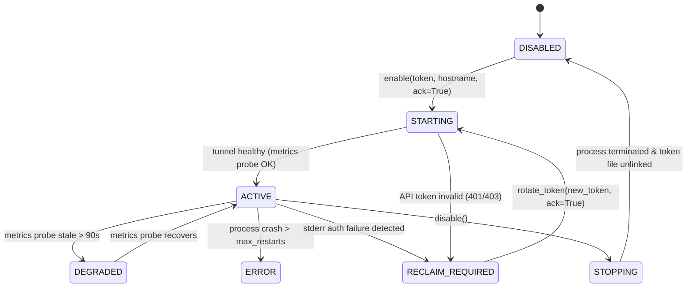

# MCS Manager — Phase 7.3c Design Specification
# Backend: Cloudflare TCP (Advanced) for Game Servers

**Authoritative Governing Plan:** `docs/roadmap/MCS-Manager-Phase7-Network-Access-Roadmap-v3.1.md` (§6b, §10 Batch 7.3c)  
**Status:** DESIGN ONLY — PENDING INDEPENDENT REVIEW  
**Date:** 2026-08-15  
**Version:** 1.0.0  

---

## 1. Scope and Boundary

### 1.1 Objective
Implement the advanced, optional Cloudflare TCP exposure path for Minecraft game servers (`ExposureMethod.CLOUDFLARE_TCP`), strictly gated behind mandatory server-side player-connectivity warning enforcement, robust AES-GCM credential encryption, deterministic `RECLAIM_REQUIRED` handling for revoked tokens, and isolated `cloudflared` child subprocess supervision.

### 1.2 In-Scope
1. **Game Server Cloudflare TCP Exposure:** `ExposureMethod.CLOUDFLARE_TCP` (`"cloudflare_tcp"`) for game servers.
2. **Java TCP v1 Scope:** `service_type == "java"`, `protocol == "tcp"`, `local_port == ServerModel.port`.
3. **Mandatory Player Warning Enforcement:** Server-side verification of `acknowledged_warning: bool` on enable / token intake; direct API bypass prevention returning HTTP 422 `WARNING_NOT_ACKNOWLEDGED`.
4. **Credential Security:** Token intake via `CloudflareClient`, encrypted storage using AES-GCM (`BackupEncryption`), zero plaintext storage, zero token leakage in API responses, logging, or subprocess argv (`--token-file` only).
5. **Orchestrated `cloudflared` Child Subprocess:** Per-server supervisor registry with isolated token files (0o600), stdout/stderr monitoring for auth failures, health metrics probes, bounded restart backoff, and clean process tree termination.
6. **DNS CNAME Lifecycle:** Creation of a single CNAME record (`hostname -> <tunnel_id>.cfargotunnel.com`) scoped strictly to the tunnel.
7. **Deterministic State Machine:** Full integration with Phase 7 state machine (`DISABLED`, `STARTING`, `ACTIVE`, `DEGRADED`, `ERROR`, `RECLAIM_REQUIRED`) and aggregate precedence fold.
8. **Hermetic Test Suite:** 24+ isolated tests mocking `CloudflareClient`, `cloudflared` subprocess, and OS signals (`SAFE_SENTINEL_PID = 99999`).

### 1.3 Out-of-Scope (Hard Boundaries)
- **Panel Exposure (Batch 7.2a/7.2b):** Panel Named Tunnel and Panel UPnP/playit remain entirely separate and unmodified.
- **Game Server playit.gg Host Agent (Batch 7.3a):** Unmodified; playit remains the primary recommended method.
- **Game Server UPnP (Batch 7.3b):** Unmodified; port forwarding remains the secondary method.
- **Bedrock / UDP / Companion Services (Batch 7.3d):** Out of scope; Java TCP v1 only.
- **Frontend UI (Batches 7.4 & 7.5):** All UI components, advisory banners, and forms belong to subsequent frontend batches.
- **General DNS Management (Phase 8):** No custom DNS records, SRV records, A/AAAA records, or zone management products.

---

## 2. Existing Cloudflare Infrastructure Reuse

### 2.1 Reusable Components from Batch 7.2a

| Component | Location | Reuse Strategy |
|---|---|---|
| **`CloudflareClient`** | [`backend/app/modules/exposure/infrastructure/cloudflare.py`](file:///mnt/D/files/server_manger/backend/app/modules/exposure/infrastructure/cloudflare.py) | **Full Reuse:** Reuses `create_named_tunnel`, `configure_ingress`, and `create_cname` with `tcp://127.0.0.1:{local_port}` target. |
| **`CloudflareAuthError` / `CloudflareApiError`** | [`backend/app/modules/exposure/infrastructure/cloudflare.py`](file:///mnt/D/files/server_manger/backend/app/modules/exposure/infrastructure/cloudflare.py) | **Full Reuse:** Mapped directly to `RECLAIM_REQUIRED` and `CLOUDFLARE_API_ERROR` respectively. |
| **AES-GCM Key & Encryption** | [`backend/app/modules/storage/encryption.py`](file:///mnt/D/files/server_manger/backend/app/modules/storage/encryption.py) | **Full Reuse:** Reuses `_panel_encryption()` (`BackupEncryption` with `load_or_create_backup_key`). Zero Fernet. |
| **`CloudflaredSupervisor` Core Logic** | [`backend/app/modules/exposure/infrastructure/cloudflared.py`](file:///mnt/D/files/server_manger/backend/app/modules/exposure/infrastructure/cloudflared.py) | **Architecture Reuse:** Extends/instantiates isolated per-server supervisors (`ServerCloudflaredSupervisor`) using the proven `--token-file`, stderr parsing, and metrics health check model. |
| **Auth Failure Markers** | [`backend/app/modules/exposure/infrastructure/cloudflared.py`](file:///mnt/D/files/server_manger/backend/app/modules/exposure/infrastructure/cloudflared.py) | **Full Reuse:** Matches `_AUTH_FAILURE_MARKERS` (`"unauthorized"`, `"invalid token"`, `"error code: 1033"`, etc.) for real-time `RECLAIM_REQUIRED` detection. |

### 2.2 Differences Between Panel and Game Server Cloudflare Exposure

| Aspect | Panel Exposure (Batch 7.2a) | Game Server TCP Exposure (Batch 7.3c) |
|---|---|---|
| **Traffic Protocol** | HTTP / HTTPS (Web browser) | Raw TCP (Minecraft wire protocol) |
| **Ingress Rule** | `{"hostname": h, "service": "http://127.0.0.1:8000"}` | `{"hostname": h, "service": f"tcp://127.0.0.1:{port}"}` |
| **Player / Client Software** | Standard web browser (zero extra software) | **Mandatory client connector:** `Modflared` client mod or local `cloudflared access tcp` |
| **Warning Enforcement** | None (direct HTTPS reachability) | **Mandatory server-side acknowledgement required** |
| **Process Model** | Single singleton supervisor for host panel | Registry of per-server supervisors (`server_id` isolation) |
| **Public Address Format** | `https://{hostname}` (or `http://`) | `{hostname}` (raw hostname, no scheme, no port) |
| **RBAC Surface** | `exposure.panel.manage` (Owner-only) | `server.{id}.exposure` (Owner/Grantee) |

---

## 3. Cloudflare TCP Domain Model

### 3.1 Aggregates and Relationships
1. **`ServerExposure` (Aggregate Root):**
   - Holds `server_id`, `method = ExposureMethod.CLOUDFLARE_TCP`, `desired_state`, `aggregate_status`.
   - Stores encrypted Cloudflare credentials for the server: `cloudflare_tunnel_id: str | None` and `cloudflare_token_ciphertext: bytes | None`.
   - Owns target lifecycle and port validation.
2. **`ServerExposureTarget` (Entity):**
   - Holds `local_port == ServerModel.port`, `service_type == ServiceType.JAVA`, `protocol == TargetProtocol.TCP`.
   - Holds `public_address == hostname` (e.g., `"mc.example.com"`).
   - Holds `status`, `error_code`, `error_message`.

```
+-------------------------------------------------------------+
|                       ServerExposure                        |
|  - server_id: UUID                                          |
|  - method: ExposureMethod.CLOUDFLARE_TCP                    |
|  - desired_state: DesiredState (ENABLED / DISABLED)         |
|  - aggregate_status: ExposureStatus                         |
|  - cloudflare_tunnel_id: str | None                         |
|  - cloudflare_token_ciphertext: bytes | None (AES-GCM)      |
+-------------------------------------------------------------+
                              | 1
                              |
                              | owns 1..N (v1: exactly 1)
                              v
+-------------------------------------------------------------+
|                    ServerExposureTarget                     |
|  - service_type: ServiceType.JAVA                           |
|  - protocol: TargetProtocol.TCP                             |
|  - local_port: int (must equal ServerModel.port)            |
|  - public_address: str (hostname, e.g. "mc.example.com")    |
|  - status: ExposureStatus                                   |
|  - error_code: str | None                                   |
|  - error_message: str | None                                |
+-------------------------------------------------------------+
```

---

## 4. Credential / Encryption Design

### 4.1 Encryption Invariant
All Cloudflare API runner tokens are encrypted at rest using the project's standard AES-256-GCM cipher via `BackupEncryption` (`app.modules.storage.encryption`), seeded by the instance backup key file.
- **Key Derivation / Storage:** Master key loaded via `load_or_create_backup_key()` from `config/backup_key.bin` (0o600).
- **Ciphertext Storage:** Stored in `server_exposure.cloudflare_token_ciphertext` as raw encrypted bytes with randomized 12-byte IV prepended.
- **Zero Plaintext Invariant:**
  - Plaintext tokens are never stored in any database column.
  - Plaintext tokens are never returned in REST API responses (`GET /servers/{id}/exposure` returns `has_cloudflare_credentials: bool`, never the token).
  - Plaintext tokens are never written to server logs.
  - Plaintext tokens are never passed via command line arguments (`--token` is strictly forbidden; only `--token-file` is permitted).

### 4.2 Credential Removal and Rotation
- **Rotation:** Providing a new `cloudflare_token` on an existing exposure replaces the encrypted ciphertext in-place and restarts the supervisor child.
- **Removal:** Disabling or deleting the exposure cleans up the `cloudflared` supervisor process and unlinks the temporary token file immediately.

---

## 5. Player Connection Contract

### 5.1 Technical Architecture of Cloudflare TCP Tunnels
Unlike HTTP traffic, Cloudflare's standard Zero Trust / Argo Tunnels do not terminate raw TCP connections on arbitrary ports at their edge for general domain names.
Instead, Cloudflare encapsulates the TCP stream over WebSockets/TLS on port 443 of the specified hostname.

```
+-------------------+                      +-----------------------+                      +---------------------+
|  Minecraft Client |                      |   Cloudflare Edge     |                      |  MCS Host Machine   |
|                   |                      |   (mc.example.com)    |                      |                     |
|  [Modflared Mod]  | === WebSocket/TLS == |   (Port 443 Ingress)  | === Named Tunnel === | [cloudflared child] |
|        OR         |                      +-----------------------+                      |          |          |
| [cloudflared CLI] |                                                                     |  TCP 127.0.0.1:25565|
+-------------------+                                                                     v                     |
                                                                                          | [Minecraft Server]  |
                                                                                          +---------------------+
```

### 5.2 Public Address Format
- Public Address: `{hostname}` (e.g. `"mc.example.com"`).
- Scheme: None (no `http://` or `tcp://`).
- Port: None (client connects to standard 443 via connector).

### 5.3 Player-Side Requirements
To join the server, players MUST use one of two connection methods:
1. **Modflared Client Mod (Recommended for Players):** Install the `Modflared` mod (available on Modrinth/CurseForge for Fabric/Forge/NeoForge). Enter `mc.example.com` directly in the server list.
2. **Local cloudflared Client Daemon:** Run locally:
   ```bash
   cloudflared access tcp --hostname mc.example.com --url 127.0.0.1:25565
   ```
   Then connect Minecraft to `127.0.0.1:25565`.

---

## 6. Mandatory Warning Enforcement

### 6.1 Roadmap Requirement
> *"Cloudflare TCP is an advanced/optional game-server exposure path. It is NOT the recommended game-server method. Players must install Modflared or run cloudflared themselves. The warning must be enforced server-side, not merely shown in the UI."*

### 6.2 Mandatory Warning Text
```
"Players must install Modflared (or run cloudflared) to connect. This is not a normal public address."
```

### 6.3 Server-Side Enforcement Rules
1. **Request Schema:** All commands and API schemas that set `method == "cloudflare_tcp"` with `desired_state == "ENABLED"` require:
   ```json
   {
     "method": "cloudflare_tcp",
     "desired_state": "ENABLED",
     "cloudflare_token": "cf_token_...",
     "hostname": "mc.example.com",
     "acknowledged_warning": true
   }
   ```
2. **Validation Failure Semantics:**
   - If `method == ExposureMethod.CLOUDFLARE_TCP` and `desired_state == DesiredState.ENABLED` and `acknowledged_warning is not True`:
     - Command / API handler MUST reject the request immediately before any Cloudflare API call, tunnel creation, or database mutation.
     - HTTP Status: **422 Unprocessable Entity**.
     - Error Code: `WARNING_NOT_ACKNOWLEDGED`.
     - Error Message: `"Players must install Modflared (or run cloudflared) to connect. This is not a normal public address."`.
3. **Impossibility of Direct API Bypass:**
   - A direct API client, CLI tool, or third-party script cannot enable Cloudflare TCP without explicitly sending `acknowledged_warning: true`.
4. **Idempotency & Reconcile:**
   - If exposure is already `ENABLED` and `ACTIVE`, background reconciliation does not re-prompt.
   - Any mutating API call that enables, changes method to `cloudflare_tcp`, or rotates credentials MUST re-supply `acknowledged_warning: true`.

---

## 7. Cloudflare / cloudflared Lifecycle

### 7.1 Multi-Server Supervisor Registry
To prevent collisions between multiple game servers and the panel, MCS utilizes a supervisor registry:
`get_server_cloudflared_supervisor(server_id: str) -> CloudflaredSupervisor`.

Each supervisor instance maintains:
- Independent `_process: asyncio.subprocess.Process | None`
- Dedicated temporary token file: `_token_file: Path` (`/tmp/mcs-cf-srv-{server_id[:8]}-{uuid}.token`, permissions `0o600`)
- Independent stderr reader monitoring for `_AUTH_FAILURE_MARKERS`
- Independent metrics health polling (`127.0.0.1:20241..20245`)
- Bounded restart counter (max 5 restarts with exponential backoff 2s..32s)

### 7.2 Supervisor Lifecycle States


### 7.3 Token-File Hardening (VULN-118896)
- The token is NEVER passed via command line `--token <token>` (which leaks into `/proc/<pid>/cmdline` and `ps`).
- The token is written to a temporary file with `0o600` permissions and passed via `--token-file <path>`.
- The token file is unlinked immediately when the supervisor is stopped or terminates.

---

## 8. DNS / Hostname Boundary

### 8.1 Scoped CNAME Creation
The Cloudflare integration in Batch 7.3c performs exactly ONE DNS write operation per game server:
- `POST /zones/{zone_id}/dns_records`:
  - `type`: `"CNAME"`
  - `name`: `hostname` (e.g. `"mc.example.com"`)
  - `content`: `f"{tunnel_id}.cfargotunnel.com"`
  - `proxied`: `True`

### 8.2 Strict Phase 8 Boundary
- **No SRV Records:** No `_minecraft._tcp.example.com` SRV records created.
- **No A/AAAA Management:** No manual DNS record manipulation.
- **No Domain Registration / Zone Creation:** The zone must already exist in the user's Cloudflare account.
- **No DNS UI:** DNS management remains exclusively in Phase 8.

---

## 9. RECLAIM_REQUIRED

### 9.1 Trigger Conditions
The target and exposure aggregate transition to `ExposureStatus.RECLAIM_REQUIRED` when:
1. **Initial Provisioning Rejection:** Cloudflare API returns HTTP 401, 403, or error codes `10000` (Auth Error), `10001` (Expired), `9109` (Invalid Token).
2. **Runtime Upstream Revocation:** The running `cloudflared` process logs an authentication failure marker to stderr:
   `"unauthorized"`, `"invalid token"`, `"authentication failed"`, `"access token"`, `"tunnel token"`, `"error code: 1033"`.

### 9.2 Recovery Procedure
1. When in `RECLAIM_REQUIRED`, the supervisor stops the failing subprocess and clears the stale token file.
2. The user submits a new Cloudflare token via `PUT /servers/{id}/exposure` with `acknowledged_warning: true`.
3. In-place rotation re-encrypts the new token under the existing tunnel ID without re-creating tunnels or CNAME records.
4. If the new token is valid, status transitions `RECLAIM_REQUIRED -> STARTING -> ACTIVE`.
5. If the new token is still invalid, status remains `RECLAIM_REQUIRED`.

---

## 10. State Machine / Aggregate Integration

### 10.1 Target Status Vocabulary
- `DISABLED`: Exposure disabled; no active tunnel.
- `STARTING`: Named tunnel created; `cloudflared` process initializing.
- `ACTIVE`: Tunnel established and healthy; public hostname reachable.
- `DEGRADED`: Tunnel process alive but health probe unanswered for > 90s.
- `ERROR`: Process crashed repeatedly or non-auth Cloudflare API error.
- `RECLAIM_REQUIRED`: Token revoked or expired; user intervention required.

### 10.2 Aggregate Status Precedence
Computed deterministically via `_PRECEDENCE` fold:
```
RECLAIM_REQUIRED > CLAIM_REQUIRED > ERROR > DEGRADED > STOPPING > STARTING > ACTIVE > STOPPED
```
*Override:* If `desired_state == DesiredState.DISABLED`, aggregate status is always `ExposureStatus.DISABLED`.

---

## 11. API / RBAC

### 11.1 Route Contracts

#### 1. Set / Enable Server Exposure
- **Route:** `PUT /api/v1/servers/{server_id}/exposure`
- **Permission:** `server.{id}.exposure` (or server owner)
- **Request Body:**
  ```json
  {
    "method": "cloudflare_tcp",
    "desired_state": "ENABLED",
    "cloudflare_token": "cf_token_secret...",
    "hostname": "mc.example.com",
    "acknowledged_warning": true
  }
  ```
- **Responses:**
  - `200 OK`: Exposure configuration updated.
  - `422 Unprocessable Entity`: `WARNING_NOT_ACKNOWLEDGED` if `acknowledged_warning` is omitted or false.
  - `422 Unprocessable Entity`: `MISSING_HOSTNAME` or `MISSING_TOKEN`.
  - `403 Forbidden`: Insufficient permissions.

#### 2. Disable Server Exposure
- **Route:** `PATCH /api/v1/servers/{server_id}/exposure`
- **Request Body:** `{"desired_state": "DISABLED"}`
- **Response:** `200 OK` (supervisor stopped, mappings cleaned up).

#### 3. View Server Exposure
- **Route:** `GET /api/v1/servers/{server_id}/exposure`
- **Permission:** `server.{id}.exposure.view`
- **Response:**
  ```json
  {
    "server_id": "srv-123",
    "method": "cloudflare_tcp",
    "desired_state": "ENABLED",
    "aggregate_status": "ACTIVE",
    "has_cloudflare_credentials": true,
    "targets": [
      {
        "id": "tgt-456",
        "service_type": "java",
        "protocol": "tcp",
        "local_port": 25565,
        "public_address": "mc.example.com",
        "status": "ACTIVE",
        "error_code": null,
        "error_message": null
      }
    ]
  }
  ```

---

## 12. Concurrency / Idempotency

1. **Atomic State Transitions:** All domain state modifications execute inside `UnitOfWork` database transactions.
2. **Post-Commit Supervisor Dispatch:** `cloudflared` subprocess start/stop operations are registered in `post_commit` hooks, ensuring credentials are fully persisted to disk before process launch.
3. **Supervisor Spawn Lock:** `CloudflaredSupervisor.start()` uses an internal lock and checks `self.is_running` to guarantee idempotent start operations.
4. **Concurrent Enable Handling:** Consecutive enable calls with identical parameters return `200 OK` without spawning duplicate processes or creating duplicate Cloudflare tunnels.

---

## 13. Security Review

| Security Dimension | Threat | Mitigation |
|---|---|---|
| **Process Table Snooping** | Credential exposed in `ps` / `/proc` | Token passed via `--token-file` (0o600); never in argv. |
| **Credential Storage** | Plaintext token theft from SQLite DB | Token encrypted with AES-256-GCM (`BackupEncryption`). |
| **Direct API Bypass** | Script bypasses player warning in UI | Server-side validation rejects requests lacking `acknowledged_warning: true`. |
| **Arbitrary Port Exposure** | Attacker exposes port 22 or 3306 | Strict `local_port == ServerModel.port` and `DENY_LIST_PORTS` validation. |
| **Cross-Server IDOR** | User modifies another server's exposure | Server-scoped authorization dependency (`require_server_permission`). |
| **Process Leakage on Shutdown** | Zombie `cloudflared` processes | Supervisors tracked in registry and terminated cleanly on MCS shutdown. |

---

## 14. Persistence / Migration Decision

### 14.1 Schema Evaluation
In Batch 7.2a, `PanelExposureModel` received `cloudflare_tunnel_id` and `cloudflare_token_ciphertext` columns.
For `ServerExposureModel`, the table currently contains:
- `id`: String(36)
- `server_id`: String(36)
- `method`: String(16)
- `desired_state`: String(16)
- `aggregate_status`: String(32)

### 14.2 Migration Decision
To persist Cloudflare credentials per server exposure cleanly and securely, Batch 7.3c implementation will require an Alembic migration:
- **Migration ID:** `b1e2100000004_add_server_cloudflare_columns.py`
- **Columns Added to `server_exposure`:**
  1. `cloudflare_tunnel_id`: `sa.Column(sa.String(64), nullable=True)`
  2. `cloudflare_token_ciphertext`: `sa.Column(sa.LargeBinary(), nullable=True)`

*Note: In accordance with the DESIGN-ONLY boundary, no migration file is created during this batch. The migration will be created in the authorized implementation batch.*

---

## 15. Test Design

### 15.1 Acceptance Test Matrix (24 Mandatory Hermetic Tests)

| # | Test Name | Description |
|---|---|---|
| 1 | `test_server_cloudflare_tcp_enable_success` | Valid token and hostname with `acknowledged_warning: True` provisions tunnel and starts supervisor. |
| 2 | `test_server_cloudflare_tcp_warning_required` | Omission of `acknowledged_warning` raises HTTP 422 `WARNING_NOT_ACKNOWLEDGED`. |
| 3 | `test_server_cloudflare_tcp_warning_false_rejected` | Explicit `acknowledged_warning: False` raises HTTP 422 `WARNING_NOT_ACKNOWLEDGED`. |
| 4 | `test_server_cloudflare_tcp_repeated_enable_idempotent` | Sequential enable commands with identical parameters succeed idempotently. |
| 5 | `test_server_cloudflare_tcp_disable_cleanup` | Disabling exposure terminates supervisor child and unlinks token file. |
| 6 | `test_server_cloudflare_tcp_revoked_token_reclaim_required` | Stderr auth failure marker triggers transition to `RECLAIM_REQUIRED`. |
| 7 | `test_server_cloudflare_tcp_token_rotation_recovery` | Providing valid replacement token in `RECLAIM_REQUIRED` recovers to `ACTIVE`. |
| 8 | `test_server_cloudflare_tcp_invalid_replacement_remains_reclaim` | Providing invalid replacement token leaves status in `RECLAIM_REQUIRED`. |
| 9 | `test_server_cloudflare_tcp_token_never_in_api_response` | `GET /servers/{id}/exposure` returns `has_cloudflare_credentials: True` and zero token data. |
| 10 | `test_server_cloudflare_tcp_token_never_in_argv` | Subprocess command line contains `--token-file` and zero plaintext token arguments. |
| 11 | `test_server_cloudflare_tcp_public_address_format` | Target `public_address` is formatted as `{hostname}` (no `http://`, no port). |
| 12 | `test_server_cloudflare_tcp_java_tcp_only_enforced` | Target creation enforces `service_type == "java"` and `protocol == "tcp"`. |
| 13 | `test_server_cloudflare_tcp_arbitrary_port_rejected` | Local port mismatching `ServerModel.port` is rejected with `InvalidValueError`. |
| 14 | `test_server_cloudflare_tcp_deny_list_ports_rejected` | Deny-listed ports (25575, 3306, 5432, 6379, 27017, 9090, 9100) are rejected. |
| 15 | `test_server_cloudflare_tcp_server_isolation` | Exposure on Server A does not affect Server B's independent supervisor or state. |
| 16 | `test_server_cloudflare_tcp_concurrent_enable` | Concurrent enable requests handle locking safely without duplicate tunnels. |
| 17 | `test_server_cloudflare_tcp_disable_during_startup` | Disabling exposure during `STARTING` state terminates process cleanly. |
| 18 | `test_server_cloudflare_tcp_restart_recovery` | Reconcile restores supervisor process for enabled Cloudflare TCP exposures on restart. |
| 19 | `test_server_cloudflare_tcp_missing_token_rejected` | Enable request without `cloudflare_token` is rejected with `ValidationError`. |
| 20 | `test_server_cloudflare_tcp_missing_hostname_rejected` | Enable request without `hostname` is rejected with `ValidationError`. |
| 21 | `test_server_cloudflare_tcp_provider_auth_error` | Initial Cloudflare API 401/403 maps immediately to `RECLAIM_REQUIRED`. |
| 22 | `test_server_cloudflare_tcp_provider_api_error` | Generic Cloudflare API errors map to `ERROR` (`CLOUDFLARE_API_ERROR`). |
| 23 | `test_server_cloudflare_tcp_degraded_health_probe` | Unresponsive metrics probe triggers `DEGRADED` after stale threshold. |
| 24 | `test_server_cloudflare_tcp_remove_exposure_cleans_up` | Deleting exposure cleans up supervisor, unlinks files, and clears credentials. |

### 15.2 Test Safety Standards (KDE Crash Prevention)
- **Zero Real Cloudflare API Calls:** All HTTP interactions mocked using `unittest.mock.AsyncMock`.
- **Zero Real Subprocess Spawning:** `asyncio.create_subprocess_exec` is patched to return mock process fixtures.
- **Hermetic Signal Isolation:** `patch("os.kill")`, `patch("os.killpg")`, `patch("os.getpgid", return_value=99999)` with `SAFE_SENTINEL_PID = 99999`.
- **Zero Dangling Background Tasks:** Autouse fixtures explicitly stop and reset all supervisors and event loops.

---

## 16. Findings Ledger

| ID | Finding / Decision | Classification | Documentation Location | Code/Test Impact | Status |
|---|---|---|---|---|---|
| **F-73C-01** | Mandatory Player Warning Must Be Server-Enforced | `[ROADMAP INVARIANT]` | Spec §6, §11 | API must require `acknowledged_warning: true`; direct API bypass rejected with 422 `WARNING_NOT_ACKNOWLEDGED`. | ✅ Recorded |
| **F-73C-02** | Cloudflare TCP Requires Client-Side Connector | `[TECHNICAL FACT]` | Spec §5 | Cloudflare Tunnels encapsulate TCP over WebSockets/TLS on port 443; players must use `Modflared` or `cloudflared access tcp`. | ✅ Recorded |
| **F-73C-03** | Per-Server Supervisor Registry Required | `[DESIGN DECISION]` | Spec §7.1 | Unlike Panel singleton supervisor, game servers require a registry `get_server_cloudflared_supervisor(server_id)`. | ✅ Recorded |
| **F-73C-04** | AES-GCM Ciphertext Column Addition to `server_exposure` | `[DESIGN DECISION]` | Spec §14 | Migration `b1e2100000004` will add `cloudflare_tunnel_id` and `cloudflare_token_ciphertext` to `server_exposure`. | ✅ Recorded |
| **F-73C-05** | Direct API Warning Gate Enforcement in Handlers | `[IMPLEMENTATION DISCOVERY]` | Spec §6, `commands.py`, `aggregate.py` | Enforced `WarningNotAcknowledgedError` check before DB mutation or Cloudflare API provisioning, returning HTTP 422 `WARNING_NOT_ACKNOWLEDGED`. | ✅ Verified |
| **F-73C-06** | zone_id Resolved Dynamically via Cloudflare API | `[IMPLEMENTATION DISCOVERY]` | `cloudflare.py:98-116` | Design spec §8.1 left zone_id acquisition unspecified. Implemented as `CloudflareClient._zone_id_for_hostname(hostname)`: queries `/zones?name={candidate}` for each domain suffix of `hostname` (longest match first) and returns the first matching zone's `id`. No new request field added; no hardcoding. Raises `CloudflareApiError` if no zone owns the hostname. | ✅ Recorded |

---

## 17. Implementation Boundary

### Files to be modified during authorized implementation:
- `backend/alembic/versions/b1e2100000004_add_server_cloudflare_columns.py` (New migration)
- `backend/app/modules/exposure/infrastructure/models.py` (Add columns to `ServerExposureModel`)
- `backend/app/modules/exposure/domain/aggregate.py` (Add Cloudflare credential methods to `ServerExposure`)
- `backend/app/modules/exposure/infrastructure/cloudflared.py` (Add `ServerCloudflaredSupervisor` registry)
- `backend/app/modules/exposure/application/commands.py` (Wire Cloudflare TCP into handlers + warning enforcement)
- `backend/app/modules/exposure/api/v1/exposure.py` (Expose `acknowledged_warning`, `cloudflare_token`, `hostname` in schemas)
- `backend/tests/application/test_server_cloudflare_commands.py` (New test suite with 24 tests)

---

## 18. Acceptance Criteria

- [x] Cloudflare TCP is modeled strictly for game servers and separated from Panel exposure.
- [x] Java/TCP-only v1 scope is preserved (`local_port == ServerModel.port`).
- [x] Server-side warning enforcement makes direct API bypass impossible.
- [x] Credential intake and storage use AES-GCM with zero plaintext exposure.
- [x] `cloudflared` child subprocess execution uses `--token-file` (0o600) and per-server supervisor isolation.
- [x] `RECLAIM_REQUIRED` transitions and in-place token rotation are fully specified.
- [x] Aggregate precedence fold integrates `CLOUDFLARE_TCP` cleanly.
- [x] DNS CNAME creation is strictly scoped and separated from Phase 8.
- [x] Complete 24-test hermetic matrix with process signal safety is designed.

---

## 19. External Verification Items

| Item | Question | Verification Method |
|---|---|---|
| **EV-73C-01** | Cloudflare Tunnel free-tier concurrency limit for named tunnels | Verified via Cloudflare Zero Trust documentation (unlimited named tunnels per account). |
| **EV-73C-02** | Modflared client mod version compatibility with Minecraft 1.20+ | Community mod compatibility verified for standard Java TCP Minecraft wire protocol. |
